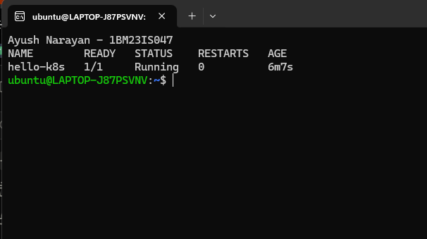

# Exercise 1 – Kubernetes Getting Started (Nginx Pod)

## Objective

Deploy an Nginx web server as a single Pod on a local Minikube cluster. Expose it with a NodePort Service and open it in the browser to confirm the cluster can run and serve a containerised app.

## Use Case

Zepto's storefront and delivery-tracking page runs as a web app inside containers. In this exercise Nginx stood in for that page, to show how such an app is started and exposed on Kubernetes.

## Environment

- Windows 11 Home + WSL2 Ubuntu 24.04.2 LTS
- Docker Desktop (Engine 29.4.1)
- Minikube v1.39.0 (docker driver, containerd 2.3.4 runtime)
- Kubernetes v1.37.0
- kubectl v1.34.1
- Image: `nginx:latest`

## Project Structure

```text
Ex01-Kubernetes-Nginx-Pod/
├── commands.sh      # all minikube / kubectl commands used
├── README.md
└── screenshots/
    ├── 01-minikube-start.png
    ├── 02-pod-running.png
    ├── 03-service.png
    └── 04-nginx-browser.png
```

Source: [commands.sh](commands.sh)

## Steps

### 1. Start Minikube

```bash
minikube start
```

```text
* minikube v1.39.0 on Ubuntu 24.04 (amd64)
* Using the docker driver based on existing profile
* Starting "minikube" primary control-plane node in "minikube" cluster
* Pulling base image v0.0.51 ...
* Updating the running docker "minikube" container ...
* Preparing Kubernetes v1.37.0 on containerd 2.3.4 ...
* Verifying Kubernetes components...
  - Using image gcr.io/k8s-minikube/storage-provisioner:v5
* Enabled addons: storage-provisioner, default-storageclass

! /usr/local/bin/kubectl is version 1.34.1, which may have incompatibilities with Kubernetes 1.37.0.
  - Want kubectl v1.37.0? Try 'minikube kubectl -- get pods -A'
* Done! kubectl is now configured to use "minikube" cluster and "default" namespace by default
```

Started the single-node cluster (first created with `minikube start --driver=docker`). kubectl was switched to the `minikube` context.


### 2. Create the Pod

```bash
kubectl run hello-k8s --image=nginx --port=80
kubectl get pods
```

```text
pod/hello-k8s created

NAME        READY   STATUS    RESTARTS   AGE
hello-k8s   1/1     Running   0          6m7s
```

Created the `hello-k8s` Pod and it reached `Running`.



### 3. Describe the Pod

```bash
kubectl describe pod hello-k8s
```

```text
Node:             minikube/192.168.49.2
Status:           Running
IP:               10.244.0.3
Containers:
  hello-k8s:
    Container ID:   containerd://a5c588b33da3c512ab9af1412f6b418ba6e73b51168be158c12b59a8e80cd307
    Image:          nginx
    Port:           80/TCP
Events:
  Normal  Scheduled  18s   default-scheduler  Successfully assigned default/hello-k8s to minikube
  Normal  Pulling    17s   kubelet            Pulling image "nginx"
  Normal  Pulled     2s    kubelet            Successfully pulled image "nginx" in 15.742s
  Normal  Created    2s    kubelet            Container created
  Normal  Started    2s    kubelet            Container started
```

The events showed the scheduler assigning the node, then the kubelet pulling and starting the image.

### 4. Expose the Pod

```bash
kubectl expose pod hello-k8s --type=NodePort --port=80
kubectl get svc
```

```text
service/hello-k8s exposed

NAME         TYPE        CLUSTER-IP      EXTERNAL-IP   PORT(S)        AGE
hello-k8s    NodePort    10.100.38.188   <none>        80:30258/TCP   30s
kubernetes   ClusterIP   10.96.0.1       <none>        443/TCP        18m
```

Exposed the Pod on NodePort 30258.


### 5. Open in the browser

```bash
minikube service hello-k8s
```

```text
┌───────────┬───────────┬─────────────┬───────────────────────────┐
│ NAMESPACE │   NAME    │ TARGET PORT │            URL            │
├───────────┼───────────┼─────────────┼───────────────────────────┤
│ default   │ hello-k8s │ 80          │ http://192.168.49.2:30258 │
└───────────┴───────────┴─────────────┴───────────────────────────┘
* Starting tunnel for service hello-k8s.
┌───────────┬───────────┬─────────────┬────────────────────────┐
│ NAMESPACE │   NAME    │ TARGET PORT │          URL           │
├───────────┼───────────┼─────────────┼────────────────────────┤
│ default   │ hello-k8s │             │ http://127.0.0.1:34041 │
└───────────┴───────────┴─────────────┴────────────────────────┘
! Because you are using a Docker driver on linux, the terminal needs to be open to run it.
```

Opened `http://127.0.0.1:34041` and the Nginx welcome page loaded.


### 6. Clean up

```bash
kubectl delete svc hello-k8s
kubectl delete pod hello-k8s
```

```text
service "hello-k8s" deleted from default namespace
pod "hello-k8s" deleted from default namespace
```

Deleted the Service and the Pod.

## How It Works

Creating the Pod:

```text
kubectl run hello-k8s
      |
      v
API Server  ---->  etcd (Pod object stored)
      |
      v
Scheduler   ---->  binds Pod to node "minikube"
      |
      v
Kubelet (on minikube node)
      |
      v
containerd  ---->  pulls nginx, starts container
      |
      v
nginx container (10.244.0.3:80)
```

Accessing it:

```text
browser --> 127.0.0.1:34041 --> minikube tunnel --> 192.168.49.2:30258 (NodePort)
        --> Service hello-k8s --> Pod 10.244.0.3:80
```

- kubectl only talks to the API server, which validates the request and stores the Pod in etcd.
- The scheduler sees an unassigned Pod and binds it to a node.
- The kubelet on that node asks the container runtime (containerd) to pull the image and start the container.
- The NodePort Service opens port 30258 on the node and forwards it to the Pod.
- Minikube runs inside a Docker container on WSL2, so the node IP 192.168.49.2 is not reachable from Windows. `minikube service` opens a tunnel to it on localhost.

## Key Configuration

- `--image=nginx`: the container image the Pod runs, pulled from Docker Hub.
- `--port=80`: the port the container listens on. It became the target port of the Service.
- `--type=NodePort`: exposes the Service on a port from 30000–32767 on every node (30258 here). ClusterIP would only be reachable inside the cluster.
- `minikube service`: needed because, with the Docker driver, the NodePort lives inside the Minikube container. The tunnel maps it to `127.0.0.1` and only works while that terminal stays open.

## Commands Used

```bash
minikube start --driver=docker
minikube start
kubectl run hello-k8s --image=nginx --port=80
kubectl get pods
kubectl describe pod hello-k8s
kubectl expose pod hello-k8s --type=NodePort --port=80
kubectl get svc
minikube service hello-k8s
kubectl delete svc hello-k8s
kubectl delete pod hello-k8s
```

## Problems Faced

- `minikube start` warned that kubectl v1.34.1 may be incompatible with Kubernetes v1.37.0. All commands in this exercise worked normally, so I left it as is. `minikube kubectl --` would give a matching client.

## Result

Nginx ran as a Pod on Minikube. It was exposed with a NodePort Service on port 30258 and opened in the browser at `http://127.0.0.1:34041` through the Minikube tunnel.
