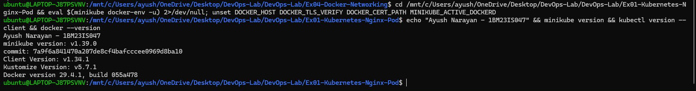
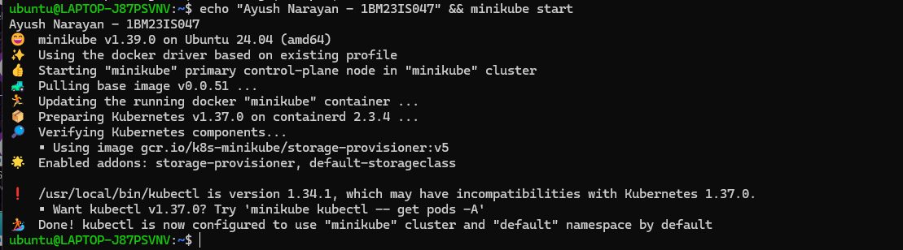
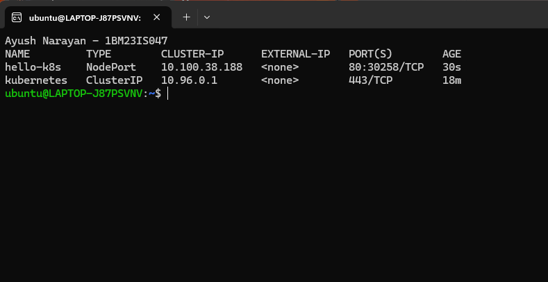
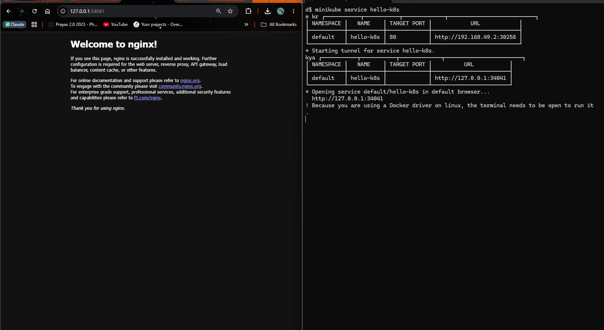

# Exercise 1 – Kubernetes Getting Started (Nginx Pod)

## Objective

Run a first application on Kubernetes. I started a local cluster with Minikube, ran the Nginx web server as a Pod, exposed it with a NodePort Service and opened it in the browser.

## Use Case

As a DevOps engineer at Zepto, I had to deploy the storefront and delivery-status web page on Kubernetes so that it stays running, is portable, and can be scaled later. The `nginx` image stood in for that web page.

## Architecture

```text
 Windows browser
       |
       |  http://127.0.0.1:34041
       v
 minikube service tunnel (runs in a WSL terminal)
       |
       v
+---------------- Minikube node (Docker container, 192.168.49.2) ----------------+
|                                                                                |
|   NodePort 30258  ---->  Service "hello-k8s" (10.100.38.188:80)                |
|                                  |                                             |
|                                  |  selector: run=hello-k8s                    |
|                                  v                                             |
|                           Pod "hello-k8s" (10.244.0.3)                          |
|                           +----------------------+                             |
|                           |  nginx container :80 |                             |
|                           +----------------------+                             |
|                                                                                |
|   Control plane: API Server, etcd, Scheduler, Controller Manager               |
|   Node agents:   Kubelet, kube-proxy, containerd                               |
+--------------------------------------------------------------------------------+
```

## Environment

- Windows 11 Home + WSL2 Ubuntu 24.04.2 LTS
- Docker Desktop (Engine 29.4.1)
- Minikube v1.39.0 (docker driver, containerd 2.3.4 runtime)
- Kubernetes v1.37.0
- kubectl v1.34.1 (Kustomize v5.7.1)
- Image: `nginx:latest`

## Project Structure

```text
Ex01-Kubernetes-Nginx-Pod/
├── commands.sh      # all minikube / kubectl commands used, in order
├── README.md
└── screenshots/
    ├── 01-tool-versions.png
    ├── 02-minikube-start.png
    ├── 03-pod-running.png
    ├── 04-service.png
    └── 05-nginx-browser.png
```

Source: [commands.sh](commands.sh)

## Steps

### 1. Install and check the tools

Before using Kubernetes, the cluster tool (Minikube), the client (kubectl) and a container engine (Docker) had to be installed. I installed Minikube in WSL the way the manual shows, then checked all three versions.

```bash
curl -LO https://storage.googleapis.com/minikube/releases/latest/minikube-linux-amd64
sudo install minikube-linux-amd64 /usr/local/bin/minikube
minikube version
kubectl version --client
docker --version
```

```text
minikube version: v1.39.0
commit: 7a9f6a841470a207de8cf4bafcccee0969d8ba10
Client Version: v1.34.1
Kustomize Version: v5.7.1
Docker version 29.4.1, build 055a478
```

All three tools were installed. Docker came from Docker Desktop's WSL integration.



### 2. Start Minikube

A Kubernetes cluster is needed before anything can be deployed. `minikube start` creates a one-node cluster inside a Docker container.

```bash
minikube start
```

```text
* minikube v1.39.0 on Ubuntu 24.04 (amd64)
* Using the docker driver based on existing profile
* Starting "minikube" primary control-plane node in "minikube" cluster
* Pulling base image v0.0.51 ...
* Updating the running docker "minikube" container ...
* Preparing Kubernetes v1.37.0 on containerd 2.3.4 ...
* Verifying Kubernetes components...
  - Using image gcr.io/k8s-minikube/storage-provisioner:v5
* Enabled addons: storage-provisioner, default-storageclass

! /usr/local/bin/kubectl is version 1.34.1, which may have incompatibilities with Kubernetes 1.37.0.
  - Want kubectl v1.37.0? Try 'minikube kubectl -- get pods -A'
* Done! kubectl is now configured to use "minikube" cluster and "default" namespace by default
```

The cluster was running Kubernetes v1.37.0 with containerd as the container runtime, and kubectl now pointed to it. The cluster had first been created with `minikube start --driver=docker`, so this run reused that profile.



### 3. Create the Pod

A Pod is the smallest thing Kubernetes runs. I created one from the `nginx` image and told Kubernetes the container listens on port 80.

```bash
kubectl run hello-k8s --image=nginx --port=80
kubectl get pods
```

```text
pod/hello-k8s created

NAME        READY   STATUS    RESTARTS   AGE
hello-k8s   1/1     Running   0          6m7s
```

`1/1` means one out of one container in the Pod was ready, and `Running` means it had started without errors.


### 4. Look inside the Pod

`kubectl describe` shows where the Pod was placed and what happened while it started. That makes the internal steps of Kubernetes visible.

```bash
kubectl describe pod hello-k8s
```

```text
Node:             minikube/192.168.49.2
Labels:           run=hello-k8s
Status:           Running
IP:               10.244.0.3
Containers:
  hello-k8s:
    Container ID:   containerd://a5c588b33da3c512ab9af1412f6b418ba6e73b51168be158c12b59a8e80cd307
    Image:          nginx
    Port:           80/TCP
    State:          Running
    Ready:          True
Events:
  Normal  Scheduled  18s   default-scheduler  Successfully assigned default/hello-k8s to minikube
  Normal  Pulling    17s   kubelet            Pulling image "nginx"
  Normal  Pulled     2s    kubelet            Successfully pulled image "nginx" in 15.742s
  Normal  Created    2s    kubelet            Container created
  Normal  Started    2s    kubelet            Container started
```

The Events show the order: the scheduler picked the node, then the kubelet pulled the image (about 15.7 s) and started the container. The Pod got its own IP, 10.244.0.3, and the label `run=hello-k8s`.

### 5. Expose the Pod as a Service

A Pod's IP only works inside the cluster and changes if the Pod is recreated. A Service gives it a fixed address, and the NodePort type also opens a port on the node.

```bash
kubectl expose pod hello-k8s --type=NodePort --port=80
kubectl get svc
```

```text
service/hello-k8s exposed

NAME         TYPE        CLUSTER-IP      EXTERNAL-IP   PORT(S)        AGE
hello-k8s    NodePort    10.100.38.188   <none>        80:30258/TCP   30s
kubernetes   ClusterIP   10.96.0.1       <none>        443/TCP        18m
```

`80:30258/TCP` means Service port 80 is reachable on port 30258 of the node. The `kubernetes` Service is the built-in one for the API server.



### 6. Open the app in the browser

With the Docker driver, the node lives inside a container, so its IP (192.168.49.2) can't be reached from Windows. `minikube service` creates a tunnel to the NodePort on localhost.

```bash
minikube service hello-k8s
```

```text
┌───────────┬───────────┬─────────────┬───────────────────────────┐
│ NAMESPACE │   NAME    │ TARGET PORT │            URL            │
├───────────┼───────────┼─────────────┼───────────────────────────┤
│ default   │ hello-k8s │ 80          │ http://192.168.49.2:30258 │
└───────────┴───────────┴─────────────┴───────────────────────────┘
* Starting tunnel for service hello-k8s.
┌───────────┬───────────┬─────────────┬────────────────────────┐
│ NAMESPACE │   NAME    │ TARGET PORT │          URL           │
├───────────┼───────────┼─────────────┼────────────────────────┤
│ default   │ hello-k8s │             │ http://127.0.0.1:34041 │
└───────────┴───────────┴─────────────┴────────────────────────┘
* Opening service default/hello-k8s in default browser...
  http://127.0.0.1:34041
! Because you are using a Docker driver on linux, the terminal needs to be open to run it.
```

The first table shows the real NodePort URL. The second shows the tunnel URL, which I opened in Chrome to get the "Welcome to nginx!" page.



### 7. Clean up

I removed the Service and the Pod so the next exercise starts clean.

```bash
kubectl delete svc hello-k8s
kubectl delete pod hello-k8s
```

```text
service "hello-k8s" deleted from default namespace
pod "hello-k8s" deleted from default namespace
```

Both objects were deleted. Because the Pod was created with `kubectl run` and is not managed by a ReplicaSet, it was not recreated.

## How It Works

What happened inside Kubernetes when I ran `kubectl run`:

```text
kubectl run hello-k8s --image=nginx
      |
      |  HTTPS request
      v
API Server  ------>  etcd            (Pod object saved, no node yet)
      |
      v
Scheduler   ------>  API Server      (Pod bound to node "minikube")
      |
      v
Kubelet on "minikube" (watches the API server for its Pods)
      |
      v
containerd  ------>  pull nginx image, create and start container
      |
      v
nginx container running at 10.244.0.3:80   (status sent back to API Server)
```

And when I opened the page:

```text
browser -> 127.0.0.1:34041 -> minikube tunnel -> 192.168.49.2:30258 (NodePort)
        -> kube-proxy rules -> Service hello-k8s :80 -> Pod 10.244.0.3:80 -> nginx
```

- kubectl never starts containers itself. It only sends the desired object to the API server.
- The API server is the only component that reads and writes etcd, the cluster's database.
- The scheduler chooses a node for every Pod that doesn't have one yet. With one node, it always chose `minikube`.
- The kubelet on the node makes the real container through the container runtime (containerd here) and reports the status back.
- kube-proxy turns the Service into network rules, so traffic to the NodePort reaches the Pod.
- `minikube service` was only needed because of the Docker driver on WSL2. On a real cluster, the NodePort is open on each node's IP.

## Key Configuration

- `kubectl run hello-k8s`: creates a single Pod named `hello-k8s`, with the label `run=hello-k8s` added automatically.
- `--image=nginx`: the container image, pulled from Docker Hub (`nginx:latest`).
- `--port=80`: records that the container listens on port 80. `kubectl expose` reused it as the Service's target port.
- `kubectl expose pod ... --port=80`: creates a Service whose selector matches the Pod's labels, with port 80 on the Service.
- `--type=NodePort`: also opens a port from 30000–32767 on the node (30258 was picked). The default type, ClusterIP, is only reachable inside the cluster.
- `minikube service hello-k8s`: prints the URL and keeps a tunnel open to it. The terminal must stay open while the page is used.

## Commands Used

```bash
curl -LO https://storage.googleapis.com/minikube/releases/latest/minikube-linux-amd64
sudo install minikube-linux-amd64 /usr/local/bin/minikube
minikube version
kubectl version --client
docker --version
minikube start --driver=docker
minikube start
kubectl run hello-k8s --image=nginx --port=80
kubectl get pods
kubectl describe pod hello-k8s
kubectl expose pod hello-k8s --type=NodePort --port=80
kubectl get svc
minikube service hello-k8s
kubectl delete svc hello-k8s
kubectl delete pod hello-k8s
```

## Problems Faced

- `minikube start` warned that kubectl v1.34.1 may be incompatible with Kubernetes v1.37.0. All the commands in this exercise worked normally, so I continued. `minikube kubectl --` would give a client that matches the cluster version.

## Result

Nginx, standing in for Zepto's storefront page, ran as a Pod on a local Minikube cluster. It was exposed through a NodePort Service on port 30258 and opened in the browser at `http://127.0.0.1:34041` through the Minikube tunnel.
