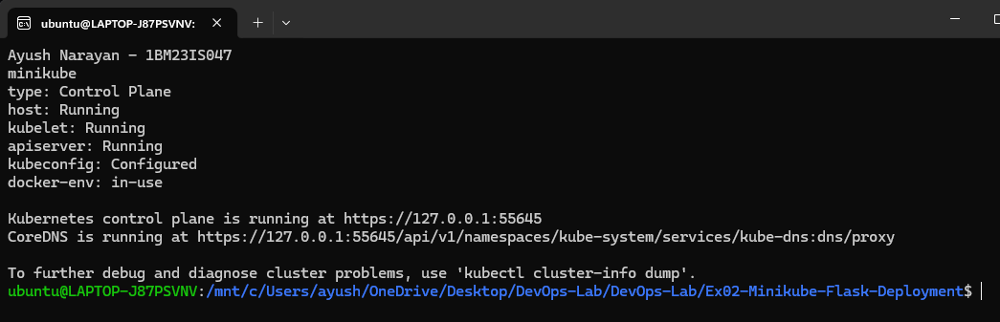
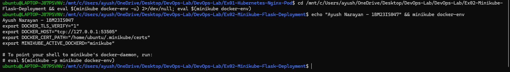
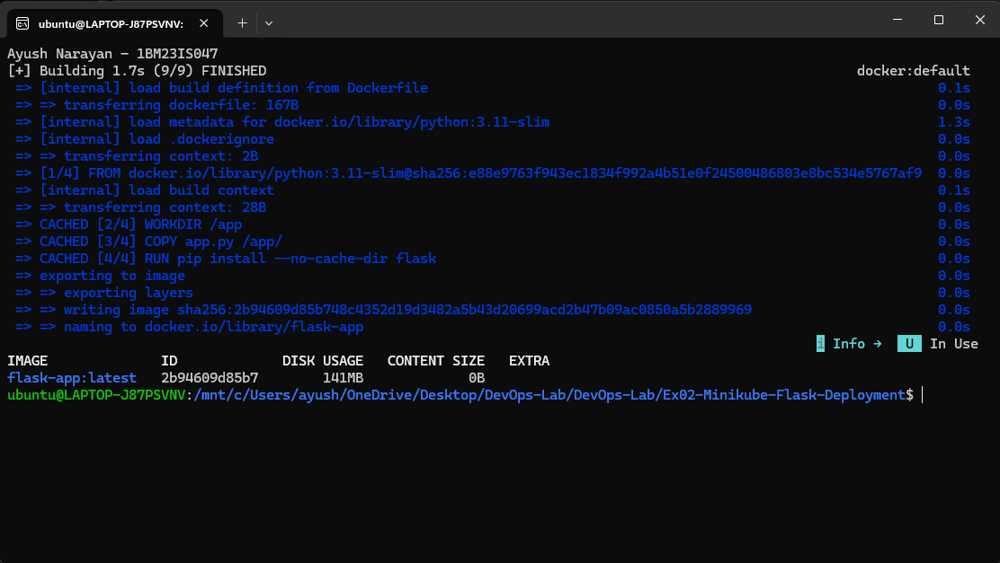
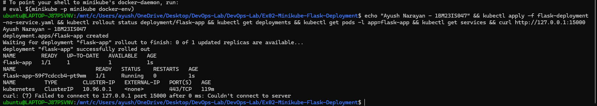
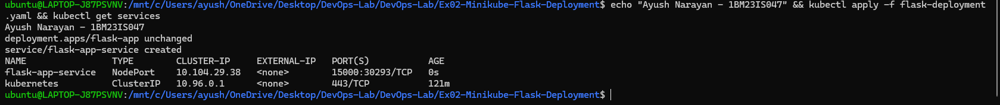
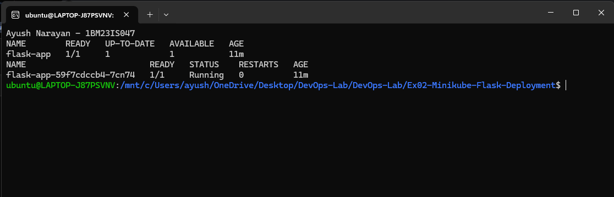
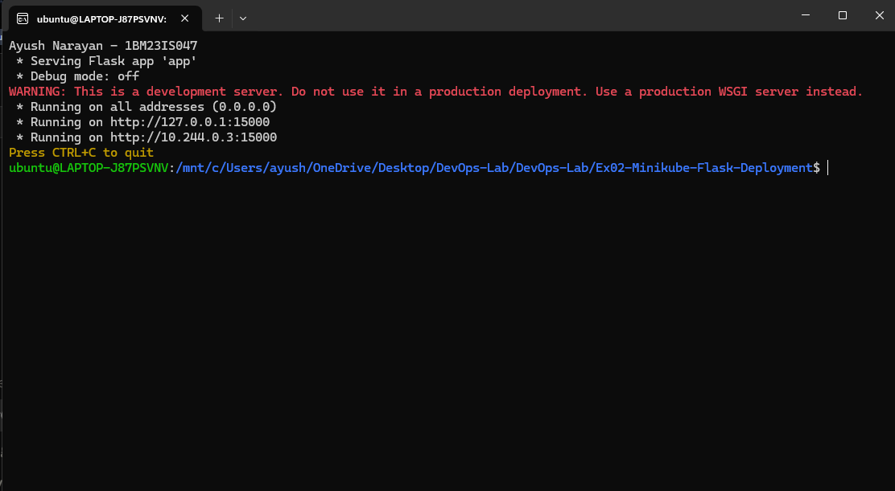
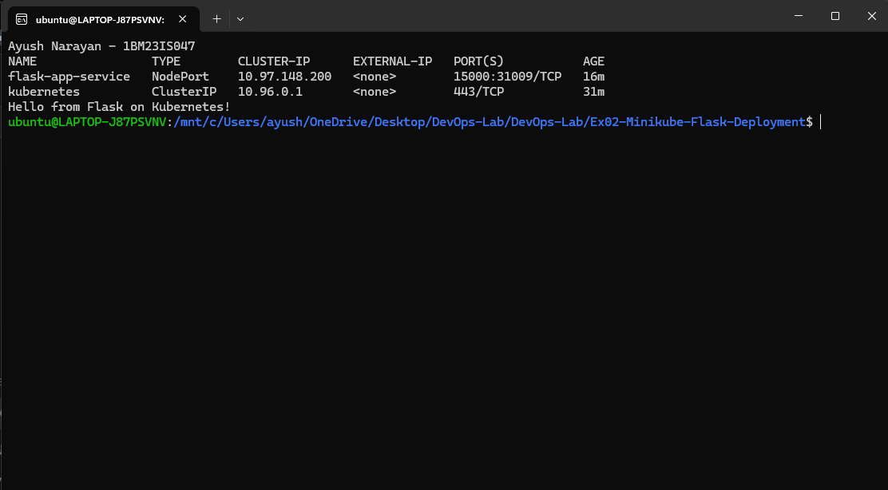
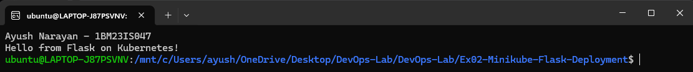

# Exercise 2 – Deploy a Flask App on Minikube using kubectl and YAML

## Objective

Learn the Kubernetes basics on a single-node Minikube cluster. I built a Python Flask app into a Docker image inside Minikube and deployed it with a Deployment written in YAML. I then showed that it could not be reached until a NodePort Service was added.

## Architecture

```text
 WSL terminal                          WSL terminal (kept open)
 curl http://127.0.0.1:34067  <----->  minikube service flask-app-service --url
                                              |
                                              v
+---------------- Minikube node (Docker container) -------------------------+
|                                                                           |
|  Docker daemon (used by "eval $(minikube docker-env)")                   |
|     image: flask-app:latest                                             |
|                                                                           |
|  NodePort 31009 --> Service flask-app-service (port 15000)                |
|                          |  selector: app=flask-app                       |
|                          v                                                |
|  Deployment flask-app --> ReplicaSet flask-app-59f7cdccb4 --> Pod          |
|                                                     +------------------+  |
|                                                     | Flask app :15000 |  |
|                                                     +------------------+  |
+---------------------------------------------------------------------------+
```

## Environment

- Windows 11 Home + WSL2 Ubuntu 24.04.2 LTS
- Docker Desktop (Engine 29.4.1)
- Minikube v1.39.0 (docker driver, Docker container runtime)
- Kubernetes v1.37.0
- kubectl v1.34.1
- Base image `python:3.11-slim`, Flask 3.1.3

## Project Structure

```text
Ex02-Minikube-Flask-Deployment/
├── app.py                            # Flask app, returns a message on / at port 15000
├── Dockerfile                        # builds the flask-app image
├── flask-deployment-no-service.yaml  # manual Step 5: Deployment only
├── flask-deployment.yaml             # manual Step 13: Deployment + NodePort Service
├── README.md
└── screenshots/
    ├── 01-docker-build.png
    ├── 02-deployment-pods.png
    ├── 03-logs.png
    ├── 04-service-curl.png
    ├── 05-minikube-status.png
    ├── 06-service-url.png
    ├── 07-docker-env.png
    ├── 08-no-service-curl-fail.png
    └── 09-apply-with-service.png
```

Source: [app.py](app.py) · [Dockerfile](Dockerfile) · [flask-deployment-no-service.yaml](flask-deployment-no-service.yaml) · [flask-deployment.yaml](flask-deployment.yaml)

## Steps

### 1. Start Minikube and check the cluster

The app needs a running cluster. I started Minikube with the Docker runtime so its Docker daemon could be used for building, then checked that every part was up.

```bash
minikube start --driver=docker --container-runtime=docker
minikube status
kubectl cluster-info
```

```text
minikube
type: Control Plane
host: Running
kubelet: Running
apiserver: Running
kubeconfig: Configured
docker-env: in-use

Kubernetes control plane is running at https://127.0.0.1:55645
CoreDNS is running at https://127.0.0.1:55645/api/v1/namespaces/kube-system/services/kube-dns:dns/proxy

To further debug and diagnose cluster problems, use 'kubectl cluster-info dump'.
```

The host, kubelet and API server were all running. `docker-env: in-use` showed that my shell was already pointed at Minikube's Docker. CoreDNS (the cluster DNS) was up too.



### 2. See what `minikube docker-env` sets

Before switching Docker over, the manual asks to look at the variables `minikube docker-env` prints.

```bash
minikube docker-env
```

```text
export DOCKER_TLS_VERIFY="1"
export DOCKER_HOST="tcp://127.0.0.1:53505"
export DOCKER_CERT_PATH="/home/ubuntu/.minikube/certs"
export MINIKUBE_ACTIVE_DOCKERD="minikube"

# To point your shell to minikube's docker-daemon, run:
# eval $(minikube -p minikube docker-env)
```

`DOCKER_HOST` points the Docker CLI at the daemon inside the Minikube node, and the TLS settings make the connection secure. `eval` runs these export lines in the current shell.



### 3. Build the image inside Minikube

Building with Minikube's daemon puts the image where the kubelet can find it, so no registry is needed.

```bash
eval $(minikube docker-env)
docker build -t flask-app .
docker images flask-app
```

```text
[+] Building 1.7s (9/9) FINISHED                                    docker:default
 => [internal] load build definition from Dockerfile                          0.1s
 => => transferring dockerfile: 167B                                          0.0s
 => [internal] load metadata for docker.io/library/python:3.11-slim           1.3s
 => [internal] load .dockerignore                                             0.0s
 => => transferring context: 2B                                               0.0s
 => [1/4] FROM docker.io/library/python:3.11-slim@sha256:e88e9763f943ec1834f992a4b51e0f24500486803e8bc534e5767af9  0.0s
 => [internal] load build context                                             0.1s
 => => transferring context: 28B                                              0.0s
 => CACHED [2/4] WORKDIR /app                                                 0.0s
 => CACHED [3/4] COPY app.py /app/                                            0.0s
 => CACHED [4/4] RUN pip install --no-cache-dir flask                         0.0s
 => exporting to image                                                        0.0s
 => => exporting layers                                                       0.0s
 => => writing image sha256:2b94609d85b748c4352d19d3482a5b43d20699acd2b47b09ac0850a5b2889969  0.0s
 => => naming to docker.io/library/flask-app                                  0.0s

IMAGE              ID             DISK USAGE   CONTENT SIZE   EXTRA
flask-app:latest   2b94609d85b7        141MB             0B
```

The image was built from the 4 Dockerfile steps. They show `CACHED` because the first build had already installed Flask 3.1.3.



### 4. Deploy without a Service and try to reach the app

The manual first deploys only the Deployment, to show that a running Pod is not reachable from outside the cluster by itself.

```bash
kubectl apply -f flask-deployment-no-service.yaml
kubectl rollout status deployment/flask-app
kubectl get deployments
kubectl get pods -l app=flask-app
kubectl get services
curl http://127.0.0.1:15000
```

```text
deployment.apps/flask-app created
Waiting for deployment "flask-app" rollout to finish: 0 of 1 updated replicas are available...
deployment "flask-app" successfully rolled out
NAME        READY   UP-TO-DATE   AVAILABLE   AGE
flask-app   1/1     1            1           1s
NAME                         READY   STATUS    RESTARTS   AGE
flask-app-59f7cdccb4-pt9wm   1/1     Running   0          1s
NAME         TYPE        CLUSTER-IP   EXTERNAL-IP   PORT(S)   AGE
kubernetes   ClusterIP   10.96.0.1    <none>        443/TCP   119m
curl: (7) Failed to connect to 127.0.0.1 port 15000 after 0 ms: Couldn't connect to server
```

The Pod was running, but only the built-in `kubernetes` Service existed. curl failed because port 15000 is only open inside the Pod, which runs inside the Minikube node, not on my machine.



### 5. Add the Service and apply again

The full `flask-deployment.yaml` has the same Deployment plus a NodePort Service after a `---` line. Applying it adds only what's new.

```bash
kubectl apply -f flask-deployment.yaml
kubectl get services
```

```text
deployment.apps/flask-app unchanged
service/flask-app-service created
NAME                TYPE        CLUSTER-IP     EXTERNAL-IP   PORT(S)           AGE
flask-app-service   NodePort    10.104.29.38   <none>        15000:30293/TCP   0s
kubernetes          ClusterIP   10.96.0.1      <none>        443/TCP           121m
```

`unchanged` means the Deployment was already as described, so Kubernetes left the Pod alone. Only the new Service was created, on NodePort 30293.



### 6. Check the Deployment and Pod

Steps 6–9 come from my first full run of the exercise, where I applied `flask-deployment.yaml` directly. That run had Pod `flask-app-59f7cdccb4-7cn74` and NodePort 31009.

```bash
kubectl get deployments
kubectl get pods -l app=flask-app
```

```text
NAME        READY   UP-TO-DATE   AVAILABLE   AGE
flask-app   1/1     1            1           11m
NAME                         READY   STATUS    RESTARTS   AGE
flask-app-59f7cdccb4-7cn74   1/1     Running   0          11m
```

The Deployment had 1 of 1 replicas available. The Pod name starts with the ReplicaSet's hash, `59f7cdccb4`.



### 7. Describe the Deployment

`describe` shows the Deployment's settings and the events from its controller.

```bash
kubectl describe deployment flask-app
```

```text
Name:                   flask-app
Namespace:              default
Selector:               app=flask-app
Replicas:               1 desired | 1 updated | 1 total | 1 available | 0 unavailable
StrategyType:           RollingUpdate
RollingUpdateStrategy:  25% max unavailable, 25% max surge
Pod Template:
  Labels:  app=flask-app
  Containers:
   flask-app:
    Image:         flask-app:latest
    Port:          15000/TCP
Conditions:
  Type           Status  Reason
  ----           ------  ------
  Available      True    MinimumReplicasAvailable
  Progressing    True    NewReplicaSetAvailable
NewReplicaSet:   flask-app-59f7cdccb4 (1/1 replicas created)
Events:
  Normal  ScalingReplicaSet  3s    deployment-controller  Scaled up replica set flask-app-59f7cdccb4 from 0 to 1
```

The Deployment created ReplicaSet `flask-app-59f7cdccb4` and scaled it to 1. `RollingUpdate` means later image changes would replace Pods gradually.

### 8. Read the application logs

The logs show whether Flask actually started inside the container.

```bash
kubectl logs flask-app-59f7cdccb4-7cn74
```

```text
 * Serving Flask app 'app'
 * Debug mode: off
WARNING: This is a development server. Do not use it in a production deployment. Use a production WSGI server instead.
 * Running on all addresses (0.0.0.0)
 * Running on http://127.0.0.1:15000
 * Running on http://10.244.0.3:15000
Press CTRL+C to quit
```

Flask was listening on port 15000 on all addresses, including the Pod IP 10.244.0.3. The WARNING is normal for Flask's built-in server.



### 9. Access the app through the Service

With the Docker driver, the NodePort is inside the Minikube container. `minikube service --url` opens a tunnel to it, and that terminal has to stay open.

```bash
minikube service flask-app-service --url
kubectl get services
curl http://127.0.0.1:34067
```

Tunnel (separate terminal):

```text
http://127.0.0.1:34067
! Because you are using a Docker driver on linux, the terminal needs to be open to run it.
```

```text
NAME                TYPE        CLUSTER-IP      EXTERNAL-IP   PORT(S)           AGE
flask-app-service   NodePort    10.97.148.200   <none>        15000:31009/TCP   16m
kubernetes          ClusterIP   10.96.0.1       <none>        443/TCP           31m
Hello from Flask on Kubernetes!
```

The request went through the tunnel to NodePort 31009, then to the Service, then to the Pod, and Flask replied.



After redeploying, I opened a new tunnel (`http://127.0.0.1:42839`) and tested again:

```bash
curl http://127.0.0.1:42839
```

```text
Hello from Flask on Kubernetes!
```



### 10. Clean up

I deleted everything defined in the YAML file so the next exercise starts clean.

```bash
kubectl delete -f flask-deployment.yaml
```

```text
deployment.apps "flask-app" deleted from default namespace
service "flask-app-service" deleted from default namespace
```

Deleting the Deployment also removed its ReplicaSet and Pod.

## How It Works

```text
kubectl apply -f flask-deployment.yaml
      |
      v
API Server --------> etcd (Deployment + Service objects saved)
      |
      v
Deployment controller --> creates ReplicaSet flask-app-59f7cdccb4
      |
      v
ReplicaSet controller --> creates 1 Pod object
      |
      v
Scheduler --> binds the Pod to node "minikube"
      |
      v
Kubelet --> Docker runtime --> finds local flask-app:latest (imagePullPolicy: Never)
      |                         --> starts the container
      v
Flask listening on Pod IP :15000
      ^
      |  Endpoints controller links the Pod to flask-app-service
      |  kube-proxy opens NodePort 31009 on the node
curl --> minikube tunnel --> NodePort 31009 --> Service :15000 --> Pod :15000
```

- `eval $(minikube docker-env)` makes `docker build` run on the Minikube node, so the image never leaves the cluster.
- A Deployment doesn't run containers itself. It manages a ReplicaSet, and the ReplicaSet keeps the right number of Pods.
- Because of `imagePullPolicy: Never`, the kubelet uses the local image and never contacts Docker Hub.
- Without a Service, the Pod was only reachable on its internal IP, which is why curl to 127.0.0.1:15000 failed.
- The Service finds the Pod by its label `app=flask-app`, and kube-proxy forwards NodePort traffic to it.
- `minikube service --url` was needed because, on WSL2 with the Docker driver, the node IP is not reachable from my shell.

## Key Configuration

app.py
- `@app.route('/')`: returns `Hello from Flask on Kubernetes!` for the home URL.
- `app.run(host='0.0.0.0', port=15000)`: listens on all interfaces. With Flask's default `127.0.0.1`, traffic from the Service would never reach the app.

Dockerfile
- `FROM python:3.11-slim`: a small Python base image. The manual uses `python:3.8-slim`; I used 3.11 because Python 3.8 is end-of-life.
- `COPY app.py /app/`: copies only the app file. The manual uses `COPY . /app`, which would also copy the YAML files and screenshots into the image.
- `RUN pip install --no-cache-dir flask`: installs Flask without keeping pip's download cache, which keeps the image smaller.
- `EXPOSE 15000` and `CMD ["python", "app.py"]`: document the port and start the app.

flask-deployment.yaml
- `kind: Deployment`, `replicas: 1`: one copy of the app, managed by a Deployment.
- `selector.matchLabels` / `template.metadata.labels` `app: flask-app`: tie the Deployment to its Pods. The Service uses the same label.
- `image: flask-app:latest` + `imagePullPolicy: Never`: use the image I built inside Minikube. The `latest` tag would otherwise trigger a pull from Docker Hub, which would fail.
- `containerPort: 15000`: the port the container listens on.
- `---`: separates the Deployment and the Service, so one file holds both.
- `kind: Service`, `type: NodePort`: exposes the app outside the cluster on a node port (31009, then 30293 in the re-run). ClusterIP would be internal only.
- `port: 15000` / `targetPort: 15000`: clients call the Service on port 15000, and the Service sends traffic to container port 15000.

## Commands Used

```bash
minikube start --driver=docker --container-runtime=docker
minikube status
kubectl cluster-info
minikube docker-env
eval $(minikube docker-env)
docker build -t flask-app .
docker images flask-app
kubectl apply -f flask-deployment-no-service.yaml
kubectl rollout status deployment/flask-app
kubectl get deployments
kubectl get pods -l app=flask-app
kubectl get services
curl http://127.0.0.1:15000
kubectl apply -f flask-deployment.yaml
kubectl describe deployment flask-app
kubectl logs flask-app-59f7cdccb4-7cn74
minikube service flask-app-service --url
curl http://127.0.0.1:34067
curl http://127.0.0.1:42839
kubectl delete -f flask-deployment.yaml
```

## Problems Faced

- Minikube v1.39 used containerd as its default runtime, so `eval $(minikube docker-env)` reported it as "highly experimental" and there was no Docker daemon in the node to build into. I deleted the cluster and recreated it with `--container-runtime=docker`, after which `docker-env` worked as the manual describes.
- When the commands were sent from PowerShell, PowerShell expanded `$(minikube docker-env)` itself before bash received it, so the variables were never set. I ran the commands directly in a bash (WSL) shell instead.

## Result

The Flask app was built into an image inside Minikube and deployed with a Deployment. Without a Service it could not be reached (`curl: (7) Failed to connect`). After adding a NodePort Service, the request through the Minikube tunnel returned `Hello from Flask on Kubernetes!`.
