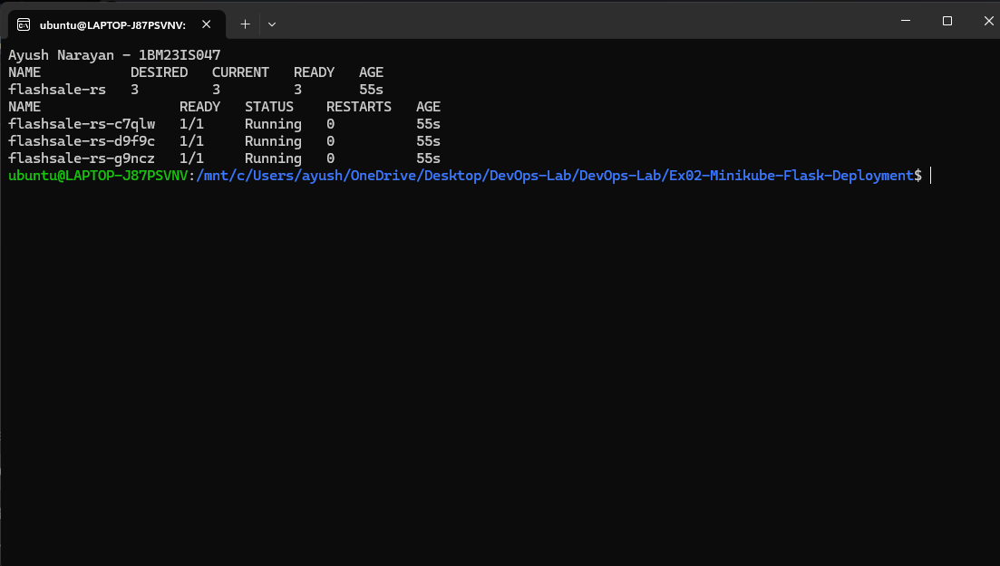
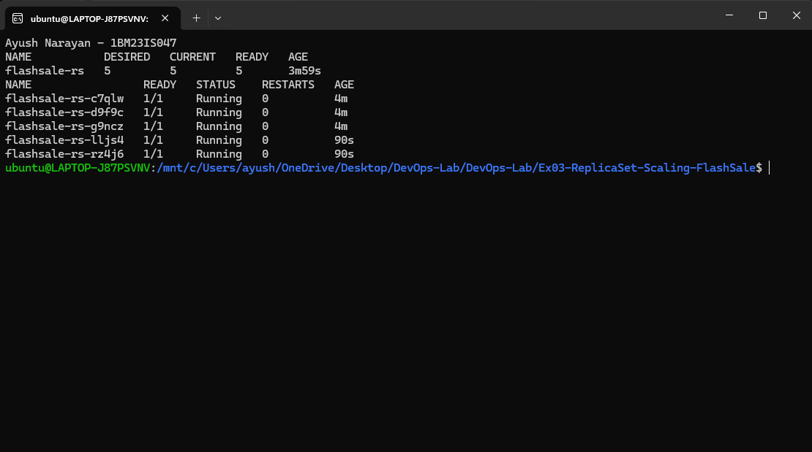
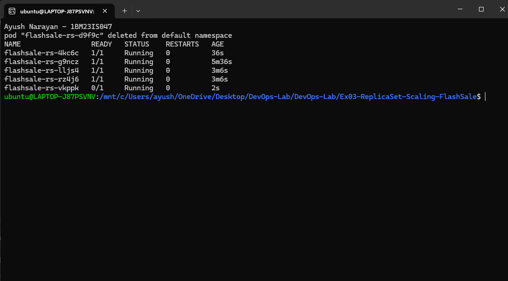
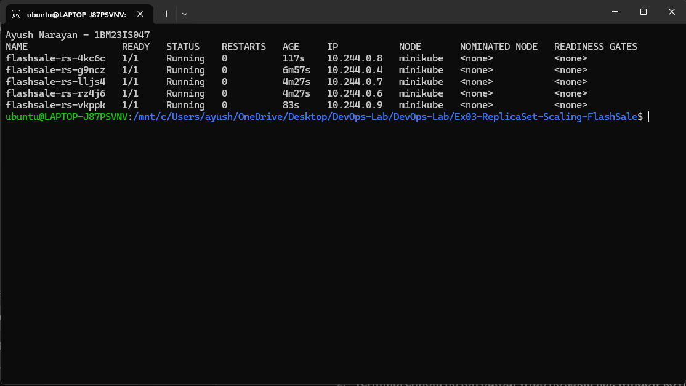

# Exercise 3 – Scaling a Flask App on a Single Node using ReplicaSets

## Objective

Simulate an e-commerce flash sale by running identical Pods of a Flask app with a ReplicaSet, scaling them up, and checking that a deleted Pod is replaced automatically.

## Environment

- OS: Windows 11 Home + WSL2 Ubuntu 24.04.2 LTS
- Docker: Docker Desktop (Engine 29.4.1)
- Minikube: v1.39.0 (docker driver, 1 node)
- Kubernetes: v1.37.0
- kubectl: v1.34.1
- Container runtime: Docker
- Base image: `python:3.11-slim`, Flask 3.1.3, gunicorn 26.2.0

## Steps

### 1. Files created

app.py

```python
from flask import Flask, request
import socket
import time
import random

app = Flask(__name__)


@app.get("/")
def homepage():
    return {
        "message": "Welcome to Big Sale!",
        "pod": socket.gethostname(),
        "ts": time.time(),
    }


@app.get("/buy")
def buy():
    # Simulate a flash sale checkout
    item = random.choice(["Smartphone", "Shoes", "Headphones", "Laptop"])
    user = request.args.get("user", f"user{random.randint(1, 1000)}")
    return {
        "status": "success",
        "item": item,
        "user": user,
        "served_by_pod": socket.gethostname(),
        "time": time.strftime("%H:%M:%S"),
    }


@app.get("/health")
def health():
    return {"status": "healthy", "pod": socket.gethostname()}
```

Dockerfile

```dockerfile
FROM python:3.11-slim
WORKDIR /app
COPY app.py .
RUN pip install --no-cache-dir flask gunicorn
EXPOSE 5000
CMD ["gunicorn", "-b", "0.0.0.0:5000", "app:app", "--workers", "1", "--threads", "2"]
```

flashsale-replicaset.yaml

```yaml
apiVersion: apps/v1
kind: ReplicaSet
metadata:
  name: flashsale-rs
  labels:
    app: flashsale
spec:
  replicas: 3  # Number of copies of the flashsale app
  selector:
    matchLabels:
      app: flashsale
  template:
    metadata:
      labels:
        app: flashsale
    spec:
      containers:
      - name: flashsale-container
        image: flashsale:1.0
        imagePullPolicy: Never   # use the image built inside Minikube
        ports:
        - containerPort: 5000
        readinessProbe:
          httpGet:
            path: /health
            port: 5000
          initialDelaySeconds: 2
          periodSeconds: 5
        livenessProbe:
          httpGet:
            path: /health
            port: 5000
          initialDelaySeconds: 10
          periodSeconds: 10
        resources:
          requests:
            cpu: "100m"
            memory: "128Mi"
          limits:
            cpu: "500m"
            memory: "256Mi"
---
apiVersion: v1
kind: Service
metadata:
  name: flashsale-svc
spec:
  selector:
    app: flashsale
  ports:
  - name: http
    port: 80
    targetPort: 5000
  type: ClusterIP
```

Created the flash-sale API, its Dockerfile, and the ReplicaSet and Service manifest.

### 2. Start a fresh single-node cluster

```bash
minikube stop && minikube delete
minikube start --nodes=1 --driver=docker --container-runtime=docker
kubectl get nodes
```

```text
* Stopping node "minikube"  ...
* 1 node stopped.
* Deleting "minikube" in docker ...
* Removed all traces of the "minikube" cluster.
* minikube v1.39.0 on Ubuntu 24.04 (amd64)
* Done! kubectl is now configured to use "minikube" cluster and "default" namespace by default

NAME       STATUS   ROLES           AGE   VERSION
minikube   Ready    control-plane   6s    v1.37.0
```

Deleted the old cluster and started a new one with one node.

### 3. Build the image inside Minikube

```bash
eval $(minikube docker-env)
docker build -t flashsale:1.0 .
docker images flashsale
```

```text
#4 [1/4] FROM docker.io/library/python:3.11-slim@sha256:e88e9763f943ec1834f992a4b51e0f24500486803e8bc534e5767af9ea65f6ce
#4 DONE 14.1s
#6 [2/4] WORKDIR /app
#7 [3/4] COPY app.py .
#8 [4/4] RUN pip install --no-cache-dir flask gunicorn
#8 5.232 Successfully installed blinker-1.9.0 click-8.5.0 flask-3.1.3 gunicorn-26.2.0 itsdangerous-2.2.0 jinja2-3.1.6 markupsafe-3.0.4 werkzeug-3.1.9
#9 naming to docker.io/library/flashsale:1.0 done

IMAGE           ID             DISK USAGE   CONTENT SIZE   EXTRA
flashsale:1.0   a8aa6f385c29        143MB             0B
```

Built `flashsale:1.0` in Minikube's Docker daemon.

### 4. Create the ReplicaSet and Service

```bash
kubectl apply -f flashsale-replicaset.yaml
kubectl get rs
kubectl get pods
```

```text
replicaset.apps/flashsale-rs created
service/flashsale-svc created

NAME           DESIRED   CURRENT   READY   AGE
flashsale-rs   3         3         3       21s

NAME                 READY   STATUS    RESTARTS   AGE
flashsale-rs-c7qlw   1/1     Running   0          21s
flashsale-rs-d9f9c   1/1     Running   0          21s
flashsale-rs-g9ncz   1/1     Running   0          21s
```

The ReplicaSet started 3 Pods, and all of them passed the readiness probe.



### 5. Scale up for the flash sale

```bash
kubectl scale rs flashsale-rs --replicas=5
kubectl get rs
kubectl get pods
```

```text
replicaset.apps/flashsale-rs scaled

NAME           DESIRED   CURRENT   READY   AGE
flashsale-rs   5         5         5       2m46s

NAME                 READY   STATUS    RESTARTS   AGE
flashsale-rs-c7qlw   1/1     Running   0          2m46s
flashsale-rs-d9f9c   1/1     Running   0          2m46s
flashsale-rs-g9ncz   1/1     Running   0          2m46s
flashsale-rs-lljs4   1/1     Running   0          16s
flashsale-rs-rz4j6   1/1     Running   0          16s
```

Scaled from 3 to 5 replicas, and 2 new Pods were added.



### 6. Delete a Pod (self-healing)

```bash
kubectl delete pod flashsale-rs-c7qlw
kubectl get pods
```

```text
pod "flashsale-rs-c7qlw" deleted from default namespace

NAME                 READY   STATUS    RESTARTS   AGE
flashsale-rs-4kc6c   0/1     Running   0          3s
flashsale-rs-d9f9c   1/1     Running   0          5m3s
flashsale-rs-g9ncz   1/1     Running   0          5m3s
flashsale-rs-lljs4   1/1     Running   0          2m33s
flashsale-rs-rz4j6   1/1     Running   0          2m33s
```

Deleted one Pod and the ReplicaSet created `flashsale-rs-4kc6c` to keep 5 replicas. I repeated this with `flashsale-rs-d9f9c`, which was replaced by `flashsale-rs-vkppk`.



### 7. Check Pod distribution

```bash
kubectl get pods -o wide
```

```text
NAME                 READY   STATUS    RESTARTS   AGE     IP           NODE       NOMINATED NODE   READINESS GATES
flashsale-rs-4kc6c   1/1     Running   0          88s     10.244.0.8   minikube   <none>           <none>
flashsale-rs-g9ncz   1/1     Running   0          6m28s   10.244.0.4   minikube   <none>           <none>
flashsale-rs-lljs4   1/1     Running   0          3m58s   10.244.0.7   minikube   <none>           <none>
flashsale-rs-rz4j6   1/1     Running   0          3m58s   10.244.0.6   minikube   <none>           <none>
flashsale-rs-vkppk   1/1     Running   0          54s     10.244.0.9   minikube   <none>           <none>
```

All 5 Pods ran on the single `minikube` node, each with its own IP.



### 8. Send requests to the Service

```bash
kubectl port-forward svc/flashsale-svc 8080:80
curl http://localhost:8080/buy
```

```text
Forwarding from 127.0.0.1:8080 -> 5000
Forwarding from [::1]:8080 -> 5000

{"item":"Headphones","served_by_pod":"flashsale-rs-g9ncz","status":"success","time":"10:50:59","user":"user113"}
{"item":"Smartphone","served_by_pod":"flashsale-rs-g9ncz","status":"success","time":"10:50:59","user":"user551"}
{"item":"Shoes","served_by_pod":"flashsale-rs-g9ncz","status":"success","time":"10:50:59","user":"user570"}
```

Port-forward connects to one Pod, so all of these requests were served by `flashsale-rs-g9ncz`. To see load balancing, I sent requests to the Service from a Pod inside the cluster:

```bash
kubectl run curl-test --restart=Never --image=curlimages/curl -- sh -c 'for i in 1 2 3 4 5 6 7 8; do curl -s http://flashsale-svc/buy; echo; done'
kubectl logs curl-test
```

```text
{"item":"Shoes","served_by_pod":"flashsale-rs-lljs4","status":"success","time":"10:51:25","user":"user281"}
{"item":"Laptop","served_by_pod":"flashsale-rs-vkppk","status":"success","time":"10:51:25","user":"user236"}
{"item":"Shoes","served_by_pod":"flashsale-rs-g9ncz","status":"success","time":"10:51:25","user":"user783"}
{"item":"Laptop","served_by_pod":"flashsale-rs-vkppk","status":"success","time":"10:51:25","user":"user676"}
{"item":"Smartphone","served_by_pod":"flashsale-rs-vkppk","status":"success","time":"10:51:25","user":"user408"}
{"item":"Headphones","served_by_pod":"flashsale-rs-vkppk","status":"success","time":"10:51:25","user":"user714"}
{"item":"Laptop","served_by_pod":"flashsale-rs-g9ncz","status":"success","time":"10:51:25","user":"user402"}
{"item":"Laptop","served_by_pod":"flashsale-rs-lljs4","status":"success","time":"10:51:25","user":"user945"}
```

The Service spread the requests across different Pods.

### 9. Clean up

```bash
kubectl delete -f flashsale-replicaset.yaml
```

```text
replicaset.apps "flashsale-rs" deleted from default namespace
service "flashsale-svc" deleted from default namespace
```

Deleted the ReplicaSet and the Service.

## How It Works

```text
ReplicaSet (desired = 5)
   |
   |  compares desired count with Pods labelled app=flashsale
   v
Pod  Pod  Pod  Pod  Pod      <-- a deleted Pod is recreated
 \    |    |    |    /
  Service flashsale-svc (ClusterIP :80 -> :5000)
            ^
       client requests
```

- The ReplicaSet controller keeps checking how many Pods match its selector and creates or removes Pods to match `replicas`.
- `kubectl scale` only changes the desired count; the controller does the rest.
- The readiness probe on `/health` keeps a new Pod out of the Service until it responds (`0/1` until then), and the liveness probe restarts a container that stops responding.
- The ClusterIP Service load-balances requests across all ready Pods with the `app=flashsale` label.

## Commands Used

```bash
minikube stop && minikube delete
minikube start --nodes=1 --driver=docker --container-runtime=docker
kubectl get nodes
eval $(minikube docker-env)
docker build -t flashsale:1.0 .
kubectl apply -f flashsale-replicaset.yaml
kubectl get rs
kubectl get pods
kubectl scale rs flashsale-rs --replicas=5
kubectl delete pod flashsale-rs-c7qlw
kubectl get pods -o wide
kubectl port-forward svc/flashsale-svc 8080:80
curl http://localhost:8080/buy
kubectl run curl-test --restart=Never --image=curlimages/curl -- sh -c 'for i in 1 2 3 4 5 6 7 8; do curl -s http://flashsale-svc/buy; echo; done'
kubectl logs curl-test
kubectl delete -f flashsale-replicaset.yaml
```

## Result

The flash-sale app was scaled from 3 to 5 replicas using a ReplicaSet. Deleted Pods were replaced automatically, and the Service distributed requests across the Pods.
