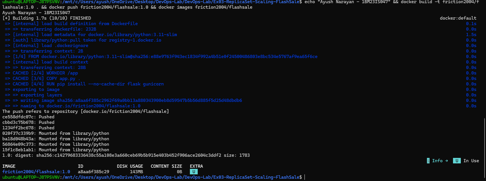
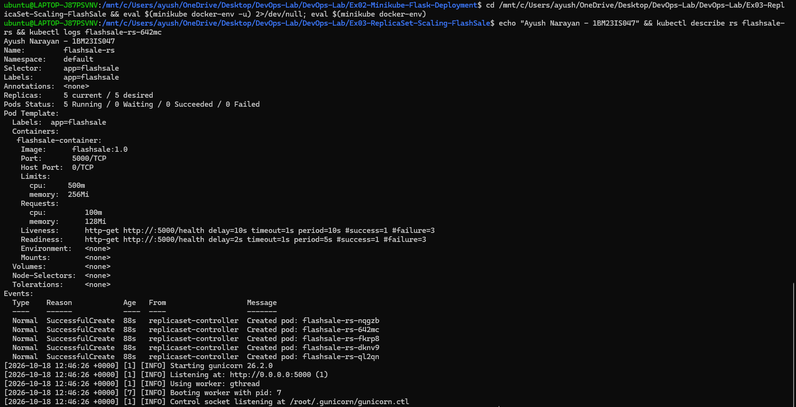
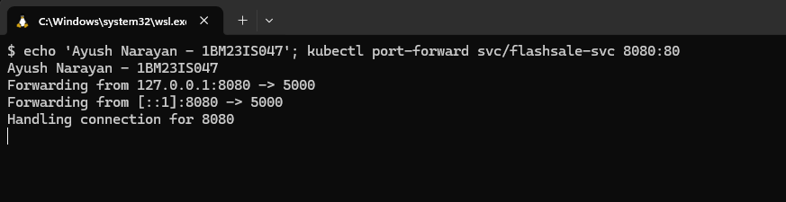
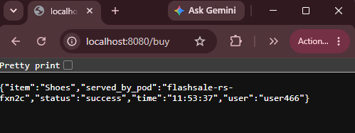
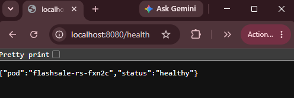
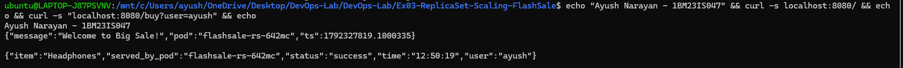
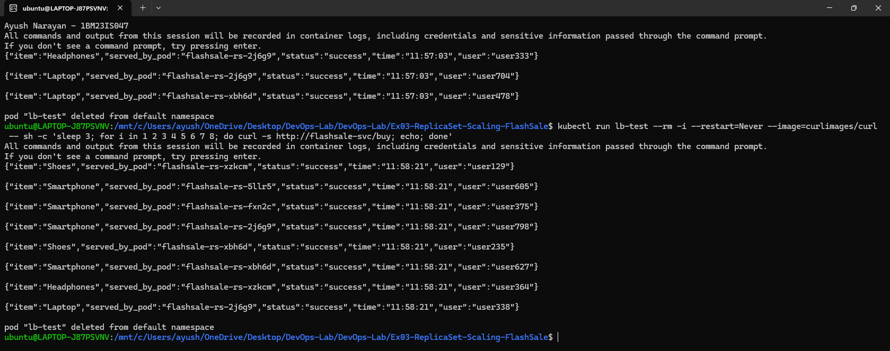

# Exercise 3 – Scaling a Flask App on a Single Node using ReplicaSets

## Objective

Understand ReplicaSets and Pods. I scaled a Flask flash-sale app from 3 to 5 Pods and deleted Pods to watch them come back. I also checked how the Pods were spread on the node and how a Service shares requests between them.

## Use Case

During a flash sale like Flipkart's Big Billion Days or Amazon Prime Day, traffic to a checkout service can jump from about 100 to 10,000 requests per minute. A single Pod would crash. With a ReplicaSet, the same app runs as many identical Pods behind one Service, and the count can go back down after the sale to save resources.

## Architecture

```text
 client (my terminal / Chrome)
        |
        |  localhost:8080   (kubectl port-forward)        curl Pod "lb-test"
        |                                                  (inside the cluster)
        v                                                        |
+--------------------------- Minikube node "minikube" ---------------------|----+
|                                                                         v    |
|              Service flashsale-svc  (ClusterIP, port 80 -> 5000)  <----------+
|                         |   selector: app=flashsale                          |
|        +--------+-------+-------+--------+                                   |
|        v        v               v        v        v                          |
|      Pod      Pod             Pod      Pod      Pod     <-- 5 replicas       |
|   gunicorn  gunicorn       gunicorn gunicorn gunicorn      (flashsale:1.0)  |
|     :5000    :5000           :5000    :5000    :5000                        |
|        ^                                                                     |
|        |  creates / replaces Pods to keep the count                         |
|   ReplicaSet flashsale-rs  (replicas: 5)                                     |
+------------------------------------------------------------------------------+

 Docker Hub: friction2004/flashsale:1.0   (image pushed from Minikube's Docker)
```

## Environment

- Windows 11 Home + WSL2 Ubuntu 24.04.2 LTS
- Docker Desktop (Engine 29.4.1), Docker Hub account `friction2004`
- Minikube v1.39.0 (docker driver, Docker runtime, 1 node)
- Kubernetes v1.37.0
- kubectl v1.34.1
- Base image `python:3.11-slim`, Flask 3.1.3, gunicorn 26.2.0

## Project Structure

```text
Ex03-ReplicaSet-Scaling-FlashSale/
├── app.py                      # flash-sale API: /, /buy, /health (each reply names the Pod)
├── Dockerfile                  # builds flashsale:1.0, served by gunicorn on port 5000
├── flashsale-replicaset.yaml   # ReplicaSet (3 replicas, probes, limits) + ClusterIP Service
├── README.md
└── screenshots/
    ├── 01-rs-3-replicas.png
    ├── 02-scaled-5.png
    ├── 03-self-healing.png
    ├── 04-pods-wide.png
    ├── 05-port-forward.png
    ├── 06-buy-browser.png
    ├── 07-health-browser.png
    ├── 08-load-balancing.png
    ├── 09-docker-push.png
    ├── 10-describe-rs-logs.png
    └── 11-home-and-user-buy.png
```

Source: [app.py](app.py) · [Dockerfile](Dockerfile) · [flashsale-replicaset.yaml](flashsale-replicaset.yaml)

## Steps

### 1. Start a fresh single-node cluster

The manual starts from a clean cluster so old objects don't get in the way. I deleted the previous one and started a new one with exactly one node.

```bash
minikube stop
minikube delete
minikube start --nodes=1 --driver=docker --container-runtime=docker
kubectl get nodes
```

```text
* Stopping node "minikube"  ...
* 1 node stopped.
* Deleting "minikube" in docker ...
* Removed all traces of the "minikube" cluster.
* minikube v1.39.0 on Ubuntu 24.04 (amd64)
* Done! kubectl is now configured to use "minikube" cluster and "default" namespace by default

NAME       STATUS   ROLES           AGE   VERSION
minikube   Ready    control-plane   6s    v1.37.0
```

One node, `minikube`, was Ready. It acts as both the control plane and the worker.

### 2. Build the image and push it to Docker Hub

The manual builds the image under my Docker Hub name and pushes it, so the image can also be pulled from anywhere. I built inside Minikube's Docker (so the cluster can use it directly) and pushed from there.

```bash
eval $(minikube docker-env)
docker build -t flashsale:1.0 .
docker build -t friction2004/flashsale:1.0 .
docker push friction2004/flashsale:1.0
docker images friction2004/flashsale
```

```text
[+] Building 1.7s (10/10) FINISHED                                   docker:default
 => [internal] load build definition from Dockerfile                           0.1s
 => => transferring dockerfile: 232B                                           0.0s
 => [internal] load metadata for docker.io/library/python:3.11-slim            1.5s
 => [auth] library/python:pull token for registry-1.docker.io                  0.0s
 => [1/4] FROM docker.io/library/python:3.11-slim@sha256:e88e9763f943ec1834f992a4b51e0f24500486803e8bc534e5767af9ea65f6ce  0.0s
 => CACHED [2/4] WORKDIR /app                                                  0.0s
 => CACHED [3/4] COPY app.py .                                                 0.0s
 => CACHED [4/4] RUN pip install --no-cache-dir flask gunicorn                 0.0s
 => => writing image sha256:a8aa6f385c2962f69a0bb13a880343900eb8d59547b5b56d885f5d25d48dbdb6  0.0s
 => => naming to docker.io/friction2004/flashsale:1.0                          0.0s
The push refers to repository [docker.io/friction2004/flashsale]
ce558dfdc07c: Pushed
cbbd3c75b678: Pushed
1234ff2bc678: Pushed
020f37c339b9: Mounted from library/python
ba18d048b43a: Mounted from library/python
56864e09c373: Mounted from library/python
15f1c8eb1ab1: Mounted from library/python
1.0: digest: sha256:c14279683336438c55a108e3a660ceb69b5b915e403b452f906ace2604c3ddf2 size: 1783

IMAGE                     ID             DISK USAGE   CONTENT SIZE   EXTRA
friction2004/flashsale:1.0 a8aa6f385c29        143MB             0B    U
```

The image ID `a8aa6f385c29` is the same as `flashsale:1.0`, so both tags point to one image. Only my 3 app layers were uploaded. The 4 Python base layers were "Mounted from library/python" because Docker Hub already had them.



### 3. Create the ReplicaSet and Service

The YAML asks for 3 identical Pods and a Service in front of them. Applying it hands that desired state to Kubernetes.

```bash
kubectl apply -f flashsale-replicaset.yaml
kubectl get rs
kubectl get pods
```

```text
replicaset.apps/flashsale-rs created
service/flashsale-svc created

NAME           DESIRED   CURRENT   READY   AGE
flashsale-rs   3         3         3       55s
NAME                 READY   STATUS    RESTARTS   AGE
flashsale-rs-c7qlw   1/1     Running   0          55s
flashsale-rs-d9f9c   1/1     Running   0          55s
flashsale-rs-g9ncz   1/1     Running   0          55s
```

DESIRED, CURRENT and READY were all 3, so every Pod passed its readiness probe. Each Pod name is the ReplicaSet name plus a random suffix.


### 4. Scale up for the sale

When traffic rises, more copies are needed. `kubectl scale` only changes the desired number; the ReplicaSet does the rest.

```bash
kubectl scale rs flashsale-rs --replicas=5
kubectl get rs
kubectl get pods
```

```text
replicaset.apps/flashsale-rs scaled

NAME           DESIRED   CURRENT   READY   AGE
flashsale-rs   5         5         5       3m59s
NAME                 READY   STATUS    RESTARTS   AGE
flashsale-rs-c7qlw   1/1     Running   0          4m
flashsale-rs-d9f9c   1/1     Running   0          4m
flashsale-rs-g9ncz   1/1     Running   0          4m
flashsale-rs-lljs4   1/1     Running   0          90s
flashsale-rs-rz4j6   1/1     Running   0          90s
```

Two new Pods (`lljs4`, `rz4j6`, 90 s old) were added next to the original three.


### 5. Delete a Pod and watch it come back

This simulates a Pod crashing during the sale. The ReplicaSet should notice that only 4 are left and make a new one.

```bash
kubectl delete pod flashsale-rs-d9f9c
kubectl get pods
```

```text
pod "flashsale-rs-d9f9c" deleted from default namespace
NAME                 READY   STATUS    RESTARTS   AGE
flashsale-rs-4kc6c   1/1     Running   0          36s
flashsale-rs-g9ncz   1/1     Running   0          5m36s
flashsale-rs-lljs4   1/1     Running   0          3m6s
flashsale-rs-rz4j6   1/1     Running   0          3m6s
flashsale-rs-vkppk   0/1     Running   0          2s
```

`flashsale-rs-vkppk` appeared 2 seconds after the delete. It was `0/1` because its readiness probe hadn't passed yet. `flashsale-rs-4kc6c` is the replacement from an earlier delete of `flashsale-rs-c7qlw`, so there were still 5 Pods.


### 6. View the Pod distribution on the node

`-o wide` adds each Pod's IP and node, which shows where the scheduler placed them.

```bash
kubectl get pods -o wide
```

```text
NAME                 READY   STATUS    RESTARTS   AGE     IP           NODE       NOMINATED NODE   READINESS GATES
flashsale-rs-4kc6c   1/1     Running   0          117s    10.244.0.8   minikube   <none>           <none>
flashsale-rs-g9ncz   1/1     Running   0          6m57s   10.244.0.4   minikube   <none>           <none>
flashsale-rs-lljs4   1/1     Running   0          4m27s   10.244.0.7   minikube   <none>           <none>
flashsale-rs-rz4j6   1/1     Running   0          4m27s   10.244.0.6   minikube   <none>           <none>
flashsale-rs-vkppk   1/1     Running   0          83s     10.244.0.9   minikube   <none>           <none>
```

All 5 Pods were on the single node `minikube`, each with its own IP from 10.244.0.0/16. `vkppk` was now `1/1`.


### 7. Inspect the ReplicaSet and a Pod's logs

The manual's tips suggest `describe` and `logs` to see what the ReplicaSet manages and whether gunicorn started. For this I re-applied the YAML and scaled to 5 again (new Pods `642mc`, `dknv9`, `fkrp8`, `nqgzb`, `ql2qn`).

```bash
kubectl describe rs flashsale-rs
kubectl logs flashsale-rs-642mc
```

```text
Name:         flashsale-rs
Namespace:    default
Selector:     app=flashsale
Labels:       app=flashsale
Replicas:     5 current / 5 desired
Pods Status:  5 Running / 0 Waiting / 0 Succeeded / 0 Failed
Pod Template:
  Labels:  app=flashsale
  Containers:
   flashsale-container:
    Image:      flashsale:1.0
    Port:       5000/TCP
    Limits:
      cpu:     500m
      memory:  256Mi
    Requests:
      cpu:        100m
      memory:     128Mi
    Liveness:     http-get http://:5000/health delay=10s timeout=1s period=10s #success=1 #failure=3
    Readiness:    http-get http://:5000/health delay=2s timeout=1s period=5s #success=1 #failure=3
Events:
  Type    Reason            Age   From                   Message
  ----    ------            ----  ----                   -------
  Normal  SuccessfulCreate  88s   replicaset-controller  Created pod: flashsale-rs-nqgzb
  Normal  SuccessfulCreate  88s   replicaset-controller  Created pod: flashsale-rs-642mc
  Normal  SuccessfulCreate  88s   replicaset-controller  Created pod: flashsale-rs-fkrp8
  Normal  SuccessfulCreate  88s   replicaset-controller  Created pod: flashsale-rs-dknv9
  Normal  SuccessfulCreate  88s   replicaset-controller  Created pod: flashsale-rs-ql2qn
[2026-10-18 12:46:26 +0000] [1] [INFO] Starting gunicorn 26.2.0
[2026-10-18 12:46:26 +0000] [1] [INFO] Listening at: http://0.0.0.0:5000 (1)
[2026-10-18 12:46:26 +0000] [1] [INFO] Using worker: gthread
[2026-10-18 12:46:26 +0000] [7] [INFO] Booting worker with pid: 7
[2026-10-18 12:46:26 +0000] [1] [INFO] Control socket listening at /root/.gunicorn/gunicorn.ctl
```

`describe` confirmed 5 of 5 Pods running, and showed the probes and resource limits from the YAML. The events show the replicaset-controller creating each Pod. The logs show gunicorn listening on 0.0.0.0:5000 with the threaded worker.



### 8. Reach the Service from my machine

The Service is ClusterIP (internal only), so I used `kubectl port-forward` to open it on `localhost:8080`.

```bash
kubectl port-forward svc/flashsale-svc 8080:80
```

```text
Forwarding from 127.0.0.1:8080 -> 5000
Forwarding from [::1]:8080 -> 5000
Handling connection for 8080
```

Port 8080 on my machine now led to port 5000 of a Pod behind the Service. Each "Handling connection" line is one request.



### 9. Call /buy and /health in the browser

`/buy` is the checkout endpoint and `/health` is what the probes call. Both return the Pod name.

```text
http://localhost:8080/buy
{"item":"Shoes","served_by_pod":"flashsale-rs-fxn2c","status":"success","time":"11:53:37","user":"user466"}

http://localhost:8080/health
{"pod":"flashsale-rs-fxn2c","status":"healthy"}
```

The checkout returned a random item and user, and the health check said `healthy`. Both were served by the same Pod.





### 10. Call / and /buy with a user name

The home endpoint welcomes users, and `/buy` accepts `?user=` instead of a random user.

```bash
curl -s localhost:8080/
curl -s "localhost:8080/buy?user=ayush"
```

```text
{"message":"Welcome to Big Sale!","pod":"flashsale-rs-642mc","ts":1792327819.1000335}

{"item":"Headphones","served_by_pod":"flashsale-rs-642mc","status":"success","time":"12:50:19","user":"ayush"}
```

`/` returned the welcome message with a timestamp, and `/buy` used my name, `ayush`, as the user.



### 11. Show load balancing across the Pods

Port-forward always connects to a single Pod, so every request above came from one Pod. To see the Service balance the load, I sent requests from a temporary curl Pod inside the cluster.

```bash
kubectl run lb-test --rm -i --restart=Never --image=curlimages/curl -- sh -c 'sleep 3; for i in 1 2 3 4 5 6 7 8; do curl -s http://flashsale-svc/buy; echo; done'
```

```text
{"item":"Shoes","served_by_pod":"flashsale-rs-xzkcm","status":"success","time":"11:58:21","user":"user129"}
{"item":"Smartphone","served_by_pod":"flashsale-rs-5llr5","status":"success","time":"11:58:21","user":"user605"}
{"item":"Smartphone","served_by_pod":"flashsale-rs-fxn2c","status":"success","time":"11:58:21","user":"user375"}
{"item":"Smartphone","served_by_pod":"flashsale-rs-2j6g9","status":"success","time":"11:58:21","user":"user798"}
{"item":"Shoes","served_by_pod":"flashsale-rs-xbh6d","status":"success","time":"11:58:21","user":"user235"}
{"item":"Smartphone","served_by_pod":"flashsale-rs-xbh6d","status":"success","time":"11:58:21","user":"user627"}
{"item":"Headphones","served_by_pod":"flashsale-rs-xzkcm","status":"success","time":"11:58:21","user":"user364"}
{"item":"Laptop","served_by_pod":"flashsale-rs-2j6g9","status":"success","time":"11:58:21","user":"user338"}
pod "lb-test" deleted from default namespace
```

The Service spread the 8 requests across all 5 Pods. `--rm` deleted the test Pod when it finished.



### 12. Clean up

I deleted the ReplicaSet and the Service, which also removed all their Pods.

```bash
kubectl delete -f flashsale-replicaset.yaml
```

```text
replicaset.apps "flashsale-rs" deleted from default namespace
service "flashsale-svc" deleted from default namespace
```

Nothing from this exercise was left in the cluster.

## How It Works

```text
kubectl apply / kubectl scale --replicas=5
      |
      v
API Server --------> etcd (ReplicaSet spec: replicas = 5)
      |
      v
ReplicaSet controller (in kube-controller-manager)
      |   loop: count Pods with label app=flashsale
      |   fewer than 5? -> create Pod objects
      |   more than 5?  -> delete Pods
      v
Scheduler --> binds each new Pod to node "minikube"
      |
      v
Kubelet --> Docker runtime --> starts gunicorn container
      |
      +-- readiness probe /health OK  --> Pod added to the Service's endpoints
      +-- liveness probe /health fails --> kubelet restarts the container

request --> flashsale-svc :80 --> kube-proxy picks a ready Pod --> Pod :5000
```

- A ReplicaSet always works towards its desired count. It doesn't care which Pod disappears, only how many match its selector.
- Deleting a Pod lowered the count to 4, so the controller created a new one within seconds. That is the self-healing seen in step 5.
- `kubectl scale` just changed one number in etcd. The controller, scheduler and kubelet did the actual work.
- New Pods only joined the Service after the readiness probe passed, so users never got sent to a Pod that wasn't ready.
- kube-proxy load-balances each new connection to the Service across all ready Pods. That is why the in-cluster test hit all 5 Pods, while port-forward stayed on one.
- On a single node, all Pods share that node's CPU and memory. The `requests` values are what the scheduler reserves for each one.

## Key Configuration

app.py
- `socket.gethostname()`: inside a container this is the Pod name, so every reply shows which Pod served it.
- `/buy`: picks a random item, and takes `?user=` or makes a random user.
- `/health`: a light endpoint for the probes.

Dockerfile
- `FROM python:3.11-slim`, `RUN pip install --no-cache-dir flask gunicorn`: a small Python image with the app server.
- `COPY app.py .`: the manual's Dockerfile copies `ex3-flash-sale.py` but then starts `app:app`, so gunicorn would not find the module. I copied `app.py` so the file name matches.
- `CMD ["gunicorn", "-b", "0.0.0.0:5000", "app:app", "--workers", "1", "--threads", "2"]`: runs the Flask `app` object in `app.py` with gunicorn, a production server, on all interfaces at port 5000. Each Pod has 1 worker process with 2 threads, and scaling happens by adding Pods.

flashsale-replicaset.yaml
- `kind: ReplicaSet`, `replicas: 3`: start with 3 identical Pods, later changed to 5 with `kubectl scale`.
- `selector.matchLabels: app: flashsale` and the template label `app: flashsale`: the ReplicaSet counts and owns every Pod with this label, and they must match.
- `image: flashsale:1.0` + `imagePullPolicy: Never`: use the image built inside Minikube. The manual leaves the policy out. With a non-`latest` tag the default `IfNotPresent` would also use the local image, but `Never` makes that explicit.
- `readinessProbe` (`/health`, after 2 s, every 5 s): a Pod gets traffic only when this passes.
- `livenessProbe` (`/health`, after 10 s, every 10 s): if it fails 3 times, the kubelet restarts the container.
- `resources.requests` (100m CPU, 128Mi) / `limits` (500m, 256Mi): requests are reserved by the scheduler, and limits are the most the container may use.
- Service `port: 80` → `targetPort: 5000`, `type: ClusterIP`: clients inside the cluster call port 80, and traffic goes to gunicorn on 5000. ClusterIP is not reachable from outside without port-forward or a tunnel.

## Commands Used

```bash
minikube stop
minikube delete
minikube start --nodes=1 --driver=docker --container-runtime=docker
kubectl get nodes
eval $(minikube docker-env)
docker build -t flashsale:1.0 .
docker build -t friction2004/flashsale:1.0 .
docker push friction2004/flashsale:1.0
docker images friction2004/flashsale
kubectl apply -f flashsale-replicaset.yaml
kubectl get rs
kubectl get pods
kubectl scale rs flashsale-rs --replicas=5
kubectl delete pod flashsale-rs-c7qlw
kubectl delete pod flashsale-rs-d9f9c
kubectl get pods -o wide
kubectl describe rs flashsale-rs
kubectl logs flashsale-rs-642mc
kubectl port-forward svc/flashsale-svc 8080:80
curl http://localhost:8080/buy
curl http://localhost:8080/health
curl -s localhost:8080/
curl -s "localhost:8080/buy?user=ayush"
kubectl run lb-test --rm -i --restart=Never --image=curlimages/curl -- sh -c 'sleep 3; for i in 1 2 3 4 5 6 7 8; do curl -s http://flashsale-svc/buy; echo; done'
kubectl delete -f flashsale-replicaset.yaml
```

## Problems Faced

- Through `kubectl port-forward`, every `/buy` request returned the same `served_by_pod`, because port-forward attaches to one Pod and skips the Service's load balancing. I sent the requests from a curl Pod inside the cluster instead, and they went through the Service.
- The first in-cluster run printed only 3 of the 8 responses. The requests finished before kubectl had attached to the Pod's output. Adding `sleep 3` at the start of the command fixed it.
- The manual applies the ReplicaSet (Step 4) before building the image (Step 5), and builds it as `flask-app` instead of `flashsale:1.0`. In that order the Pods can't start, because the image doesn't exist yet. I built `flashsale:1.0` first, then applied the YAML.

## Result

The flash-sale app ran as a ReplicaSet and was scaled from 3 to 5 Pods on one node. Deleted Pods were replaced within seconds, and the ClusterIP Service spread requests across all 5 Pods. The image was also pushed to Docker Hub as `friction2004/flashsale:1.0`.
