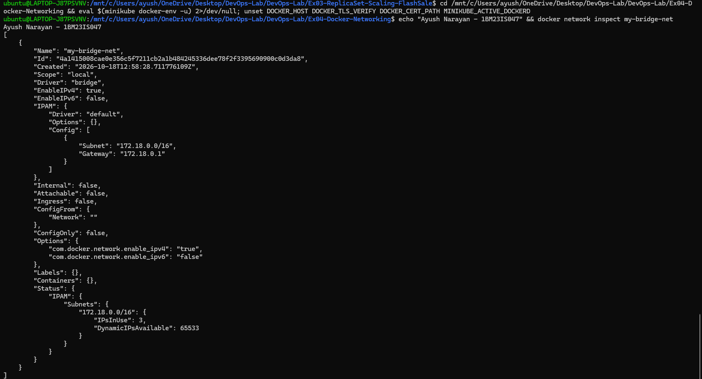
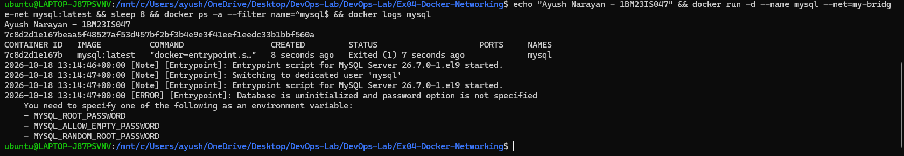
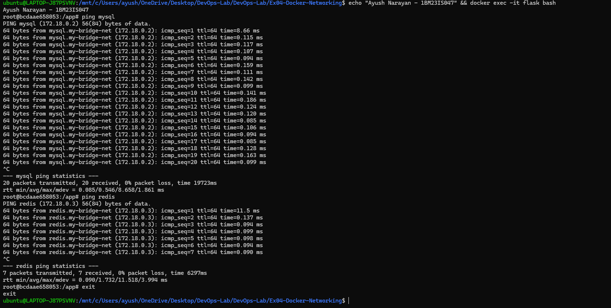

# Exercise 4 – Docker Networking with Multiple Containers

## Objective

Understand Docker networking by building a small multi-container application. I ran a Flask web server, a MySQL database and a Redis cache on one user-defined bridge network. Then I checked that they reach each other by name, and that only the web server is open to the host.

## Use Case

The manual's scenario is a web application with three parts: a Python Flask web server (container 1), a MySQL database (container 2) and a Redis cache (container 3). Each part runs in its own container, and they talk over a private Docker network.

## Architecture

```text
              Host (WSL2 / Windows)
                       |
                curl localhost:5001
                       |   published with -p 5001:5001
+----------------------|------------------------------------------+
|  my-bridge-net       v              subnet 172.18.0.0/16        |
|               +---------------+                                 |
|               |    flask      |   172.18.0.4  :5001             |
|               |  (flask-api)  |                                 |
|               +---------------+                                 |
|                 |           |     "ping mysql", "ping redis"    |
|                 |           |     names resolved by Docker DNS  |
|                 v           v     (127.0.0.11)                  |
|       +-------------+   +-------------+                         |
|       |   mysql     |   |   redis     |   no -p: not reachable  |
|       | 172.18.0.2  |   | 172.18.0.3  |   from the host         |
|       | :3306       |   | :6379       |                         |
|       +-------------+   +-------------+                         |
+-----------------------------------------------------------------+
                  gateway 172.18.0.1 (host side of the bridge)
```

## Environment

- Windows 11 Home + WSL2 Ubuntu 24.04.2 LTS
- Docker Desktop (Engine 29.4.1)
- Base image `python:3.9-slim`, Flask 3.0.3
- `mysql:latest` (MySQL Server 26.7.0), `redis:latest` (Redis 8.10.2)

## Project Structure

```text
Ex04-Docker-Networking/
├── app.py             # Flask REST API, GET /about on port 5001
├── requirements.txt   # Flask==3.0.3
├── Dockerfile         # builds flask-api on python:3.9-slim, adds ping
├── commands.sh        # the manual's commands for Tasks 1-6
├── README.md
└── screenshots/
    ├── 01-network-create-ls.png
    ├── 02-network-inspect.png
    ├── 03-docker-ps.png
    ├── 04-curl-about.png
    ├── 05-ping.png
    ├── 06-docker-build.png
    ├── 07-dns-check.png
    ├── 08-redis-mysql-check.png
    ├── 09-network-inspect-full.png
    ├── 10-mysql-no-password.png
    └── 11-exec-bash-ping.png
```

Source: [app.py](app.py) · [requirements.txt](requirements.txt) · [Dockerfile](Dockerfile) · [commands.sh](commands.sh)

## Steps

I ran this exercise three times. Run 1 was the main setup and connectivity test, run 2 added database and DNS checks, and run 3 covered the manual's exact commands that run 1 had not shown (full inspect, MySQL without a password, ping from an interactive shell). Each run created the network and containers again.

### 1. Create and list the bridge network (run 1)

Containers need a shared network to talk privately. A user-defined bridge network also gives them name-based DNS.

```bash
docker network create --driver bridge my-bridge-net
docker network ls
```

```text
9e054bd7e6f51f7ecc66e1d37ae17a13be63e0bb9e596c5f329d83245b6a951f

NETWORK ID     NAME            DRIVER    SCOPE
4c21e8fe02d2   bridge          bridge    local
1247a1060d23   host            host      local
b8619f3f253a   minikube        bridge    local
9e054bd7e6f5   my-bridge-net   bridge    local
6e638db5c915   none            null      local
```

The long string is the new network's ID. `my-bridge-net` showed up next to Docker's built-in `bridge`, `host` and `none` networks (and Minikube's network).


### 2. Build the Flask image

The web server needs its own image, built from `app.py`, `requirements.txt` and the Dockerfile.

```bash
docker build -t flask-api .
```

```text
#5 [1/6] FROM docker.io/library/python:3.9-slim@sha256:2d97f6910b16bd338d3060f261f53f144965f755599aab1acda1e13cf1731b1b
#6 [2/6] RUN apt-get update && apt-get install -y --no-install-recommends iputils-ping && rm -rf /var/lib/apt/lists/*
#7 [3/6] WORKDIR /app
#8 [4/6] COPY requirements.txt .
#9 [5/6] COPY app.py .
#10 [6/6] RUN pip install --no-cache-dir -r requirements.txt
#10 5.347 Successfully installed Flask-3.0.3 Jinja2-3.1.6 MarkupSafe-3.0.4 Werkzeug-3.1.9 blinker-1.9.0 click-8.1.8 importlib-metadata-8.7.1 itsdangerous-2.2.0 zipp-3.23.1
#11 naming to docker.io/library/flask-api:latest done
```

All 6 Dockerfile steps ran. `ping` was installed in step 2/6, and Flask 3.0.3 in step 6/6.

### 3. Launch the three containers on the network

`-d` runs each container in the background, and `--net` attaches it to `my-bridge-net`. Only Flask gets a published port.

```bash
docker run -d --name mysql --net=my-bridge-net -e MYSQL_ROOT_PASSWORD=root mysql:latest
docker run -d --name redis --net=my-bridge-net redis:latest
docker run -d --name flask --net=my-bridge-net -p 5001:5001 flask-api
```

```text
Status: Downloaded newer image for mysql:latest
9f0cb30fe41c252bd6d4dfab69550575cdccc0a449cdc5e534940c2190d2eb73
Status: Downloaded newer image for redis:latest
d8acb2119fa1b4cd503b18314792e93fac8c805dd2c00201d468ce59e18595d7
845ed1234d3c271c0515fa61b47cf0a55c1f703fd959e29c1df73c283a13e9e6
```

Docker pulled the MySQL and Redis images and printed the ID of each new container. MySQL got a root password, because it won't start without one (shown in step 13).

### 4. Inspect the network with the containers attached

`docker network inspect` shows the subnet and which containers joined. I used `--format` to print just those parts.

```bash
docker network inspect my-bridge-net --format '{{.Name}} {{.Driver}} {{range .IPAM.Config}}{{.Subnet}} gw {{.Gateway}}{{end}}'
docker network inspect my-bridge-net --format '{{range .Containers}}{{.Name}}  {{.IPv4Address}}{{println}}{{end}}'
```

```text
my-bridge-net bridge 172.18.0.0/16 gw 172.18.0.1
flask  172.18.0.4/16
mysql  172.18.0.2/16
redis  172.18.0.3/16
```

The network used subnet 172.18.0.0/16 with gateway 172.18.0.1. Each container got its own address from it, in the order they started.


### 5. Check the running containers

`docker ps` confirms all three are up and shows their port mappings.

```bash
docker ps
```

```text
CONTAINER ID   IMAGE          COMMAND                  CREATED         STATUS         PORTS                                         NAMES
845ed1234d3c   flask-api      "python app.py"          2 minutes ago   Up 2 minutes   0.0.0.0:5001->5001/tcp, [::]:5001->5001/tcp   flask
d8acb2119fa1   redis:latest   "docker-entrypoint.s…"   2 minutes ago   Up 2 minutes   6379/tcp                                      redis
9f0cb30fe41c   mysql:latest   "docker-entrypoint.s…"   3 minutes ago   Up 3 minutes   3306/tcp, 33060/tcp                           mysql
```

Only Flask had `0.0.0.0:5001->5001`. Redis (6379) and MySQL (3306, 33060) listed their ports without `->`, which means they were not published to the host.


### 6. Call the Flask API from the host

This checks the path host → published port → Flask container.

```bash
curl http://localhost:5001/about
```

```text
{"description":"This is a simple REST API built with Flask.","name":"Simple REST API","version":"1.0"}
```

The `/about` endpoint returned its JSON, so the port mapping and `host='0.0.0.0'` in `app.py` both worked.


### 7. Ping MySQL and Redis by name from Flask

This is the main test of the exercise: can one container find another by name alone?

```bash
docker exec -it flask ping -c 3 mysql
docker exec -it flask ping -c 3 redis
```

```text
PING mysql (172.18.0.2) 56(84) bytes of data.
64 bytes from mysql.my-bridge-net (172.18.0.2): icmp_seq=1 ttl=64 time=0.211 ms
64 bytes from mysql.my-bridge-net (172.18.0.2): icmp_seq=2 ttl=64 time=0.095 ms
64 bytes from mysql.my-bridge-net (172.18.0.2): icmp_seq=3 ttl=64 time=0.076 ms

--- mysql ping statistics ---
3 packets transmitted, 3 received, 0% packet loss, time 2008ms
rtt min/avg/max/mdev = 0.076/0.127/0.211/0.059 ms
PING redis (172.18.0.3) 56(84) bytes of data.
64 bytes from redis.my-bridge-net (172.18.0.3): icmp_seq=1 ttl=64 time=0.322 ms
64 bytes from redis.my-bridge-net (172.18.0.3): icmp_seq=2 ttl=64 time=0.135 ms
64 bytes from redis.my-bridge-net (172.18.0.3): icmp_seq=3 ttl=64 time=0.093 ms

--- redis ping statistics ---
3 packets transmitted, 3 received, 0% packet loss, time 2109ms
rtt min/avg/max/mdev = 0.093/0.183/0.322/0.099 ms
```

`mysql` resolved to 172.18.0.2 and `redis` to 172.18.0.3, with 0% packet loss. The full name `mysql.my-bridge-net` shows the answer came from Docker's DNS for this network.


At the end of run 1, I stopped and removed the three containers and the network.

### 8. Build the image again (run 2)

At the start of run 2, I rebuilt the image and listed it to record its ID and size.

```bash
docker build -t flask-api .
docker images flask-api
```

```text
[+] Building 1.9s (11/11) FINISHED                                   docker:default
 => [internal] load build definition from Dockerfile                           0.0s
 => => transferring dockerfile: 613B                                           0.0s
 => [internal] load metadata for docker.io/library/python:3.9-slim             1.4s
 => [internal] load .dockerignore                                              0.0s
 => => transferring context: 2B                                                0.0s
 => [1/6] FROM docker.io/library/python:3.9-slim@sha256:2d97f6910b16bd338d3060f261f53f144965f755599aab1acda1e13cf1731b1b  0.0s
 => [internal] load build context                                              0.0s
 => => transferring context: 63B                                               0.0s
 => CACHED [2/6] RUN apt-get update && apt-get install -y --no-install-recommends iputils-ping && rm -rf /var/lib/apt/lists/*  0.0s
 => CACHED [3/6] WORKDIR /app                                                  0.0s
 => CACHED [4/6] COPY requirements.txt .                                       0.0s
 => CACHED [5/6] COPY app.py .                                                 0.0s
 => CACHED [6/6] RUN pip install --no-cache-dir -r requirements.txt            0.0s
 => exporting to image                                                         0.2s
 => => naming to docker.io/library/flask-api:latest                            0.0s
 => => unpacking to docker.io/library/flask-api:latest                         0.0s

IMAGE              ID             DISK USAGE   CONTENT SIZE   EXTRA
flask-api:latest   f626b45faf44        204MB         49.9MB    U
```

Every step was `CACHED`, because nothing in the files had changed since step 2. The image is 204 MB on disk.


### 9. Run with a database and check DNS and ports

This time MySQL also got `MYSQL_DATABASE=devopsdb`, so it creates a database on first start. Then I checked the port mapping and name lookup directly.

```bash
docker network create --driver bridge my-bridge-net
docker run -d --name mysql --net=my-bridge-net -e MYSQL_ROOT_PASSWORD=root -e MYSQL_DATABASE=devopsdb mysql:latest
docker run -d --name redis --net=my-bridge-net redis:latest
docker run -d --name flask --net=my-bridge-net -p 5001:5001 flask-api
docker port flask
docker exec flask getent hosts mysql
docker exec flask getent hosts redis
```

```text
5001/tcp -> 0.0.0.0:5001
5001/tcp -> [::]:5001
172.18.0.2      mysql
172.18.0.3      redis
```

`docker port` listed the only host mapping (5001, on IPv4 and IPv6). `getent hosts` asked the container's resolver for each name, and Docker's DNS answered with the right IPs.


### 10. Check that Redis and MySQL work

Ping only proves the network path. These commands check that both services actually answer.

```bash
docker exec redis redis-cli ping
docker exec mysql mysql -uroot -proot -e "SHOW DATABASES;"
```

```text
PONG
mysql: [Warning] Using a password on the command line interface can be insecure.
Database
devopsdb
information_schema
mysql
performance_schema
sys
```

Redis replied `PONG`. MySQL accepted the root password and listed `devopsdb`, the database created from the environment variable, next to its system databases.


At the end of run 2, I removed the containers and the network again.

### 11. Inspect the empty network in full (run 3)

The manual's Task 3 runs `docker network inspect` with no format, right after creating the network.

```bash
docker network create --driver bridge my-bridge-net
docker network inspect my-bridge-net
```

```text
[
    {
        "Name": "my-bridge-net",
        "Id": "4a1415008cae0e356c5f7211cb2a1b484245336dee78f2f3395690900c0d3da8",
        "Created": "2026-10-18T12:58:28.711776109Z",
        "Scope": "local",
        "Driver": "bridge",
        "EnableIPv4": true,
        "EnableIPv6": false,
        "IPAM": {
            "Driver": "default",
            "Options": {},
            "Config": [
                {
                    "Subnet": "172.18.0.0/16",
                    "Gateway": "172.18.0.1"
                }
            ]
        },
        "Internal": false,
        "Attachable": false,
        "Ingress": false,
        "ConfigFrom": {
            "Network": ""
        },
        "ConfigOnly": false,
        "Options": {
            "com.docker.network.enable_ipv4": "true",
            "com.docker.network.enable_ipv6": "false"
        },
        "Labels": {},
        "Containers": {},
        "Status": {
            "IPAM": {
                "Subnets": {
                    "172.18.0.0/16": {
                        "IPsInUse": 3,
                        "DynamicIPsAvailable": 65533
                    }
                }
            }
        }
    }
]
```

`Driver: bridge` and the IPAM `Config` (subnet and gateway) match the summary in step 4. `"Containers": {}` is empty because nothing had joined yet. `"Internal": false` means containers on it can reach the outside world.



### 12. Run MySQL exactly as the manual writes it

The manual's Task 4 starts MySQL without any environment variables. I ran it as written to see what happens.

```bash
docker run -d --name mysql --net=my-bridge-net mysql:latest
sleep 8
docker ps -a --filter name=^mysql$
docker logs mysql
```

```text
7c8d2d1e167beaa5f48527af53d457bf2bf3b4e9e3f41eef1eedc33b1bbf560a
CONTAINER ID   IMAGE          COMMAND                  CREATED         STATUS                     PORTS     NAMES
7c8d2d1e167b   mysql:latest   "docker-entrypoint.s…"   8 seconds ago   Exited (1) 7 seconds ago             mysql
2026-10-18 13:14:46+00:00 [Note] [Entrypoint]: Entrypoint script for MySQL Server 26.7.0-1.el9 started.
2026-10-18 13:14:47+00:00 [Note] [Entrypoint]: Switching to dedicated user 'mysql'
2026-10-18 13:14:47+00:00 [Note] [Entrypoint]: Entrypoint script for MySQL Server 26.7.0-1.el9 started.
2026-10-18 13:14:47+00:00 [ERROR] [Entrypoint]: Database is uninitialized and password option is not specified
    You need to specify one of the following as an environment variable:
    - MYSQL_ROOT_PASSWORD
    - MYSQL_ALLOW_EMPTY_PASSWORD
    - MYSQL_RANDOM_ROOT_PASSWORD
```

The container stopped one second after starting (`Exited (1)`). The log explains why: a new MySQL needs one of three password options. That's why all my other runs used `-e MYSQL_ROOT_PASSWORD=root`.



### 13. Ping from an interactive shell inside Flask

The manual's Task 5 opens a bash shell inside the Flask container and pings from there. I removed the failed MySQL, started the three containers properly, and followed it.

```bash
docker rm mysql
docker run -d --name mysql --net=my-bridge-net -e MYSQL_ROOT_PASSWORD=root mysql:latest
docker run -d --name redis --net=my-bridge-net redis:latest
docker run -d --name flask --net=my-bridge-net -p 5001:5001 flask-api
docker exec -it flask bash
ping mysql        # stopped with Ctrl+C
ping redis        # stopped with Ctrl+C
exit
```

```text
root@bcdaae658053:/app# ping mysql
PING mysql (172.18.0.2) 56(84) bytes of data.
64 bytes from mysql.my-bridge-net (172.18.0.2): icmp_seq=1 ttl=64 time=8.66 ms
64 bytes from mysql.my-bridge-net (172.18.0.2): icmp_seq=2 ttl=64 time=0.115 ms
64 bytes from mysql.my-bridge-net (172.18.0.2): icmp_seq=3 ttl=64 time=0.117 ms
...
64 bytes from mysql.my-bridge-net (172.18.0.2): icmp_seq=20 ttl=64 time=0.099 ms
^C
--- mysql ping statistics ---
20 packets transmitted, 20 received, 0% packet loss, time 19723ms
rtt min/avg/max/mdev = 0.085/0.546/8.658/1.861 ms
root@bcdaae658053:/app# ping redis
PING redis (172.18.0.3) 56(84) bytes of data.
64 bytes from redis.my-bridge-net (172.18.0.3): icmp_seq=1 ttl=64 time=11.5 ms
64 bytes from redis.my-bridge-net (172.18.0.3): icmp_seq=2 ttl=64 time=0.137 ms
64 bytes from redis.my-bridge-net (172.18.0.3): icmp_seq=3 ttl=64 time=0.094 ms
...
64 bytes from redis.my-bridge-net (172.18.0.3): icmp_seq=7 ttl=64 time=0.090 ms
^C
--- redis ping statistics ---
7 packets transmitted, 7 received, 0% packet loss, time 6297ms
rtt min/avg/max/mdev = 0.090/1.732/11.518/3.994 ms
root@bcdaae658053:/app# exit
exit
```

The prompt `root@bcdaae658053:/app#` shows I was inside the Flask container (the hostname is its container ID). Both names resolved and answered with 0% loss. The first reply was slower (8.66 ms and 11.5 ms) because of the first lookup and ARP, and later replies took about 0.1 ms. Without `-c`, ping runs until stopped, hence the `^C`.



### 14. Clean up

The manual's Task 6 stops and removes the containers, then the network.

```bash
docker stop mysql redis flask && docker rm mysql redis flask
docker network rm my-bridge-net
```

```text
mysql
redis
flask
mysql
redis
flask
my-bridge-net
```

Each name printed once for `stop` and once for `rm`, then the network name for `network rm`. Nothing from the exercise was left running.

## How It Works

```text
docker network create my-bridge-net
      |
      v
Docker creates a Linux bridge (virtual switch) + subnet 172.18.0.0/16, gateway 172.18.0.1

docker run --net=my-bridge-net ...
      |
      v
each container gets a veth pair: one end inside the container (eth0, 172.18.0.x),
the other end plugged into the bridge

flask: "ping mysql"
      |
      v
resolver in the container --> Docker embedded DNS (127.0.0.11) --> "mysql" = 172.18.0.2
      |
      v
packet goes eth0 --> bridge --> mysql's eth0          (never leaves the host)

host: curl localhost:5001
      |
      v
-p 5001:5001 --> Docker forwards host port 5001 --> flask 172.18.0.4:5001
```

- A user-defined bridge network is a private virtual switch. Containers on it can reach each other on any port.
- Docker runs a small DNS server (127.0.0.11) for user-defined networks, so container names work as hostnames. The default `bridge` network does not offer this.
- `--net` decides which network a container joins. A container can be on more than one.
- Nothing is reachable from the host unless it is published with `-p`. MySQL and Redis stayed private, and only Flask was published.
- Bridge vs host network: a bridge gives containers their own isolated IPs. With `--network host`, a container shares the host's network stack directly and `-p` is not used.

## Key Configuration

app.py
- `@app.route('/about', methods=['GET'])` returns `name`, `version` and `description` as JSON with `jsonify`.
- `app.run(host='0.0.0.0', port=5001)`: the manual uses `app.run(debug=True, port=5001)`, which listens only on 127.0.0.1 inside the container, so `curl localhost:5001` from the host would get no answer. I added `host='0.0.0.0'` so the app listens on the container's network interface.

requirements.txt
- `Flask==3.0.3`: the manual pins `Flask==2.0.1`. I checked it in a `python:3.9-slim` container: pip pulled Werkzeug 3.1.9, and `import flask` failed with `ImportError: cannot import name 'url_quote' from 'werkzeug.urls'`. Flask 3.0.3 works with the current Werkzeug.

Dockerfile
- `FROM python:3.9-slim`: the same small base image as the manual.
- `RUN apt-get install -y --no-install-recommends iputils-ping`: the slim image has no `ping`, so the manual's Task 5 would fail with "command not found". I added it, and removed the apt lists to keep the image small.
- `COPY requirements.txt .` before `COPY app.py .`: dependencies are installed in an earlier layer, so changing only `app.py` doesn't re-run pip.
- `EXPOSE 5001`: only documents the port. The `-p 5001:5001` flag is what actually published it.
- `CMD ["python", "app.py"]`: starts the Flask server when the container runs.

docker run options
- `-d`: detached, so the container runs in the background.
- `--name mysql|redis|flask`: these names are also the DNS names on the network.
- `--net=my-bridge-net`: join the custom network instead of the default bridge.
- `-p 5001:5001`: host port 5001 → container port 5001.
- `-e MYSQL_ROOT_PASSWORD=root`: required by the MySQL image (step 12). `-e MYSQL_DATABASE=devopsdb` creates an empty database on first start.

## Commands Used

```bash
docker network create --driver bridge my-bridge-net
docker network ls
docker build -t flask-api .
docker run -d --name mysql --net=my-bridge-net -e MYSQL_ROOT_PASSWORD=root mysql:latest
docker run -d --name redis --net=my-bridge-net redis:latest
docker run -d --name flask --net=my-bridge-net -p 5001:5001 flask-api
docker network inspect my-bridge-net --format '{{.Name}} {{.Driver}} {{range .IPAM.Config}}{{.Subnet}} gw {{.Gateway}}{{end}}'
docker network inspect my-bridge-net --format '{{range .Containers}}{{.Name}}  {{.IPv4Address}}{{println}}{{end}}'
docker ps
curl http://localhost:5001/about
docker exec -it flask ping -c 3 mysql
docker exec -it flask ping -c 3 redis
docker stop mysql redis flask && docker rm mysql redis flask
docker network rm my-bridge-net
docker images flask-api
docker run -d --name mysql --net=my-bridge-net -e MYSQL_ROOT_PASSWORD=root -e MYSQL_DATABASE=devopsdb mysql:latest
docker port flask
docker exec flask getent hosts mysql
docker exec flask getent hosts redis
docker exec redis redis-cli ping
docker exec mysql mysql -uroot -proot -e "SHOW DATABASES;"
docker network inspect my-bridge-net
docker run -d --name mysql --net=my-bridge-net mysql:latest
docker ps -a --filter name=^mysql$
docker logs mysql
docker rm mysql
docker exec -it flask bash
ping mysql
ping redis
exit
```

## Problems Faced

- The manual's `docker run -d --name mysql --net=my-bridge-net mysql:latest` exits right away with `Database is uninitialized and password option is not specified` (step 12). Adding `-e MYSQL_ROOT_PASSWORD=root` fixed it.
- In run 2, the first `SHOW DATABASES` failed with `ERROR 1045 (28000): Access denied for user 'root'@'localhost'`. On first start, MySQL runs a temporary server to set itself up, and my readiness check (`mysqladmin ping`) passed against that server before the root password was set. Once I waited for the final `ready for connections ... port: 3306` line in `docker logs mysql`, the query worked.
- The manual's `ping mysql` inside the shell has no count, so it keeps running. I stopped it with Ctrl+C. In run 1 I used `ping -c 3` instead.

## Result

Flask, MySQL and Redis ran on the user-defined bridge network `my-bridge-net` (172.18.0.0/16) and reached each other by container name through Docker's DNS. Only Flask was published to the host, on port 5001, where `/about` answered. Redis replied `PONG`, and MySQL listed `devopsdb` once it was given a root password.
