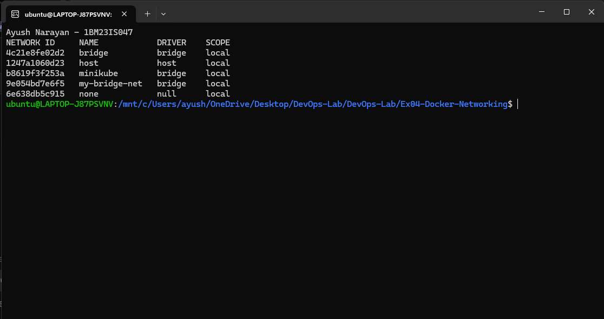
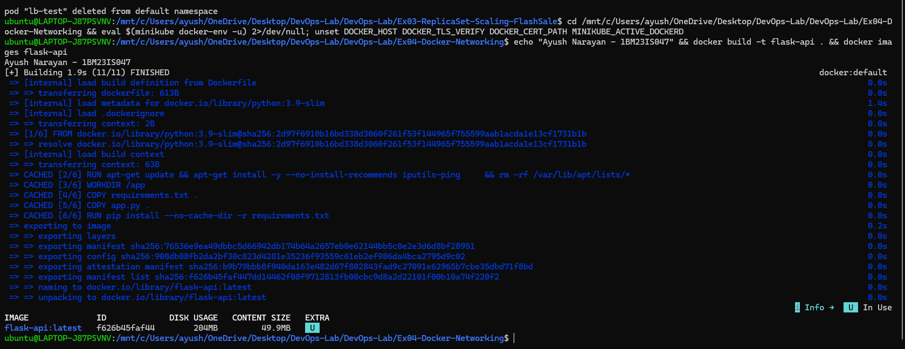
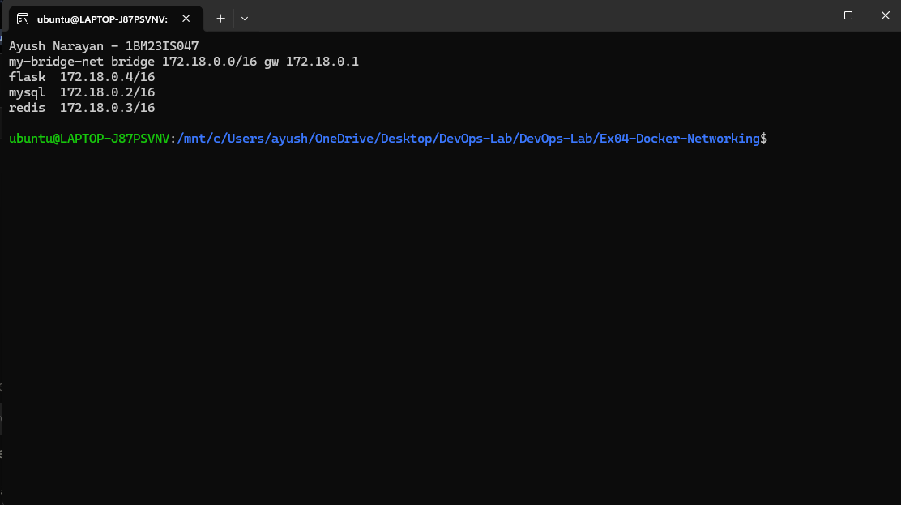
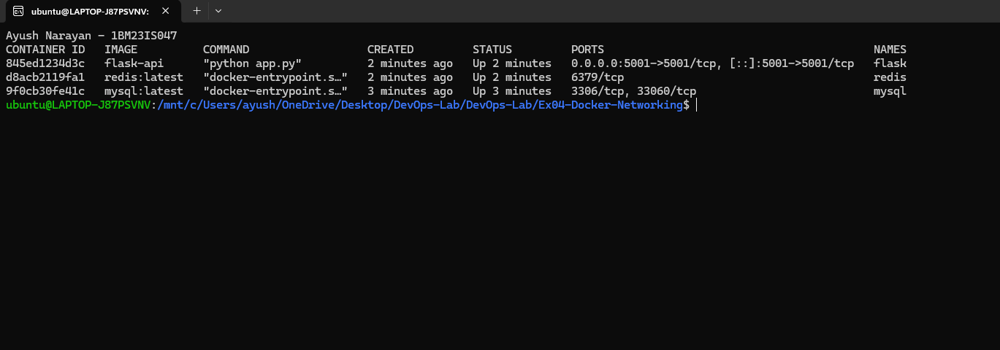
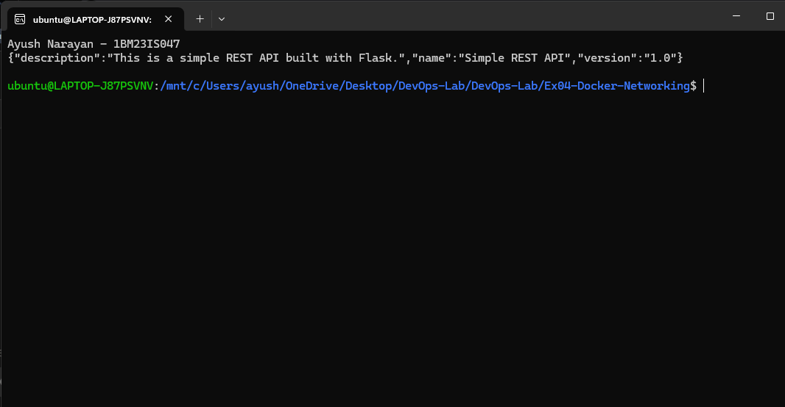
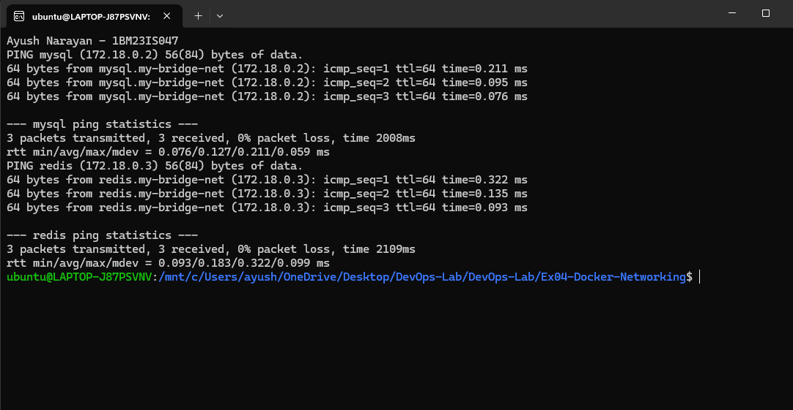
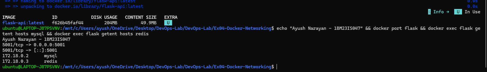
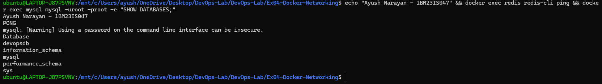

# Exercise 4 – Docker Networking with Multiple Containers

## Objective

Connect three containers (a Flask REST API, MySQL and Redis) on a user-defined bridge network. Check that they reach each other by container name and that only the API is exposed to the host.

## Environment

- Windows 11 Home + WSL2 Ubuntu 24.04.2 LTS
- Docker Desktop (Engine 29.4.1)
- Base image `python:3.9-slim`, Flask 3.0.3
- `mysql:latest` (MySQL 26.7.0), `redis:latest` (Redis 8.10.2)

## Project Structure

```text
Ex04-Docker-Networking/
├── app.py             # Flask REST API, GET /about on port 5001
├── requirements.txt   # Flask==3.0.3
├── Dockerfile         # builds flask-api on python:3.9-slim, adds ping
├── commands.sh        # all commands for this exercise
├── README.md
└── screenshots/
    ├── 01-network-create-ls.png
    ├── 02-network-inspect.png
    ├── 03-docker-ps.png
    ├── 04-curl-about.png
    ├── 05-ping.png
    ├── 06-docker-build.png
    ├── 07-dns-check.png
    └── 08-redis-mysql-check.png
```

Source: [app.py](app.py) · [requirements.txt](requirements.txt) · [Dockerfile](Dockerfile) · [commands.sh](commands.sh)

## Steps

### 1. Create the bridge network

```bash
docker network create --driver bridge my-bridge-net
docker network ls
```

```text
9e054bd7e6f51f7ecc66e1d37ae17a13be63e0bb9e596c5f329d83245b6a951f

NETWORK ID     NAME            DRIVER    SCOPE
4c21e8fe02d2   bridge          bridge    local
1247a1060d23   host            host      local
b8619f3f253a   minikube        bridge    local
9e054bd7e6f5   my-bridge-net   bridge    local
6e638db5c915   none            null      local
```

Created `my-bridge-net` with the bridge driver. It appeared next to Docker's default networks.



### 2. Build the Flask image

```bash
docker build -t flask-api .
docker images flask-api
```

```text
[+] Building 1.9s (11/11) FINISHED                                   docker:default
 => [internal] load build definition from Dockerfile                           0.0s
 => => transferring dockerfile: 613B                                           0.0s
 => [internal] load metadata for docker.io/library/python:3.9-slim             1.4s
 => [internal] load .dockerignore                                              0.0s
 => => transferring context: 2B                                                0.0s
 => [1/6] FROM docker.io/library/python:3.9-slim@sha256:2d97f6910b16bd338d3060f261f53f144965f755599aab1acda1e13cf1731b1b  0.0s
 => [internal] load build context                                              0.0s
 => => transferring context: 63B                                               0.0s
 => CACHED [2/6] RUN apt-get update && apt-get install -y --no-install-recommends iputils-ping && rm -rf /var/lib/apt/lists/*  0.0s
 => CACHED [3/6] WORKDIR /app                                                  0.0s
 => CACHED [4/6] COPY requirements.txt .                                       0.0s
 => CACHED [5/6] COPY app.py .                                                 0.0s
 => CACHED [6/6] RUN pip install --no-cache-dir -r requirements.txt            0.0s
 => exporting to image                                                         0.2s
 => => naming to docker.io/library/flask-api:latest                            0.0s
 => => unpacking to docker.io/library/flask-api:latest                         0.0s

IMAGE              ID             DISK USAGE   CONTENT SIZE   EXTRA
flask-api:latest   f626b45faf44        204MB         49.9MB    U
```

Built `flask-api` with `ping` installed. The layers were cached from the first build, which had installed Flask 3.0.3.



### 3. Run the three containers on the network

```bash
docker run -d --name mysql --net=my-bridge-net -e MYSQL_ROOT_PASSWORD=root mysql:latest
docker run -d --name redis --net=my-bridge-net redis:latest
docker run -d --name flask --net=my-bridge-net -p 5001:5001 flask-api
```

```text
Status: Downloaded newer image for mysql:latest
9f0cb30fe41c252bd6d4dfab69550575cdccc0a449cdc5e534940c2190d2eb73
Status: Downloaded newer image for redis:latest
d8acb2119fa1b4cd503b18314792e93fac8c805dd2c00201d468ce59e18595d7
845ed1234d3c271c0515fa61b47cf0a55c1f703fd959e29c1df73c283a13e9e6
```

Started MySQL, Redis and Flask on `my-bridge-net`. Only Flask was published to the host.

### 4. Inspect the network

```bash
docker network inspect my-bridge-net --format '{{.Name}} {{.Driver}} {{range .IPAM.Config}}{{.Subnet}} gw {{.Gateway}}{{end}}'
docker network inspect my-bridge-net --format '{{range .Containers}}{{.Name}}  {{.IPv4Address}}{{println}}{{end}}'
```

```text
my-bridge-net bridge 172.18.0.0/16 gw 172.18.0.1
flask  172.18.0.4/16
mysql  172.18.0.2/16
redis  172.18.0.3/16
```

All three containers got addresses from the network's 172.18.0.0/16 subnet.



### 5. Check the running containers

```bash
docker ps
```

```text
CONTAINER ID   IMAGE          COMMAND                  CREATED         STATUS         PORTS                                         NAMES
845ed1234d3c   flask-api      "python app.py"          2 minutes ago   Up 2 minutes   0.0.0.0:5001->5001/tcp, [::]:5001->5001/tcp   flask
d8acb2119fa1   redis:latest   "docker-entrypoint.s…"   2 minutes ago   Up 2 minutes   6379/tcp                                      redis
9f0cb30fe41c   mysql:latest   "docker-entrypoint.s…"   3 minutes ago   Up 3 minutes   3306/tcp, 33060/tcp                           mysql
```

All three were up. Only Flask had a host port mapping.



### 6. Call the API from the host

```bash
curl http://localhost:5001/about
```

```text
{"description":"This is a simple REST API built with Flask.","name":"Simple REST API","version":"1.0"}
```

The API answered on the published port 5001.



### 7. Ping MySQL and Redis by name

```bash
docker exec -it flask ping -c 3 mysql
docker exec -it flask ping -c 3 redis
```

```text
PING mysql (172.18.0.2) 56(84) bytes of data.
64 bytes from mysql.my-bridge-net (172.18.0.2): icmp_seq=1 ttl=64 time=0.211 ms
64 bytes from mysql.my-bridge-net (172.18.0.2): icmp_seq=2 ttl=64 time=0.095 ms
64 bytes from mysql.my-bridge-net (172.18.0.2): icmp_seq=3 ttl=64 time=0.076 ms

--- mysql ping statistics ---
3 packets transmitted, 3 received, 0% packet loss, time 2008ms
rtt min/avg/max/mdev = 0.076/0.127/0.211/0.059 ms
PING redis (172.18.0.3) 56(84) bytes of data.
64 bytes from redis.my-bridge-net (172.18.0.3): icmp_seq=1 ttl=64 time=0.322 ms
64 bytes from redis.my-bridge-net (172.18.0.3): icmp_seq=2 ttl=64 time=0.135 ms
64 bytes from redis.my-bridge-net (172.18.0.3): icmp_seq=3 ttl=64 time=0.093 ms

--- redis ping statistics ---
3 packets transmitted, 3 received, 0% packet loss, time 2109ms
rtt min/avg/max/mdev = 0.093/0.183/0.322/0.099 ms
```

The names `mysql` and `redis` resolved to their IPs, with no packet loss.



### 8. Recreate with a database and check DNS

```bash
docker network create --driver bridge my-bridge-net
docker run -d --name mysql --net=my-bridge-net -e MYSQL_ROOT_PASSWORD=root -e MYSQL_DATABASE=devopsdb mysql:latest
docker run -d --name redis --net=my-bridge-net redis:latest
docker run -d --name flask --net=my-bridge-net -p 5001:5001 flask-api
docker port flask
docker exec flask getent hosts mysql
docker exec flask getent hosts redis
```

```text
5001/tcp -> 0.0.0.0:5001
5001/tcp -> [::]:5001
172.18.0.2      mysql
172.18.0.3      redis
```

Ran the setup again with `MYSQL_DATABASE=devopsdb`. `docker port` showed the only host mapping, and `getent` showed Docker's DNS resolving both names.



### 9. Check Redis and MySQL

```bash
docker exec redis redis-cli ping
docker exec mysql mysql -uroot -proot -e "SHOW DATABASES;"
```

```text
PONG
mysql: [Warning] Using a password on the command line interface can be insecure.
Database
devopsdb
information_schema
mysql
performance_schema
sys
```

Redis answered `PONG`, and MySQL listed the `devopsdb` database created at start-up.



### 10. Clean up

```bash
docker stop mysql redis flask && docker rm mysql redis flask
docker network rm my-bridge-net
```

```text
mysql
redis
flask
mysql
redis
flask
my-bridge-net
```

Stopped and removed the containers and the network.

## How It Works

```text
            Host (WSL2 / Windows)
                    |
             localhost:5001
                    |  -p 5001:5001
+-------------------|------------------------------------+
| my-bridge-net     v           172.18.0.0/16            |
|            +-------------+                             |
|            |    flask    |  172.18.0.4  :5001          |
|            +-------------+                             |
|               |       |   name lookup via Docker DNS  |
|               v       v   (127.0.0.11)                |
|   +-------------+   +-------------+                   |
|   |    mysql    |   |    redis    |                   |
|   | 172.18.0.2  |   | 172.18.0.3  |                   |
|   | :3306       |   | :6379       |                   |
|   +-------------+   +-------------+                   |
+--------------------------------------------------------+
        gateway 172.18.0.1 (host side of the bridge)
```

- `docker network create` made a Linux bridge with its own subnet. Containers started with `--net=my-bridge-net` were attached to it.
- On a user-defined network, Docker's embedded DNS server resolves container names, so `ping mysql` and `getent hosts redis` worked. The default `bridge` network does not provide this.
- Containers on the same network can reach each other on any port. The host can only reach ports published with `-p`.
- MySQL and Redis had no `-p`, so they were reachable from Flask but not from the host.

## Key Configuration

- `app.run(host='0.0.0.0', port=5001)`: Flask listens on all interfaces of the container. With the default `127.0.0.1`, the `-p 5001:5001` mapping would not reach it.
- `EXPOSE 5001` vs `-p 5001:5001`: `EXPOSE` only documents the port in the image. `-p host:container` is what actually published it on the host.
- `iputils-ping` in the Dockerfile: `python:3.9-slim` has no `ping`, so it was installed to test connectivity from inside the Flask container.
- `-e MYSQL_ROOT_PASSWORD=root`: the MySQL image refuses to initialise without a root password option. `MYSQL_DATABASE=devopsdb` creates an empty database on first start.
- `--net=my-bridge-net`: attaches a container to the custom network instead of the default bridge.

## Commands Used

```bash
docker network create --driver bridge my-bridge-net
docker network ls
docker build -t flask-api .
docker images flask-api
docker run -d --name mysql --net=my-bridge-net -e MYSQL_ROOT_PASSWORD=root mysql:latest
docker run -d --name redis --net=my-bridge-net redis:latest
docker run -d --name flask --net=my-bridge-net -p 5001:5001 flask-api
docker network inspect my-bridge-net --format '{{.Name}} {{.Driver}} {{range .IPAM.Config}}{{.Subnet}} gw {{.Gateway}}{{end}}'
docker network inspect my-bridge-net --format '{{range .Containers}}{{.Name}}  {{.IPv4Address}}{{println}}{{end}}'
docker ps
curl http://localhost:5001/about
docker exec -it flask ping -c 3 mysql
docker exec -it flask ping -c 3 redis
docker run -d --name mysql --net=my-bridge-net -e MYSQL_ROOT_PASSWORD=root -e MYSQL_DATABASE=devopsdb mysql:latest
docker port flask
docker exec flask getent hosts mysql
docker exec flask getent hosts redis
docker exec redis redis-cli ping
docker exec mysql mysql -uroot -proot -e "SHOW DATABASES;"
docker stop mysql redis flask && docker rm mysql redis flask
docker network rm my-bridge-net
```

## Problems Faced

- The first `SHOW DATABASES` check failed with `ERROR 1045 (28000): Access denied for user 'root'@'localhost'`. MySQL first starts a temporary server to initialise the data directory, and my readiness check (`mysqladmin ping`) succeeded against it before the root password was set. I waited for the final `ready for connections ... port: 3306` line in `docker logs mysql`, and the query then worked.

## Result

Flask, MySQL and Redis ran on a custom bridge network and reached each other by container name through Docker's DNS. Only the Flask API was published to the host on port 5001. Redis answered `PONG`, and MySQL listed the `devopsdb` database.
