# Exercise 5 – Docker Security with AppArmor and Python

## Objective

Learn how to secure a Docker container with an AppArmor profile, apply it with the Docker CLI and the Docker SDK for Python, and test restricted actions inside the container. I also tested whether the profile is actually enforced on WSL2 + Docker Desktop, and showed container hardening options that do work there.

> **Note: AppArmor is not supported on WSL2 with Docker Desktop.** The WSL2 kernel is booted without the AppArmor security module, and Docker Desktop's engine only offers seccomp. Every task from the manual was run, and the AppArmor profile and steps are kept in this folder. Docker accepted the AppArmor option but did not enforce it, which steps 5–9 prove. Steps 10–12 show hardening that is enforced on this setup.

## Use Case

A Python Flask web application runs inside a Docker container. It has to be secured so it cannot read sensitive system files like `/etc/passwd` or start other programs like `/bin/bash`, even if the app is compromised. The Docker SDK for Python is used to apply and verify the profile, and Python scripts test the restricted actions.

## Architecture

```text
 WSL2 Ubuntu 24.04 (my shell)                      Docker Desktop engine
 +--------------------------------+               (WSL2 distro "docker-desktop")
 | apparmor-utils, apparmor_parser|   docker CLI   +--------------------------------+
 | /etc/apparmor.d/               | -------------> | dockerd 29.4.1                 |
 |   my-apparmor-profile          |   Docker SDK   |  security options: seccomp only|
 | apply_apparmor.py              | -------------> |                                |
 | test_restricted_actions.py     |                |  +--------------------------+  |
 +--------------------------------+                |  | container flask-apparmor |  |
                 |                                 |  | Flask :5000              |  |
                 | curl localhost:5000 <-----------|--| --security-opt apparmor= |  |
                 |                                 |  |   (recorded, not applied)|  |
                 v                                 |  +--------------------------+  |
 +-----------------------------------------------------------------------------------+
 | Microsoft WSL2 kernel 5.15.167.4 (shared by both distros)                         |
 |   AppArmor LSM: NOT loaded  -> profile can't be loaded, nothing is confined       |
 |   seccomp, capabilities, read-only mounts, no_new_privs: available and enforced   |
 +-----------------------------------------------------------------------------------+
```

## Environment

- Windows 11 Home + WSL2 Ubuntu 24.04.2 LTS, kernel 5.15.167.4-microsoft-standard-WSL2
- Docker Desktop (Engine 29.4.1), security options: `name=seccomp,profile=builtin`
- apparmor-utils 4.0.1really4.0.1-0ubuntu0.24.04.9
- Python 3.12 venv with Docker SDK for Python 7.2.0
- Base image `python:3.11-slim`, Flask (latest at build time)

## Project Structure

```text
Ex05-Docker-Security-AppArmor/
├── app.py                       # Flask app on port 5000
├── Dockerfile                   # builds the flask-apparmor image
├── my-apparmor-profile          # fixed AppArmor profile (named, with baseline rules)
├── manual-apparmor-profile      # the manual's original profile, kept to show the parser error
├── apply_apparmor.py            # Task 4: build + run with the profile via the Docker SDK, then inspect
├── test_restricted_actions.py   # Task 5: try restricted actions inside the container
├── README.md
└── screenshots/
    ├── 01-aa-status.png
    ├── 02-profile-parse-load.png
    ├── 03-docker-build.png
    ├── 04-run-with-profile.png
    ├── 05-nonexistent-profile.png
    ├── 06-inspect-requested-vs-applied.png
    ├── 07-not-enforced.png
    ├── 08-apply-apparmor-py.png
    ├── 09-test-restricted-py.png
    ├── 10-hardened-run.png
    ├── 11-cap-drop-proof.png
    └── 12-hardened-inspect.png
```

Source: [app.py](app.py) · [Dockerfile](Dockerfile) · [my-apparmor-profile](my-apparmor-profile) · [manual-apparmor-profile](manual-apparmor-profile) · [apply_apparmor.py](apply_apparmor.py) · [test_restricted_actions.py](test_restricted_actions.py)

## Steps

### 1. Check the AppArmor tools and kernel support

The manual's prerequisite is `apparmor-utils`. I installed it, then checked whether the kernel and Docker actually support AppArmor.

```bash
sudo apt-get update
sudo apt-get install apparmor-utils
dpkg -l apparmor-utils | tail -1
uname -r
sudo aa-status
docker info --format 'Docker security options: {{json .SecurityOptions}}'
```

```text
ii  apparmor-utils 4.0.1really4.0.1-0ubuntu0.24.04.9 all          utilities for controlling AppArmor
5.15.167.4-microsoft-standard-WSL2
apparmor not present.
Docker security options: ["name=seccomp,profile=builtin"]
```

The tools were installed, but `aa-status` said `apparmor not present`, so the WSL2 kernel had no AppArmor module. Docker listed only seccomp, with no `name=apparmor`. Installing the tools doesn't add the kernel feature.

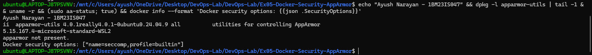

### 2. Check and load the AppArmor profile

The manual's Task 3 saves the profile in `/etc/apparmor.d/` and loads it with `apparmor_parser`. First I compiled both profiles without loading them (`-Q`), to check the syntax.

```bash
apparmor_parser -Q -K -T manual-apparmor-profile
apparmor_parser -Q -K -T my-apparmor-profile
sudo cp my-apparmor-profile /etc/apparmor.d/my-apparmor-profile
sudo apparmor_parser -r /etc/apparmor.d/my-apparmor-profile
```

```text
Cache read/write disabled: interface file missing. (Kernel needs AppArmor 2.4 compatibility patch.)
AppArmor parser error for manual-apparmor-profile in profile manual-apparmor-profile at line 15: Invalid perms, in deny rules 'x' must not be preceded by exec qualifier 'i', 'p', or 'u'
manual profile exit=1
Cache read/write disabled: interface file missing. (Kernel needs AppArmor 2.4 compatibility patch.)
my profile exit=0
Cache read/write disabled: interface file missing. (Kernel needs AppArmor 2.4 compatibility patch.)
Warning: unable to find a suitable fs in /proc/mounts, is it mounted?
Use --subdomainfs to override.
load exit=1
```

The manual's profile failed to compile: line 15, `deny /bin/** rmix`, is not allowed, because a deny rule can't use the `i` exec qualifier. My fixed profile compiled fine (exit 0). Loading it into the kernel failed, because there is no AppArmor filesystem (`securityfs`) to load it into. The "Cache read/write disabled" line is a warning that appears for the same reason.

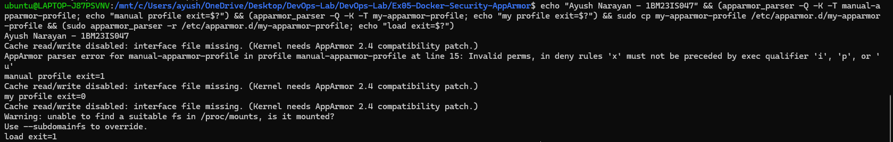

### 3. Build the Flask image

Task 2 containerises the Flask app as `flask-apparmor`.

```bash
docker build -t flask-apparmor .
docker images flask-apparmor
```

```text
[+] Building 15.6s (10/10) FINISHED                                  docker:default
 => [internal] load build definition from Dockerfile                           0.1s
 => => transferring dockerfile: 385B                                           0.0s
 => [internal] load metadata for docker.io/library/python:3.11-slim            2.6s
 => [auth] library/python:pull token for registry-1.docker.io                  0.0s
 => [1/4] FROM docker.io/library/python:3.11-slim@sha256:e88e9763f943ec1834f992a4b51e0f24500486803e8bc534e5767af9ea65f6ce  4.7s
 => [2/4] WORKDIR /app                                                         0.2s
 => [3/4] COPY app.py /app/                                                    0.1s
 => [4/4] RUN pip install --no-cache-dir flask                                 5.3s
 => exporting to image                                                         2.4s
 => => naming to docker.io/library/flask-apparmor:latest                       0.0s
 => => unpacking to docker.io/library/flask-apparmor:latest                    0.9s

IMAGE                   ID             DISK USAGE   CONTENT SIZE   EXTRA
flask-apparmor:latest   dcaf5eb62ac3        211MB         51.3MB
```

All 4 Dockerfile steps ran and the image `flask-apparmor:latest` (ID `dcaf5eb62ac3`, 211 MB) was created.

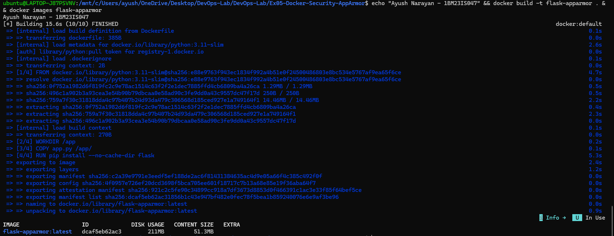

### 4. Run the container with the AppArmor profile

This is the manual's `docker run --security-opt="apparmor=my-apparmor-profile" -p 5000:5000 flask-apparmor`. I added `-d` and `--name` so I could test it afterwards.

```bash
docker run -d --name secure-flask --security-opt="apparmor=my-apparmor-profile" -p 5000:5000 flask-apparmor
curl -s localhost:5000
docker ps --filter name=secure-flask
```

```text
2d07f23339742b18ed4566220d867be2d836718717a92c394b38ed3eb908181d
Hello, this is a secure Flask application running inside a Docker container!
CONTAINER ID   IMAGE            COMMAND           CREATED         STATUS         PORTS                                         NAMES
2d07f2333974   flask-apparmor   "python app.py"   4 seconds ago   Up 3 seconds   0.0.0.0:5000->5000/tcp, [::]:5000->5000/tcp   secure-flask
```

Docker started the container with no error and the app answered on port 5000. Even though the profile was never loaded (step 2), Docker didn't complain.

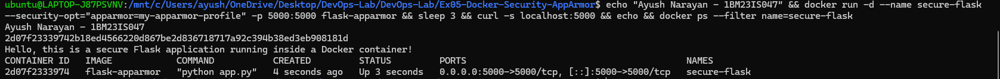

### 5. Run with a profile that doesn't exist

On a host with AppArmor, Docker refuses to start a container with an unknown profile. If it starts here, Docker isn't checking AppArmor at all.

```bash
docker run -d --name fake-profile --security-opt apparmor=does-not-exist flask-apparmor
docker ps --filter name=fake-profile
```

```text
d3d68a293b8e6b7a28ef5f52e6f4f7c4454b21d692b03a45233cfa9d9cda481d
CONTAINER ID   IMAGE            COMMAND           CREATED         STATUS         PORTS      NAMES
d3d68a293b8e   flask-apparmor   "python app.py"   3 seconds ago   Up 2 seconds   5000/tcp   fake-profile
```

The container started normally with a made-up profile name. Docker on this setup ignores the AppArmor option entirely.

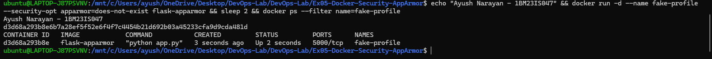

### 6. Compare the requested profile with the applied one

`docker inspect` has two fields: `HostConfig.SecurityOpt` is what was asked for, and `AppArmorProfile` is what the engine actually applied.

```bash
docker inspect secure-flask fake-profile --format '{{.Name}}  SecurityOpt={{json .HostConfig.SecurityOpt}}  AppArmorProfile="{{.AppArmorProfile}}"'
```

```text
/secure-flask  SecurityOpt=["apparmor=my-apparmor-profile"]  AppArmorProfile=""
/fake-profile  SecurityOpt=["apparmor=does-not-exist"]  AppArmorProfile=""
```

Both containers recorded the requested profile, but `AppArmorProfile` was empty for both. So the request was saved and never applied. Checking only `SecurityOpt`, as the manual's script does, would wrongly suggest the profile works.

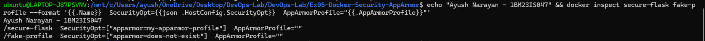

### 7. Try the restricted actions inside the container

This is the real test: read the AppArmor label of a process in the container, then try the two actions the profile is meant to block.

```bash
docker exec secure-flask cat /proc/self/attr/current
docker exec secure-flask head -3 /etc/passwd
docker exec secure-flask /bin/bash -c 'echo shell opened'
```

```text
cat: /proc/self/attr/current: Invalid argument
attr exit=1
root:x:0:0:root:/root:/bin/bash
daemon:x:1:1:daemon:/usr/sbin:/usr/sbin/nologin
bin:x:2:2:bin:/bin:/usr/sbin/nologin
passwd exit=0
shell opened
bash exit=0
```

`/proc/self/attr/current` normally shows the AppArmor profile, for example `my-apparmor-profile (enforce)`. Here it gave `Invalid argument`, because no AppArmor module is there to answer. `/etc/passwd` was readable and bash ran, both with exit 0. Under enforcement these would fail (exit 1 and 126).

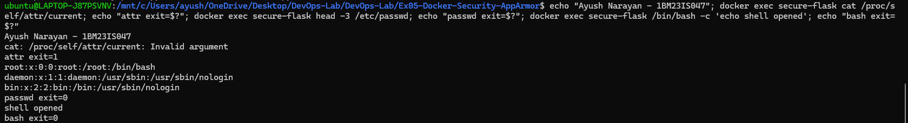

### 8. Apply the profile with the Docker SDK for Python

Task 4 does the same with Python: build the image, run it with `security_opt`, then inspect. Ubuntu 24.04 doesn't allow a global `pip install`, so I installed the SDK in a virtual environment.

```bash
python3 -m venv ~/ex05-venv
. ~/ex05-venv/bin/activate
pip install docker
python apply_apparmor.py
```

```text
Successfully installed certifi-2026.7.22 charset_normalizer-3.5.2 docker-7.2.0 idna-3.20 requests-2.34.2 urllib3-2.8.0
Building image from Dockerfile...
Running container with AppArmor profile...
Container started: e26f0fdb1d9d
Inspecting container to verify AppArmor profile...
SecurityOpt: ['apparmor=my-apparmor-profile']
AppArmorProfile:
Stopping the container...
Container stopped and removed
```

The SDK built the image, started the container, and read back `SecurityOpt: ['apparmor=my-apparmor-profile']`, which matches the manual's expected output. My script also prints `AppArmorProfile`, and it was empty, the same result as step 6.

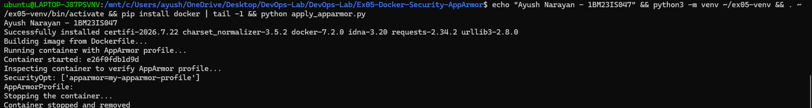

### 9. Test restricted actions with Python

Task 5 runs commands inside the container from Python and reports the exit codes.

```bash
python test_restricted_actions.py
```

```text
Container started: 80aa8245ea36
Attempt to read /etc/passwd: Exit Code 0 -> ALLOWED
   Output: root:x:0:0:root:/root:/bin/bash
daemon:x:1:1:daemon:/usr/sbin:/usr/sbin/nologin
bin:x:2:2:bin:/bin:/usr/sbin/nologin
sys
Attempt to execute /bin/bash: Exit Code 0 -> ALLOWED
   Output: shell opened
Attempt to read app file (allowed): Exit Code 0 -> ALLOWED
   Output: from flask import Flask

app = Flask(__name__)


@app.route('/')
def home():
    return "Hello, this is a secure Flask a
Container stopped
```

Both restricted actions were ALLOWED (exit 0). The manual expects exit 1 for `/etc/passwd` and 126 for `/bin/bash`, which only happens when AppArmor is enforced. The third test (reading the app's own file) is a control, and it should be allowed in both cases. The output is cut at 120 characters by the script.

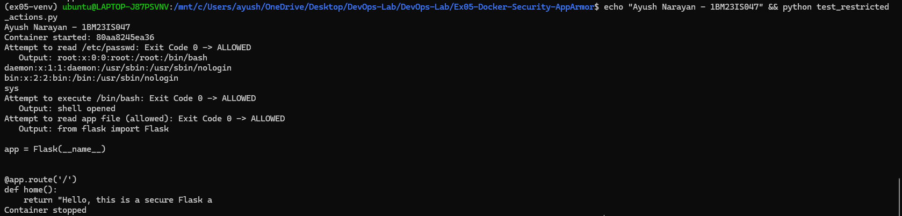

### 10. Harden the container with options that do work

Since AppArmor isn't available, I used three Docker options that the WSL2 kernel does enforce: a read-only root filesystem, no Linux capabilities, and no privilege escalation.

```bash
docker run -d --name hardened-flask --read-only --cap-drop ALL --security-opt no-new-privileges -p 5000:5000 flask-apparmor
curl -s localhost:5000
docker exec hardened-flask touch /test
docker exec hardened-flask chown nobody /app/app.py
docker exec hardened-flask grep -E 'CapEff|NoNewPrivs' /proc/self/status
```

```text
4b7067b6129c499a3a7dcee1f45e44449f4227346744e5df4cff689ab9a42b74
Hello, this is a secure Flask application running inside a Docker container!
touch: cannot touch '/test': Read-only file system
touch exit=1
chown: changing ownership of '/app/app.py': Read-only file system
chown exit=1
CapEff: 0000000000000000
NoNewPrivs:     1
```

The app still served its page. Writing a new file failed with `Read-only file system`. `chown` on `app.py` also failed with `Read-only file system`, because the read-only mount blocked it before any capability check. `CapEff: 0000000000000000` shows the process had no effective capabilities, and `NoNewPrivs: 1` shows it can never gain more.

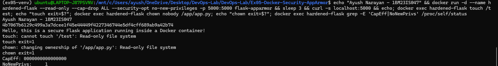

### 11. Prove the capabilities are dropped

To test capabilities on their own, I used `/dev`, which is a separate writable tmpfs even with `--read-only`. I compared it with a container that keeps Docker's default capabilities.

```bash
docker exec hardened-flask chown nobody /dev/null
docker exec hardened-flask sh -c 'mount | grep " /dev "'
docker run --rm --read-only flask-apparmor sh -c 'chown nobody /dev/null; echo "exit=$?"; grep CapEff /proc/self/status'
```

```text
--- with --cap-drop ALL:
chown: changing ownership of '/dev/null': Operation not permitted
exit=1
tmpfs on /dev type tmpfs (rw,nosuid,size=65536k,mode=755)
--- default capabilities (also --read-only):
exit=0
CapEff: 00000000a80425fb
```

`/dev` was mounted `rw`, so the filesystem allowed the change. `chown` still failed with `Operation not permitted`, because `CAP_CHOWN` was dropped. With default capabilities, the same command worked (exit 0), and `CapEff` was `00000000a80425fb` instead of all zeros.

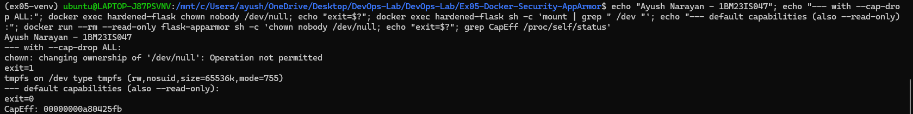

### 12. Check the hardening in docker inspect

The applied settings can be read back from `docker inspect`, the same way the AppArmor option was checked.

```bash
docker inspect hardened-flask --format 'ReadonlyRootfs={{.HostConfig.ReadonlyRootfs}}  CapDrop={{json .HostConfig.CapDrop}}  SecurityOpt={{json .HostConfig.SecurityOpt}}  AppArmorProfile="{{.AppArmorProfile}}"'
```

```text
ReadonlyRootfs=true  CapDrop=["ALL"]  SecurityOpt=["no-new-privileges"]  AppArmorProfile=""
```

All three settings were recorded, and steps 10 and 11 proved they were also enforced. `AppArmorProfile` stayed empty, as expected on this setup.

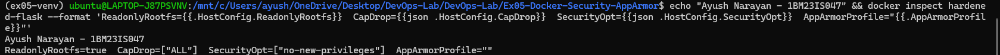

### 13. Clean up

I removed the test containers so the next exercise starts clean.

```bash
docker rm -f hardened-flask
```

```text
hardened-flask
```

`secure-flask` and `fake-profile` had already been removed with `docker rm -f secure-flask fake-profile` before step 8, to free port 5000 for the SDK scripts. The SDK scripts remove their own containers.

## How It Works

How AppArmor is supposed to work with Docker:

```text
my-apparmor-profile (text)
      |  sudo apparmor_parser -r
      v
kernel AppArmor module  <-- profile compiled and loaded
      |
docker run --security-opt apparmor=my-apparmor-profile
      |
      v
dockerd --> runc --> writes "my-apparmor-profile" to /proc/<pid>/attr/exec
      |
      v
container process confined: every file open / exec checked by the kernel
      cat /etc/passwd  -> Permission denied (exit 1)
      /bin/bash        -> Permission denied (exit 126)
```

What happened on WSL2 + Docker Desktop:

```text
apparmor_parser -r  --> no AppArmor fs in the kernel --> load failed
docker run --security-opt apparmor=...  --> engine has no AppArmor support
      |                                     --> option only stored in HostConfig
      v
container runs unconfined (AppArmorProfile = "", attr/current = Invalid argument)
      cat /etc/passwd  -> allowed (exit 0)
      /bin/bash        -> allowed (exit 0)
```

- AppArmor is a Linux Security Module (LSM). It lives in the kernel, and `apparmor-utils` only provides the tools to manage it.
- A profile has to be loaded into the kernel before Docker can attach it to a container. After that, the kernel checks every file access and program start against it.
- On WSL2 the kernel runs without the AppArmor LSM, so loading failed. Docker Desktop's engine doesn't support AppArmor, so it stored the option and ignored it, even for a profile that doesn't exist.
- `docker inspect` → `HostConfig.SecurityOpt` only shows what was requested. `AppArmorProfile` and `/proc/self/attr/current` show what was really applied.
- `--read-only`, `--cap-drop ALL` and `no-new-privileges` use mount flags, capabilities and the `no_new_privs` process flag. These are core kernel features that WSL2 has, so they were enforced.

## Key Configuration

my-apparmor-profile
- `profile my-apparmor-profile flags=(attach_disconnected,mediate_deleted)`: names the profile so `--security-opt apparmor=my-apparmor-profile` can find it. The flags are the same ones Docker's default profile uses, needed for container paths. **Manual bug:** the manual writes `/usr/bin/python3 { ... }`, which creates a profile called `/usr/bin/python3`, so Docker could never find `my-apparmor-profile`.
- `#include <abstractions/base>`, `network inet tcp`/`udp` (and inet6), `file,`, `umount,`, `signal` rules: the baseline. AppArmor denies everything not allowed, so without these Python and Flask couldn't start. `file,` allows normal file access, and the `deny` rules below take away the sensitive parts. **Manual bug:** the manual has no baseline.
- `deny /etc/passwd r`, `deny /etc/shadow rw`, `deny /etc/group r`: block reading user and password files.
- `deny /bin/bash mx`, `deny /usr/bin/bash mx`, `/bin/sh`, `/bin/dash` and so on: block starting shells (`x`) and mapping them as executable (`m`). Both `/bin` and `/usr/bin` are listed, because `/bin` is a link to `/usr/bin` in Debian images. **Manual bugs:** the manual's `deny /bin/** rmix` is rejected by the parser (step 2: `in deny rules 'x' must not be preceded by exec qualifier 'i'`), and denying all of `/bin/**` and `/usr/bin/**` would also block `python` and `cat`. That would stop the app itself.
- `deny /proc/sys/** w`, `deny /sys/** w`: no writing to kernel settings.
- `capability net_bind_service, setuid, setgid, chown, dac_override` + `deny capability sys_admin` + `deny mount`: allow only a few capabilities and explicitly block the powerful `sys_admin` and mounting.

Dockerfile
- `FROM python:3.11-slim`: the manual uses `python:3.8-slim`. Python 3.8 is end-of-life, so I used 3.11.
- `COPY app.py /app/`: the manual's `COPY . /app` would copy the profiles, scripts and screenshots into the image as well.
- `RUN pip install --no-cache-dir flask`, `EXPOSE 5000`, `CMD ["python", "app.py"]`: install Flask without keeping the download cache, document the port, start the app.

app.py
- `app.run(host='0.0.0.0', port=5000)`: listen on all interfaces so `-p 5000:5000` can reach it.

apply_apparmor.py
- `client.images.build(path=".", tag=IMAGE)` and `client.containers.run(..., security_opt=[f"apparmor={PROFILE}"], detach=True)`: the SDK versions of `docker build` and `docker run --security-opt`.
- `client.api.inspect_container(...)['HostConfig']['SecurityOpt']`: the check from the manual. I also print `AppArmorProfile`, because `SecurityOpt` alone can't tell requested from applied (step 6). The container is removed at the end so the scripts can run again without a name or port conflict.

test_restricted_actions.py
- `container.exec_run(cmd)` returns `(exit_code, output)`. The script runs each test, prints `BLOCKED` for a non-zero exit and `ALLOWED` for zero, and adds a control test (`cat /app/app.py`) that should always be allowed.

Hardening options
- `--read-only`: mounts the container's root filesystem read-only. `/dev` and similar special mounts stay writable.
- `--cap-drop ALL`: removes every Linux capability, so even root in the container can't `chown`, bind low ports, change the clock and so on.
- `--security-opt no-new-privileges`: sets `no_new_privs`, so setuid programs can't give the process more rights.

## Commands Used

```bash
sudo apt-get update
sudo apt-get install apparmor-utils
dpkg -l apparmor-utils | tail -1
uname -r
sudo aa-status
docker info --format 'Docker security options: {{json .SecurityOptions}}'
apparmor_parser -Q -K -T manual-apparmor-profile
apparmor_parser -Q -K -T my-apparmor-profile
sudo cp my-apparmor-profile /etc/apparmor.d/my-apparmor-profile
sudo apparmor_parser -r /etc/apparmor.d/my-apparmor-profile
docker build -t flask-apparmor .
docker images flask-apparmor
docker run -d --name secure-flask --security-opt="apparmor=my-apparmor-profile" -p 5000:5000 flask-apparmor
curl -s localhost:5000
docker ps --filter name=secure-flask
docker run -d --name fake-profile --security-opt apparmor=does-not-exist flask-apparmor
docker inspect secure-flask fake-profile --format '{{.Name}}  SecurityOpt={{json .HostConfig.SecurityOpt}}  AppArmorProfile="{{.AppArmorProfile}}"'
docker exec secure-flask cat /proc/self/attr/current
docker exec secure-flask head -3 /etc/passwd
docker exec secure-flask /bin/bash -c 'echo shell opened'
docker rm -f secure-flask fake-profile
python3 -m venv ~/ex05-venv
. ~/ex05-venv/bin/activate
pip install docker
python apply_apparmor.py
python test_restricted_actions.py
docker run -d --name hardened-flask --read-only --cap-drop ALL --security-opt no-new-privileges -p 5000:5000 flask-apparmor
docker exec hardened-flask touch /test
docker exec hardened-flask chown nobody /app/app.py
docker exec hardened-flask grep -E 'CapEff|NoNewPrivs' /proc/self/status
docker exec hardened-flask chown nobody /dev/null
docker exec hardened-flask sh -c 'mount | grep " /dev "'
docker run --rm --read-only flask-apparmor sh -c 'chown nobody /dev/null; echo "exit=$?"; grep CapEff /proc/self/status'
docker inspect hardened-flask --format 'ReadonlyRootfs={{.HostConfig.ReadonlyRootfs}}  CapDrop={{json .HostConfig.CapDrop}}  SecurityOpt={{json .HostConfig.SecurityOpt}}  AppArmorProfile="{{.AppArmorProfile}}"'
docker rm -f hardened-flask
```

## Problems Faced

- **AppArmor not available.** `sudo aa-status` said `apparmor not present`, `docker info` listed only seccomp, and `apparmor_parser -r` failed with `unable to find a suitable fs in /proc/mounts`. The WSL2 kernel runs without the AppArmor module, so the profile could not be enforced on this machine. I ran every task anyway, proved the non-enforcement (steps 5–9), and added hardening that does work (steps 10–12).
- **The manual's profile does not compile.** `apparmor_parser` rejected it at line 15 (`deny /bin/** rmix`). It is also attached to the path `/usr/bin/python3` instead of the name Docker uses, and it has no baseline rules. I fixed all of these in `my-apparmor-profile` (see Key Configuration) and kept the original as `manual-apparmor-profile`.
- **`chown` in the hardened container failed for the wrong reason.** In step 10, `chown` on `/app/app.py` failed with `Read-only file system`, so it didn't show that capabilities were dropped. I ran `chown` on `/dev/null` instead, on a writable tmpfs, and compared it with a container that has default capabilities (step 11).

## Result

All five tasks from the manual were completed: the Flask app was built into `flask-apparmor`, the AppArmor profile was written and checked, and the container was run with `--security-opt apparmor=my-apparmor-profile` from both the CLI and the Docker SDK for Python. On WSL2 + Docker Desktop the profile was accepted but not enforced (`AppArmorProfile=""`, `/etc/passwd` readable, bash allowed), because the kernel has no AppArmor. The container was secured with `--read-only`, `--cap-drop ALL` and `no-new-privileges` instead, and all three were shown to be enforced.
