# Exercise 6 – Real-Time Operations Monitoring and Alerting

## Objective

Build a monitoring setup for a delivery service. A Python app simulates delivery metrics, Prometheus collects them and checks alert rules, and Grafana shows them on a live dashboard. Then a Jenkins pipeline builds and starts the whole stack automatically.

## Use Case

I am a DevOps engineer at ZAPPTTO, a fast quick-commerce delivery service. The team needs real-time insight into how many deliveries are total, pending and on the way, and how long they take. They also need automatic alerts when pending deliveries pile up or deliveries get slow, so problems are caught quickly.

## Architecture

Part A, the manual run (as in the manual, adapted for Docker Desktop):

```text
                              Chrome on Windows
            :8000/metrics          |  :9090 (UI)        |  :3000 (UI)
                 |                 v                    v
+----------------|---------------------------------------------------------------+
| WSL2 Ubuntu    v                                                               |
|  delivery_metrics.py  (venv, prometheus-client)                                |
|  start_http_server(8000)  --> /metrics                                         |
+--------------------------------------^-----------------------------------------+
                                       | scrape every 15 s
                                       | http://host.docker.internal:8000/metrics
+--------------------------------------|-----------------------------------------+
| Docker Desktop                       |                                         |
|   +-----------------------------+    |      +------------------------------+   |
|   | prometheus  (-p 9090:9090)  |----+      | grafana  (-p 3000:3000)      |   |
|   |  prometheus.yml             |<----------|  data source:                |   |
|   |  alert_rules.yml -> alerts  |  PromQL   |  http://host.docker.internal |   |
|   +-----------------------------+  queries  |  :9090                       |   |
|                                             +------------------------------+   |
+--------------------------------------------------------------------------------+
```

Part B, the Jenkins pipeline:

```text
GitHub: marvelayush/DevOps-Lab  (Jenkinsfile, Dockerfile, Dockerfile.prometheus, configs)
      |  Checkout SCM
      v
+----------------- jenkins container (-u root) -----------------+
| pipeline stages: Pre-check Docker -> Cleanup -> Build Images  |
|                  -> Run Application -> Run Prometheus & Grafana|
|                  -> Verify                                     |
| docker CLI  --/var/run/docker.sock-->  Docker Desktop engine   |
+----------------------------------------------------------------+
                         | starts
          +--------------+------------------+---------------------+
          v                                 v                     v
  delivery_metrics :8000  <--scrape--  prometheus :9090  <--  grafana :3000
  (image: delivery_metrics)     (image: delivery_prometheus,    (dashboard re-imported
                                 config baked in)                from grafana-dashboard.json)
```

## Environment

- Windows 11 Home + WSL2 Ubuntu 24.04.2 LTS
- Docker Desktop (Engine 29.4.1)
- Python 3.12 venv in WSL, `prometheus-client` 0.26.0 (app image: `python:3.11-slim`)
- Prometheus 3.15.0 (`prom/prometheus`)
- Grafana v13.2.4 (`grafana/grafana`)
- Jenkins 2.580.1 (`jenkins/jenkins:lts`, Debian 13, Java 21), Docker CLI 26.1.5 (API 1.45) inside it

## Project Structure

```text
Ex06-Prometheus-Grafana-Monitoring/
├── delivery_metrics.py      # simulates deliveries, exposes metrics on :8000/metrics
├── prometheus.yml           # Prometheus scrape config (targets host.docker.internal:8000)
├── alert_rules.yml          # HighPendingDeliveries + HighAverageDeliveryTime alerts
├── Dockerfile               # image for the metrics app (used by Jenkins)
├── Dockerfile.prometheus    # Prometheus image with both config files baked in (used by Jenkins)
├── Jenkinsfile              # pipeline: check Docker, build, run app, run Prometheus & Grafana, verify
├── grafana-dashboard.json   # exported "ZAPPTTO Delivery Monitoring" dashboard, re-importable
├── README.md
└── screenshots/             # 01 ... 22
```

Source: [delivery_metrics.py](delivery_metrics.py) · [prometheus.yml](prometheus.yml) · [alert_rules.yml](alert_rules.yml) · [Dockerfile](Dockerfile) · [Dockerfile.prometheus](Dockerfile.prometheus) · [Jenkinsfile](Jenkinsfile) · [grafana-dashboard.json](grafana-dashboard.json)

## Steps

### Part A – Metrics, Prometheus, Grafana and alerts

### 1. Install the Prometheus client library

The Python app needs `prometheus-client` to publish metrics. I first ran the manual's command as written.

```bash
pip3 install prometheus-client
python3 -m venv ~/ex06-venv
. ~/ex06-venv/bin/activate
pip install prometheus-client
pip show prometheus-client
```

```text
error: externally-managed-environment

× This environment is externally managed
╰─> To install Python packages system-wide, try apt install
pip3 exit=1
Successfully installed prometheus-client-0.26.0
Name: prometheus_client
Version: 0.26.0
```

Ubuntu 24.04 blocks system-wide `pip` installs (PEP 668), so the manual's command failed. Inside a virtual environment, `prometheus-client` 0.26.0 installed normally. In the screenshot, a `BrokenPipeError` appears after `pip show`, because `head -2` closed the pipe early. It's harmless.

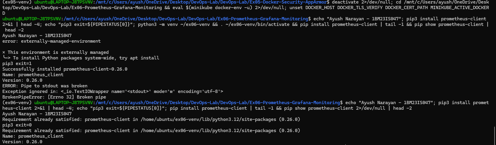

### 2. Run the delivery simulator

The script starts a small web server on port 8000 and, every second, makes up new delivery numbers. I ran it in its own window because it never stops.

```bash
python3 delivery_metrics.py
```

```text
[INFO] Starting the HTTP server on port 8000...
[INFO] HTTP server started. Simulating deliveries...
[DEBUG] Total deliveries: 49
[DEBUG] Pending deliveries: 13
[DEBUG] On-the-way deliveries: 5
[DEBUG] Average delivery time: 34.37 seconds
[INFO] Sleeping for 1 seconds...
[DEBUG] Total deliveries: 81
[DEBUG] Pending deliveries: 12
[DEBUG] On-the-way deliveries: 7
[DEBUG] Average delivery time: 36.14 seconds
[INFO] Sleeping for 1 seconds...
```

Each block is one simulated snapshot. Pending is between 10 and 20, so it is usually above the alert threshold of 10.

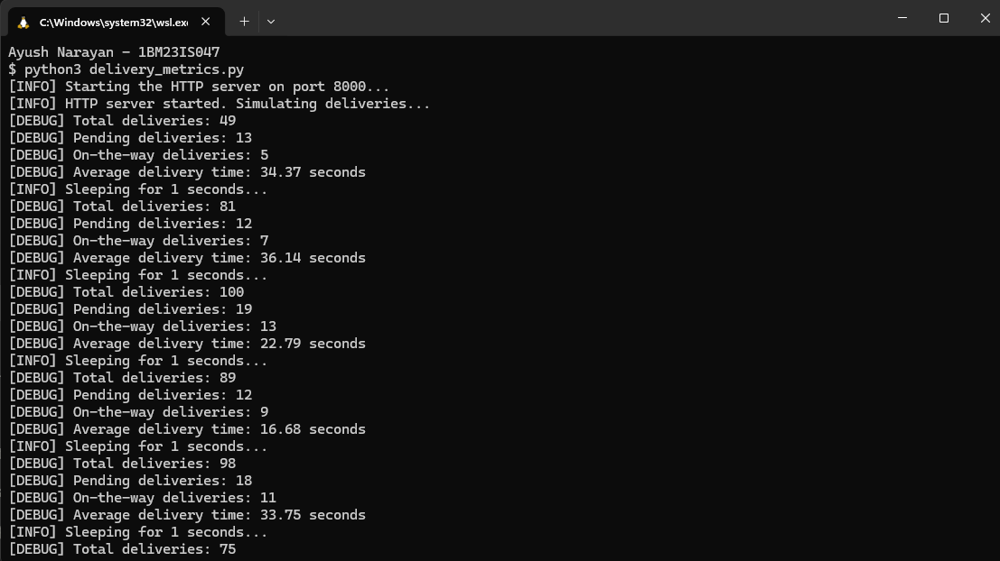

### 3. Read the metrics endpoint

`/metrics` is what Prometheus will read. The library creates it automatically.

```bash
curl -s http://localhost:8000/metrics | grep -E '^# (HELP|TYPE) (total|pending|on_the_way|average)|^(total|pending|on_the_way|average)'
```

```text
# HELP total_deliveries Total number of deliveries
# TYPE total_deliveries gauge
total_deliveries 79.0
# HELP pending_deliveries Number of pending deliveries
# TYPE pending_deliveries gauge
pending_deliveries 13.0
# HELP on_the_way_deliveries Number of deliveries on the way
# TYPE on_the_way_deliveries gauge
on_the_way_deliveries 6.0
# HELP average_delivery_time Average delivery time in seconds
# TYPE average_delivery_time summary
average_delivery_time_count 157.0
average_delivery_time_sum 4705.7379324240355
# HELP average_delivery_time_created Average delivery time in seconds
# TYPE average_delivery_time_created gauge
average_delivery_time_created 1.7923403793699152e+09
```

Every metric has a `HELP` line (description) and a `TYPE` line. The three gauges show the current value. The summary `average_delivery_time` has a `_count` (157 observations so far) and a `_sum` (4705.7 s), and their ratio is the average, about 29.97 s.

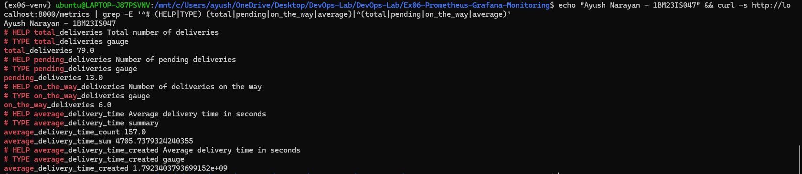

### 4. Check how containers reach the host on Docker Desktop

The manual points Prometheus and Grafana at `172.17.0.1`, the `docker0` bridge on native Linux. I checked whether that exists here, and what works instead.

```bash
ip addr show docker0
docker run --rm python:3.11-slim getent hosts host.docker.internal
docker run --rm curlimages/curl -s http://host.docker.internal:8000/metrics | grep '^pending'
```

```text
Device "docker0" does not exist.
fdc4:f303:9324::254 host.docker.internal
pending_deliveries 18.0
```

WSL has no `docker0`, because Docker Desktop's engine runs in its own VM. Inside a container, the name `host.docker.internal` resolves to the host. A container fetched the app's `/metrics` through it. So `host.docker.internal` replaces `172.17.0.1` everywhere in this exercise.

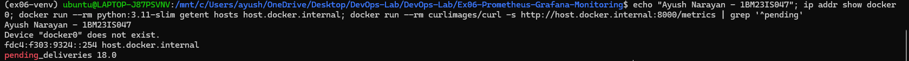

### 5. Check the Prometheus configuration

Before starting Prometheus, I validated both config files with `promtool`, which ships in the Prometheus image.

```bash
docker run --rm -v ./prometheus.yml:/etc/prometheus/prometheus.yml -v ./alert_rules.yml:/etc/prometheus/alert_rules.yml --entrypoint promtool prom/prometheus check config /etc/prometheus/prometheus.yml
```

```text
  SUCCESS: 1 rule files found
 SUCCESS: /etc/prometheus/prometheus.yml is valid prometheus config file syntax

Checking /etc/prometheus/alert_rules.yml
  SUCCESS: 2 rules found
```

The scrape config was valid, and it found the rule file with both alert rules.

### 6. Run Prometheus

This is the manual's `docker run` with both config files mounted. I used `-p 9090:9090` instead of `--network=host`, because host networking doesn't work the Linux way on Docker Desktop.

```bash
docker run -d --name prometheus -p 9090:9090 -v ./prometheus.yml:/etc/prometheus/prometheus.yml -v ./alert_rules.yml:/etc/prometheus/alert_rules.yml prom/prometheus
docker ps -a | grep prom
```

```text
7430f8aef313e492e40e8ef2ad5a957de84fa3eed415b428fdac9bdc722ef530
7430f8aef313   prom/prometheus   "/bin/prometheus --c…"   4 seconds ago   Up 3 seconds   0.0.0.0:9090->9090/tcp, [::]:9090->9090/tcp   prometheus
```

Prometheus was up, with its web UI published on port 9090.

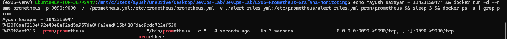

### 7. Verify the scrape targets

**Status → Target health** shows whether Prometheus can actually read each endpoint.

```text
http://localhost:9090/targets

delivery_service   http://host.docker.internal:8000/metrics   instance="host.docker.internal:8000" job="delivery_service"   UP   (12ms)
prometheus         http://localhost:9090/metrics              instance="localhost:9090" job="prometheus"                     UP   (5ms)
```

Both targets were **UP**: the delivery app through `host.docker.internal`, and Prometheus scraping itself.

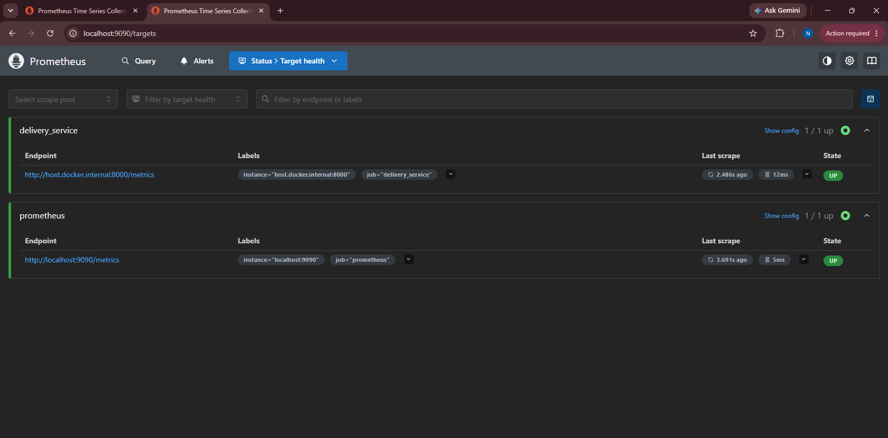

### 8. Query a metric

The manual's expected output includes Prometheus graphs. I queried `pending_deliveries` over the last 5 minutes.

```text
http://localhost:9090/query   expr: pending_deliveries   tab: Graph   range: 5m
pending_deliveries{instance="host.docker.internal:8000", job="delivery_service"}
values between 10 and 20, e.g. 16 at 2026-10-18T16:36:04Z
```

The graph moves in steps every 15 seconds. That's the scrape interval: Prometheus only sees the value at each scrape, not every change the app makes each second.

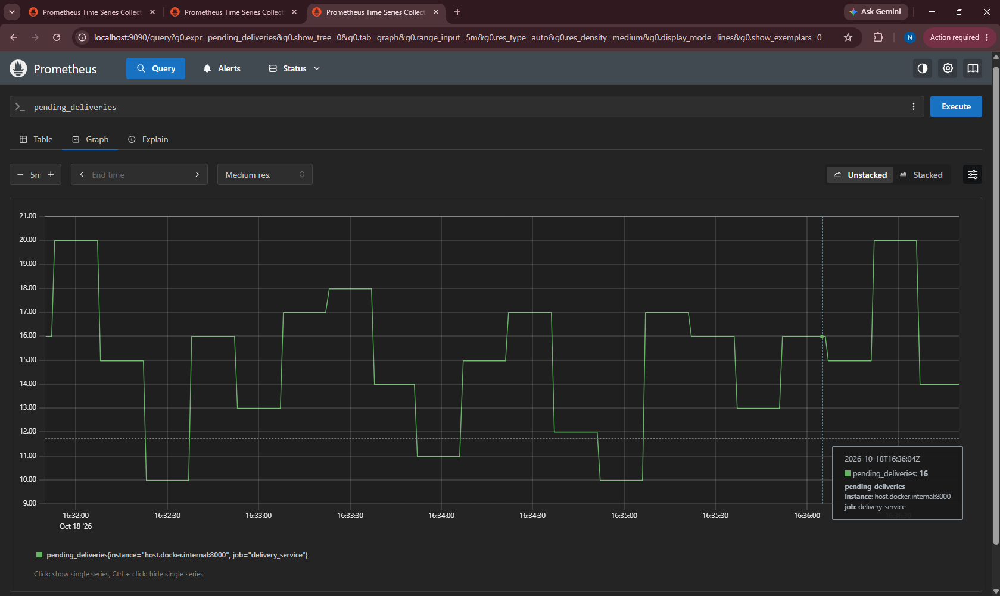

### 9. Check the alerts

The Alerts page shows each rule from `alert_rules.yml` and its state.

```text
http://localhost:9090/alerts        delivery_alerts  /etc/prometheus/alert_rules.yml   FIRING (2)

HighPendingDeliveries     pending_deliveries > 10                                          for: 15s  severity="warning"
  FIRING   active since 3m 19.81s   value 20
HighAverageDeliveryTime   (average_delivery_time_sum / average_delivery_time_count) > 30   for: 15s  severity="critical"
  FIRING   active since 3m 21.024s  value 30.115591106427427
```

Both alerts were **FIRING**: pending was 20 (above 10), and the running average was 30.12 s (just above 30). Each alert carries its labels and the description and summary from the rule file.

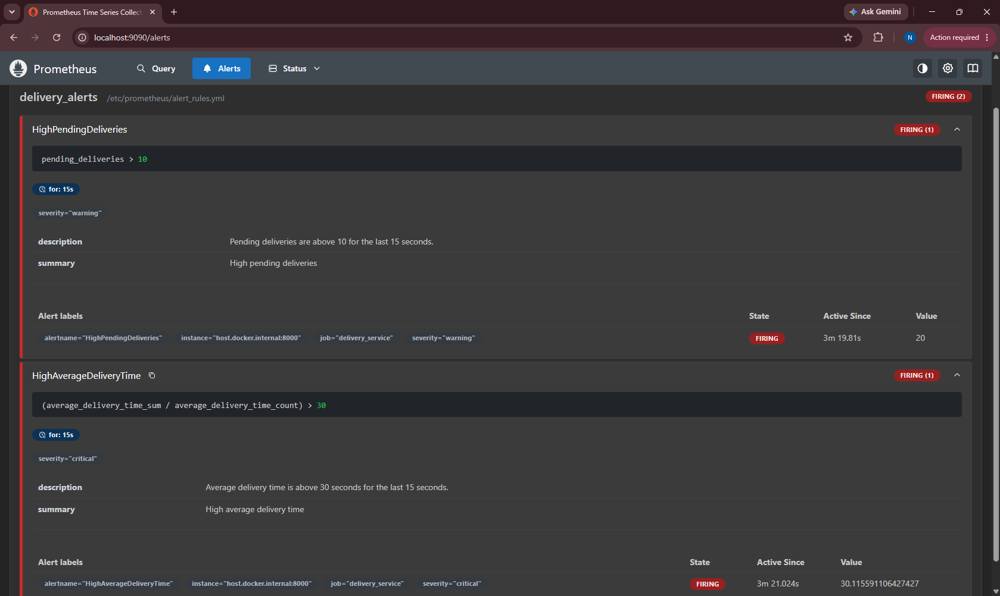

### 10. Run Grafana

Grafana draws dashboards from Prometheus data. Manual Step 3 starts it on port 3000.

```bash
docker run -d --name grafana -p 3000:3000 grafana/grafana
docker ps --filter name=grafana --filter name=prometheus
```

```text
Status: Downloaded newer image for grafana/grafana:latest
26153ed69b5e92083cb988a515cb036c6423e87ed1de59543ee1ce06aff83805
CONTAINER ID   IMAGE             COMMAND                  CREATED          STATUS          PORTS                                         NAMES
26153ed69b5e   grafana/grafana   "/run.sh"                9 seconds ago    Up 8 seconds    0.0.0.0:3000->3000/tcp, [::]:3000->3000/tcp   grafana
7430f8aef313   prom/prometheus   "/bin/prometheus --c…"   11 minutes ago   Up 11 minutes   0.0.0.0:9090->9090/tcp, [::]:9090->9090/tcp   prometheus
```

Both containers were running. The manual's `ip addr show docker0` step isn't needed here, because step 4 already showed there's no `docker0`.

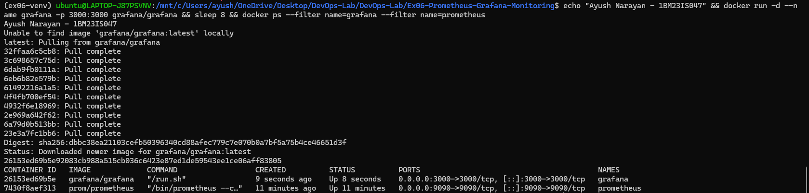

I opened `http://localhost:3000`, logged in with `admin` / `admin` and skipped the password change, as the manual says.

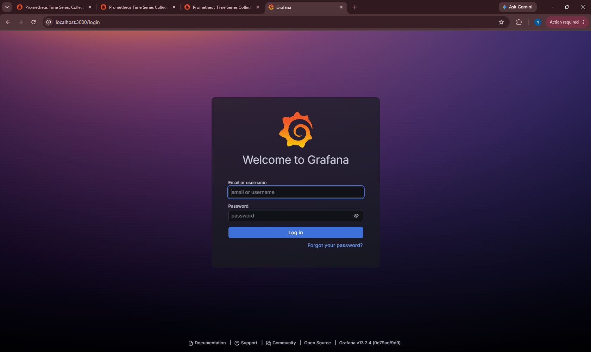

### 11. Add Prometheus as a data source

Grafana needs to know where Prometheus is. Inside the Grafana container, `localhost` would mean Grafana itself, and `172.17.0.1` doesn't exist, so I used `host.docker.internal`.

```text
Connections → Data sources → Add new data source → Prometheus
Name: prometheus
Prometheus server URL: http://host.docker.internal:9090
Authentication: No Authentication
Save & test → "Successfully queried the Prometheus API."
```

The green message means Grafana reached Prometheus and ran a test query.

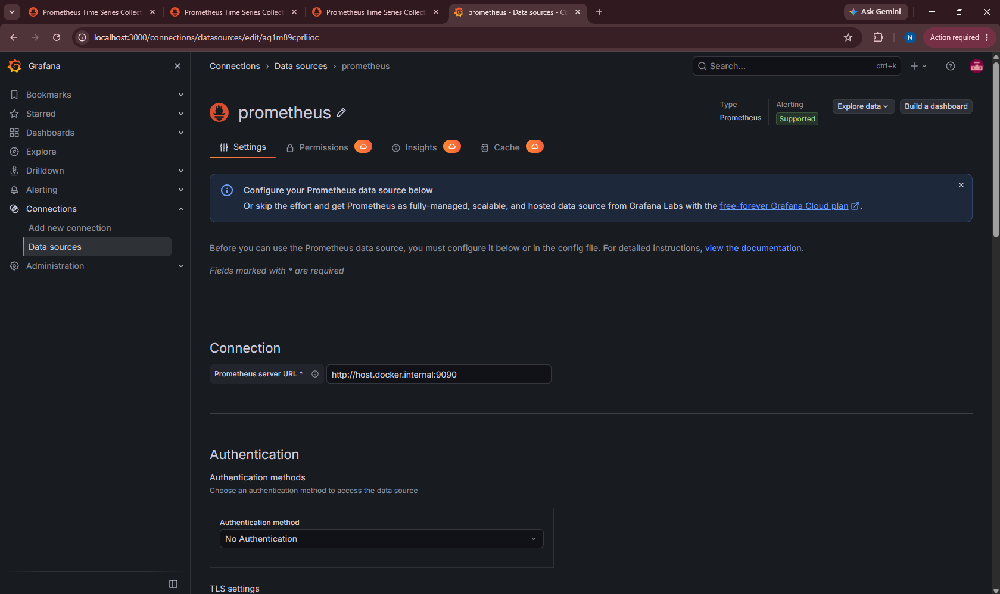

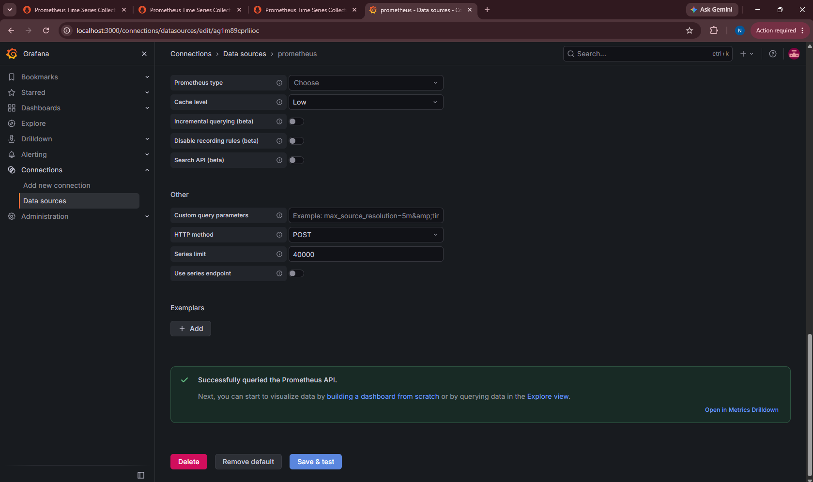

### 12. Build the delivery dashboard

The manual asks for 4 panels. I used **Stat** panels with a sparkline (Graph mode: Area), so each one shows the current number big plus its recent trend. Thresholds match the alerts.

| Panel | PromQL query | Settings |
|---|---|---|
| Total Deliveries | `total_deliveries` | blue base color |
| Pending Deliveries | `pending_deliveries` | red from 10 (same as the alert) |
| On-the-Way Deliveries | `on_the_way_deliveries` | default thresholds |
| Average Delivery Time (s) | `average_delivery_time_sum / average_delivery_time_count` | unit seconds, 2 decimals, red from 30 |

The panel editor for the Average panel showed the query in Code mode, Stat with "From thresholds" colors, and the red step at 30:

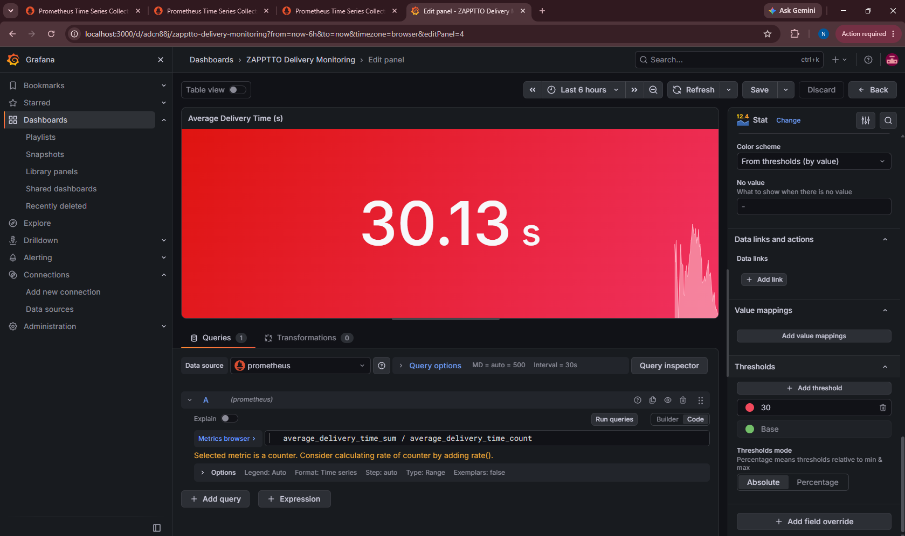

The saved dashboard, **ZAPPTTO Delivery Monitoring**, used the last 15 minutes and refreshed every 5 s:

```text
Total Deliveries 79 (blue) | Pending Deliveries 13 (red, > 10)
On-the-Way Deliveries 5 (green) | Average Delivery Time 30.09 s (red, > 30)
```

Pending and Average were red because both were over their alert thresholds, which matches the FIRING alerts in step 9.

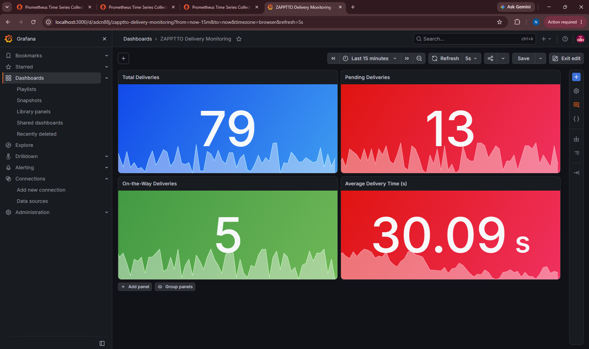

I then exported the dashboard to [`grafana-dashboard.json`](grafana-dashboard.json), using Grafana's HTTP API in "share externally" form. The data source is replaced by an input (`${DS_PROMETHEUS}`), so the file can be imported into any Grafana (step 20).

### 13. Simulate alerts (manual Step 6)

The manual raises the pending range so the alert clearly fires, then restarts the script and Prometheus.

```python
pending = random.randint(50, 100)  # Step 6: increase range to exceed alert threshold
```

```bash
grep -n "randint(50, 100)" delivery_metrics.py
docker restart prometheus
curl -s localhost:8000/metrics | grep '^pending'
```

```text
14:    pending = random.randint(50, 100)  # Step 6: increase range to exceed alert threshold
prometheus
pending_deliveries 76.0
```

The script window now showed pending values like 77, 55, 86 and 83, and the endpoint gave 76.

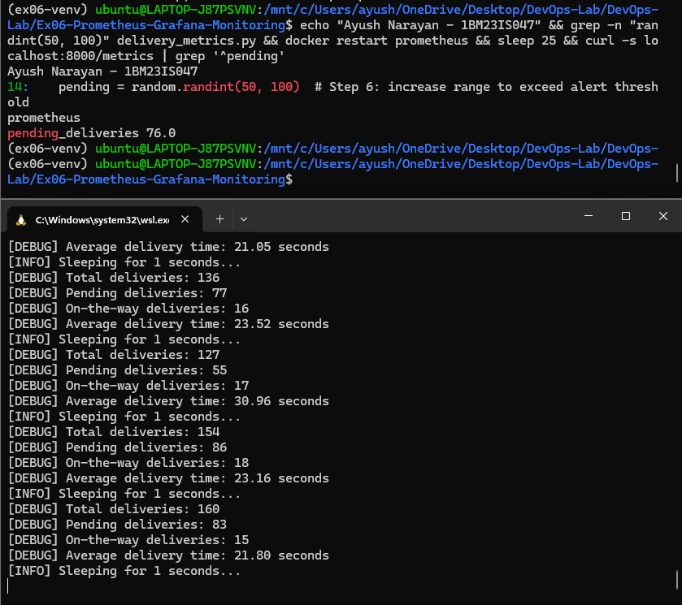

```text
http://localhost:9090/alerts        delivery_alerts   FIRING (1)  INACTIVE (1)

HighPendingDeliveries     FIRING    active since 3m 28.068s   value 99
HighAverageDeliveryTime   INACTIVE
```

`HighPendingDeliveries` fired with a value of 99. `HighAverageDeliveryTime` went **INACTIVE**: restarting the script reset its Summary, and the new running average happened to be under 30. That gave a natural mixed state.

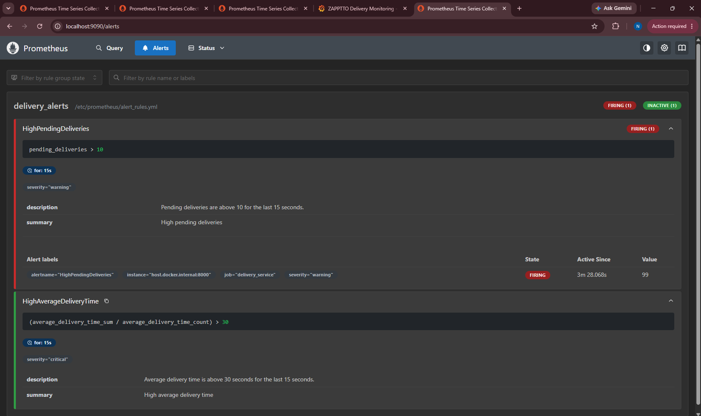

```text
Total Deliveries 158 | Pending Deliveries 82 | On-the-Way Deliveries 6 | Average Delivery Time 29.46 s (green)
```

On the dashboard, the Pending sparkline jumped from the 10–20 band to 50–100, and Average dropped below 30 and turned green. Afterwards I set the range back to `randint(10, 20)`, so the committed code is the normal version.

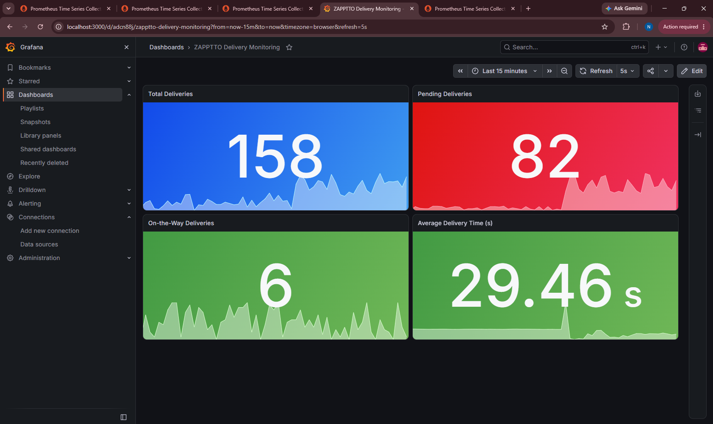

### Part B – Jenkins pipeline

### 14. Start Jenkins with Docker access

Manual Step 5 runs Jenkins in Docker. The pipeline runs `docker` commands, so Jenkins also needs the Docker socket and a Docker CLI. I first checked for an old Jenkins container (manual Step 5a).

```bash
docker ps -a | grep jenkins
docker run -d -p 8080:8080 -p 50000:50000 --name jenkins -u root -v jenkins_home:/var/jenkins_home -v /var/run/docker.sock:/var/run/docker.sock jenkins/jenkins:lts
docker ps --filter name=jenkins
docker exec jenkins bash -c "apt-get update -qq && apt-get install -y -qq docker.io > /dev/null"
docker exec jenkins docker version --format 'Jenkins docker client {{.Client.Version}} (API {{.Client.APIVersion}}) -> server {{.Server.Version}}'
```

```text
(no old jenkins container)
f7f39778ddf67daeb2063c079bf18ec2c12851f6a4e84aa35b21be188fecccee
CONTAINER ID   IMAGE                 COMMAND                  CREATED         STATUS         PORTS                                                                                      NAMES
f7f39778ddf6   jenkins/jenkins:lts   "/usr/bin/tini -- /u…"   6 seconds ago   Up 5 seconds   0.0.0.0:8080->8080/tcp, [::]:8080->8080/tcp, 0.0.0.0:50000->50000/tcp, [::]:50000->50000/tcp   jenkins
debconf: unable to initialize frontend: Dialog
debconf: falling back to frontend: Noninteractive
Jenkins docker client 26.1.5+dfsg1 (API 1.45) -> server 29.4.1
```

Jenkins was up on 8080 (web UI) and 50000 (agents). The `debconf` lines only mean apt had no interactive screen. The Docker CLI inside Jenkins (26.1.5, API 1.45) could talk to the host engine 29.4.1 through the mounted socket.

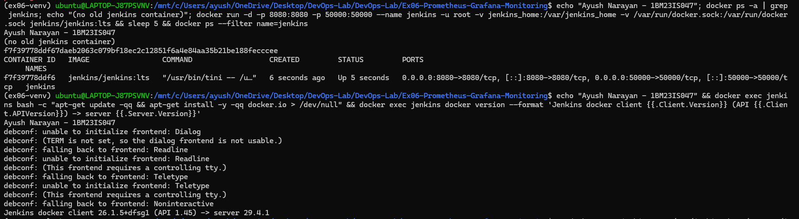

### 15. Unlock and set up Jenkins

For first-time access, Jenkins asks for the initial admin password. The manual's `sudo cat /var/lib/jenkins/...` path is for a package install. In the Docker image, the file is under `/var/jenkins_home`.

```bash
docker exec jenkins cat /var/jenkins_home/secrets/initialAdminPassword
```

I pasted the password at `http://localhost:8080`, chose **Install suggested plugins** (which includes Git and Pipeline), created my admin user and kept the URL `http://localhost:8080/`. The password isn't shown here on purpose.

### 16. Create the pipeline job

The manual mentions pasting the Jenkinsfile as a "Pipeline script". I used **Pipeline script from SCM** instead, so Jenkins checks out this repository and reads the real files.

```text
New Item → Ex06-Delivery-Monitoring → Pipeline → OK
Definition:          Pipeline script from SCM
SCM:                 Git
Repository URL:      https://github.com/marvelayush/DevOps-Lab.git
Credentials:         - none -   (public repository)
Branch Specifier:    */main
Script Path:         Ex06-Prometheus-Grafana-Monitoring/Jenkinsfile
Lightweight checkout: on
```

With SCM, the Dockerfiles and configs are already in the workspace after checkout. That's why the manual's "Setup Workspace" stage, which copies files from a local path, isn't needed.

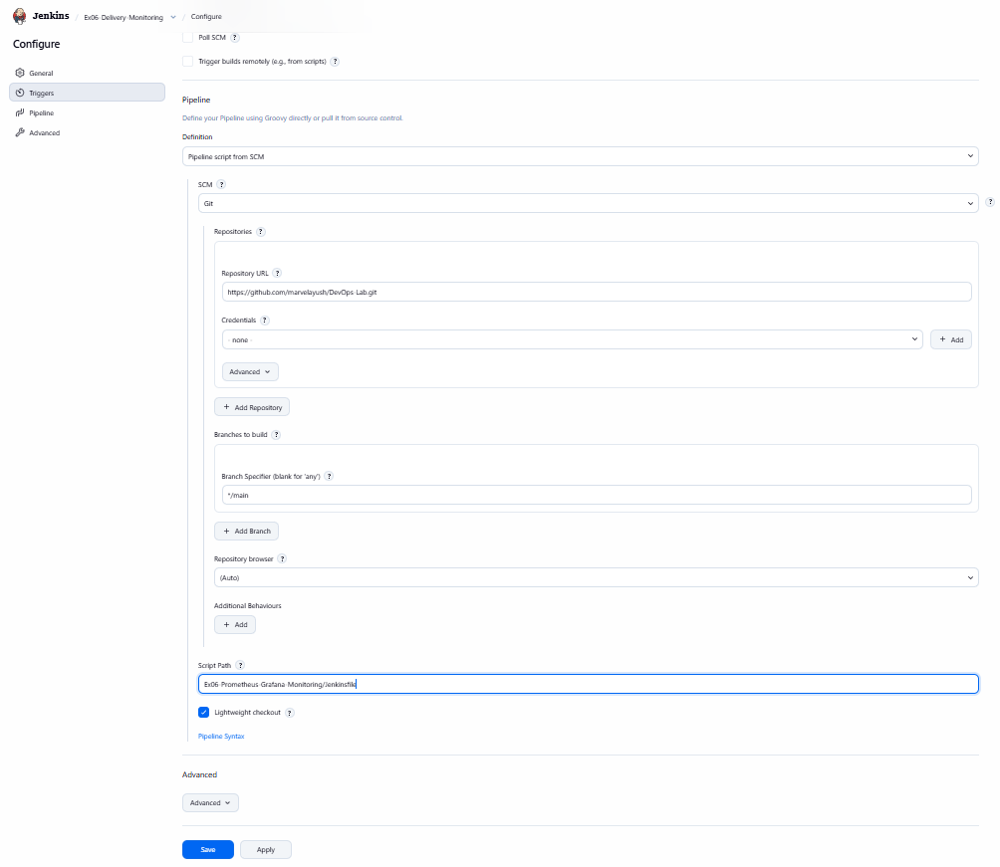

### 17. Run the pipeline

I clicked **Build Now**. The stage view shows every stage and how long it took.

```text
#1  Started by ayush narayan   Took 1 min 8 sec
Checkout SCM 18s → Pre-check Docker 2s → Cleanup Old Containers 0.92s → Build Docker Images 17s
→ Run Application 0.9s → Run Prometheus & Grafana 3s → Verify 10s → Post Actions 1s
Post Actions: Monitoring stack is up: app :8000, Prometheus :9090, Grafana :3000
```

All stages passed on the first build. Building the two images took the longest (17 s).

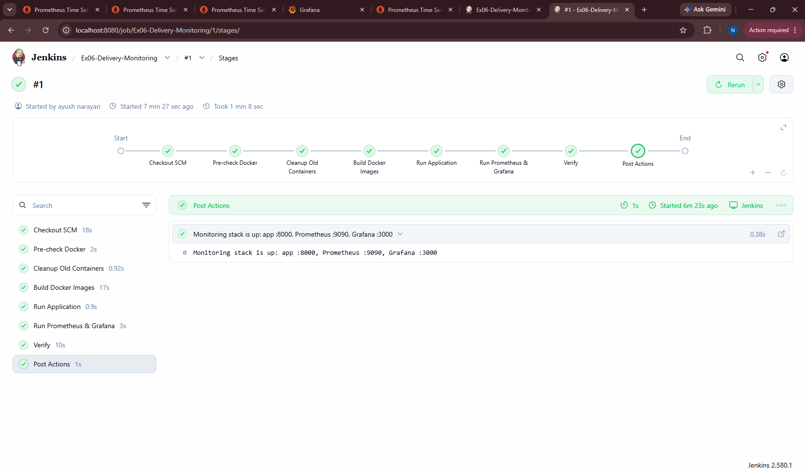

### 18. Read the console output

The console log shows the real commands that ran.

```text
+ docker run -d --name prometheus -p 9090:9090 delivery_prometheus
817ce0f54c67f053c84eda0ff3ccf5021382f068ba096af5237d794595d20f26
+ docker run -d --name grafana -p 3000:3000 grafana/grafana
e7d46e8e4936cb3561df11d80072acedffb94a0dee8b35cd9e9ff4ccf46c2151
[Pipeline] { (Verify)
+ sleep 10
+ docker ps --filter name=delivery_metrics --filter name=prometheus --filter name=grafana
CONTAINER ID   IMAGE                 COMMAND                  CREATED          STATUS          PORTS                                         NAMES
e7d46e8e4936   grafana/grafana       "/run.sh"                11 seconds ago   Up 11 seconds   0.0.0.0:3000->3000/tcp, :::3000->3000/tcp     grafana
817ce0f54c67   delivery_prometheus   "/bin/prometheus --c…"   14 seconds ago   Up 11 seconds   0.0.0.0:9090->9090/tcp, :::9090->9090/tcp     prometheus
d2e161a433b8   delivery_metrics      "python -u delivery_…"   15 seconds ago   Up 14 seconds   0.0.0.0:8000->8000/tcp, :::8000->8000/tcp     delivery_metrics
[Pipeline] { (Declarative: Post Actions)
Monitoring stack is up: app :8000, Prometheus :9090, Grafana :3000
[Pipeline] End of Pipeline
Finished: SUCCESS
```

The pipeline started the app and Prometheus from its own images (`delivery_metrics`, `delivery_prometheus`), plus Grafana. The Verify stage confirmed all three were Up, and the build finished with `SUCCESS`.

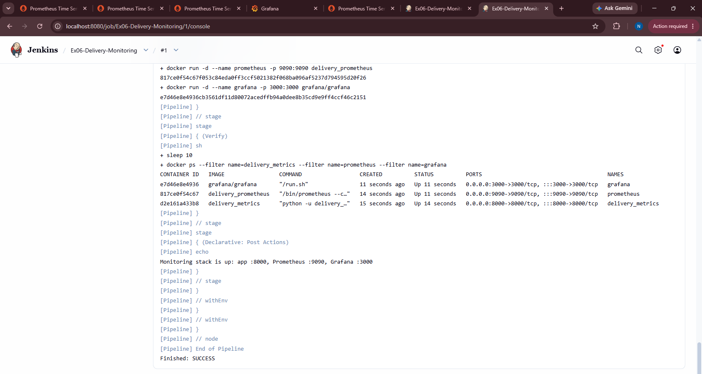

### 19. Check the stack deployed by Jenkins

Now the running containers came from the pipeline, not from my manual commands.

```bash
docker ps --format 'table {{.Names}}\t{{.Image}}\t{{.Status}}\t{{.Ports}}' | grep -E 'NAMES|delivery_metrics|prometheus|grafana|jenkins'
```

```text
NAMES              IMAGE                 STATUS              PORTS
grafana            grafana/grafana       Up 9 minutes        0.0.0.0:3000->3000/tcp, [::]:3000->3000/tcp
prometheus         delivery_prometheus   Up 9 minutes        0.0.0.0:9090->9090/tcp, [::]:9090->9090/tcp
delivery_metrics   delivery_metrics      Up 9 minutes        0.0.0.0:8000->8000/tcp, [::]:8000->8000/tcp
jenkins            jenkins/jenkins:lts   Up About an hour    0.0.0.0:8080->8080/tcp, [::]:8080->8080/tcp, 0.0.0.0:50000->50000/tcp, [::]:50000->50000/tcp
```

The pipeline's Prometheus (with its config baked in) showed both targets **UP** again. `delivery_service` was now the app *container*, reached through its published port 8000.

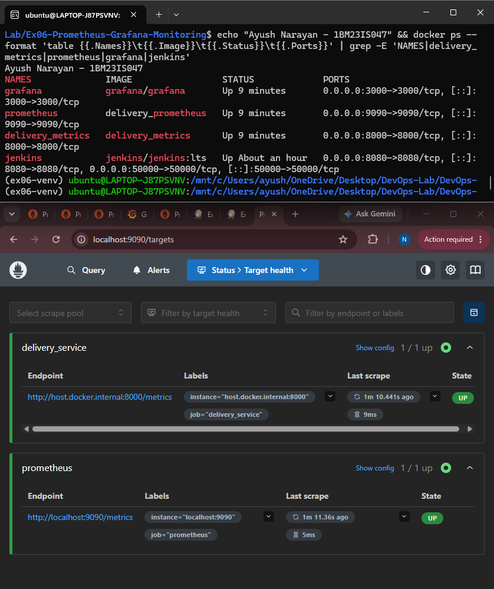

### 20. Re-import the dashboard from JSON

The pipeline's Grafana was brand new and empty. I added the same data source, then imported `grafana-dashboard.json` to prove the export works.

```text
Connections → Data sources → Prometheus → URL http://host.docker.internal:9090 → Save & test
Dashboards → New → Import → Upload dashboard JSON file → grafana-dashboard.json
prometheus (input DS_PROMETHEUS) → select "prometheus" → Import

ZAPPTTO Delivery Monitoring:  Total 71 | Pending 16 | On-the-Way 8 | Average 29.52 s
```

The dashboard came back with the same 4 Stat panels, colors, sparklines, 15-minute range and 5 s refresh, now showing live data from the pipeline's stack.

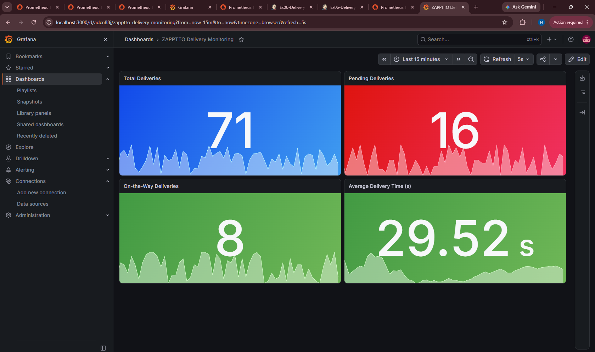

### 21. Clean up

I stopped the delivery simulator, and removed the manual Prometheus and Grafana before the pipeline run (they used the same names and ports). After the pipeline checks, I removed the pipeline's containers too.

```bash
docker rm -f prometheus grafana
docker rm -f delivery_metrics prometheus grafana
```

```text
prometheus
grafana
delivery_metrics
prometheus
grafana
```

The `jenkins` container and its `jenkins_home` volume were kept on purpose, because Exercises 7–9 use the same Jenkins.

## How It Works

```text
delivery_metrics.py           every 1 s: set gauges, observe() summary
      |
      | GET /metrics (text format)            every 15 s (scrape_interval)
      v
Prometheus  ---- stores samples in its time-series database (TSDB)
      |
      +-- every 15 s (evaluation_interval): run alert_rules.yml
      |      expr true            -> PENDING
      |      true for 15 s (for:) -> FIRING  (shown on /alerts)
      |      expr false           -> INACTIVE
      |
      | PromQL over HTTP (/api/v1/query_range)
      v
Grafana  ---- dashboard panels run their queries every 5 s and draw Stat + sparkline

Jenkins (Part B): git checkout -> docker build (app, Prometheus) -> docker run x3
                  through /var/run/docker.sock -> same flow as above, automated
```

- Prometheus **pulls** metrics: the app only exposes `/metrics`, and Prometheus fetches it on a schedule. If the app stops, the target turns DOWN.
- A **Gauge** holds a value that can go up and down (pending, on the way). A **Summary** keeps a running `_count` and `_sum`, so `sum / count` gives the average since the app started. That's why it reset when the script restarted.
- An alert rule is a PromQL expression checked on every evaluation. `for: 15s` means it has to stay true for 15 s before it moves from PENDING to FIRING, which avoids alerts for one-off spikes.
- Grafana stores no metrics itself. Every panel asks Prometheus with PromQL, so the dashboard is only as fresh as the last scrape.
- On Docker Desktop, containers reach the host (and each other's published ports) through `host.docker.internal`. On native Linux, the manual's `172.17.0.1` (`docker0`) plays that role.
- Jenkins inside a container uses the host's Docker engine through the mounted socket, so the containers it starts are siblings of Jenkins, not inside it.

## Key Configuration

delivery_metrics.py
- `Gauge("total_deliveries", "Total number of deliveries")`: metric name, help text, type. There are three gauges: total, pending, on the way.
- `Summary("average_delivery_time", ...)` with `.observe(avg_time)`: records each delivery time and exposes `_count` and `_sum`.
- `pending = random.randint(10, 20)`: values mostly above the alert threshold of 10. Step 6 changed it to `randint(50, 100)`, then it was set back.
- `start_http_server(8000, addr="0.0.0.0")`: serves `/metrics` on all interfaces, so containers can reach it.
- `print(..., flush=True)` and `python -u` in the Dockerfile: print logs right away instead of buffering, so `docker logs` and the console show them live.

prometheus.yml
- `global: scrape_interval: 15s`, `evaluation_interval: 15s`: how often targets are scraped and rules are checked. 15 s is also Prometheus's default.
- `rule_files: - /etc/prometheus/alert_rules.yml`: path *inside* the container, where the `-v` mount (or `Dockerfile.prometheus`) puts the file.
- `job_name: "prometheus"`, `targets: ["localhost:9090"]`: Prometheus scrapes its own metrics. Here `localhost` means the Prometheus container itself.
- `job_name: "delivery_service"`, `targets: ["host.docker.internal:8000"]`: the delivery app. The manual has `172.17.0.1:8000`, which only exists on native Linux Docker.

alert_rules.yml
- `alert: HighPendingDeliveries`, `expr: pending_deliveries > 10`, `for: 15s`, `severity: warning`: warn when pending stays above 10 for 15 s.
- `alert: HighAverageDeliveryTime`, `expr: (average_delivery_time_sum / average_delivery_time_count) > 30`, `severity: critical`: critical when the average is over 30 s. The manual's rule has no `for:` even though its description says "for the last 15 seconds", so I added `for: 15s` to make the rule match its description.
- `annotations: summary / description`: human-readable text shown on the Alerts page.
- File name: the manual's directory tree says `alerts_rules.yml`, but its config and commands use `alert_rules.yml`. I used `alert_rules.yml` everywhere.

Dockerfile (app image, used by Jenkins)
- The manual's Jenkinsfile runs `docker build -t delivery_metrics .` but never gives a Dockerfile, so I wrote one: `python:3.11-slim`, copy the script, `pip install prometheus-client`, `EXPOSE 8000`, `CMD ["python", "-u", "delivery_metrics.py"]`.

Dockerfile.prometheus
- `FROM prom/prometheus` + `COPY prometheus.yml` and `alert_rules.yml` into `/etc/prometheus/`. The manual mounts `$WORKSPACE/prometheus.yml` with `-v`. But a `-v` path is resolved by the Docker engine, and the Jenkins workspace only exists inside the Jenkins container, so the mount would be empty. Baking the files into an image avoids that.

Jenkinsfile
- `agent any`: run on the built-in Jenkins node.
- `environment { EX_DIR = 'Ex06-Prometheus-Grafana-Monitoring' }` + `dir("${EX_DIR}")`: the checkout contains the whole repo, so builds run inside this exercise folder.
- `Pre-check Docker`: `docker --version`, and `docker info` must succeed, as in the manual.
- `Cleanup Old Containers`: `docker rm -f delivery_metrics prometheus grafana || true`, so the pipeline can run again without name clashes (`|| true` ignores "no such container").
- `Build Docker Images`: builds `delivery_metrics` and `delivery_prometheus`.
- `Run Application` / `Run Prometheus & Grafana`: the manual's `docker run` lines with `-p 8000`, `-p 9090` and `-p 3000`.
- `Verify` + `post { success / failure }`: wait 10 s, list the three containers, then print a clear success or failure message.

Jenkins container
- `-u root`: lets Jenkins use the Docker socket and install the Docker CLI.
- `-v /var/run/docker.sock:/var/run/docker.sock`: gives Jenkins access to the host's Docker engine.
- `-v jenkins_home:/var/jenkins_home`: keeps jobs, plugins and users in a named volume across container restarts.
- `-p 8080:8080` (web UI), `-p 50000:50000` (agent connections), from the manual.

grafana-dashboard.json
- `__inputs: DS_PROMETHEUS`: on import, Grafana asks which Prometheus data source to use.
- `panels[].type: "stat"`, `options.graphMode: "area"`, `colorMode: "background"`: Stat panels with sparklines and colored backgrounds.
- `"time": {"from": "now-15m"}`, `"refresh": "5s"`: the dashboard opens on the last 15 minutes and refreshes every 5 s.

## Commands Used

```bash
pip3 install prometheus-client
python3 -m venv ~/ex06-venv
. ~/ex06-venv/bin/activate
pip install prometheus-client
pip show prometheus-client
python3 delivery_metrics.py
curl -s http://localhost:8000/metrics
ip addr show docker0
docker run --rm python:3.11-slim getent hosts host.docker.internal
docker run --rm curlimages/curl -s http://host.docker.internal:8000/metrics | grep '^pending'
docker run --rm -v ./prometheus.yml:/etc/prometheus/prometheus.yml -v ./alert_rules.yml:/etc/prometheus/alert_rules.yml --entrypoint promtool prom/prometheus check config /etc/prometheus/prometheus.yml
docker run -d --name prometheus -p 9090:9090 -v ./prometheus.yml:/etc/prometheus/prometheus.yml -v ./alert_rules.yml:/etc/prometheus/alert_rules.yml prom/prometheus
docker ps -a | grep prom
docker run -d --name grafana -p 3000:3000 grafana/grafana
docker ps --filter name=grafana --filter name=prometheus
grep -n "randint(50, 100)" delivery_metrics.py
docker restart prometheus
docker rm -f prometheus grafana
docker ps -a | grep jenkins
docker run -d -p 8080:8080 -p 50000:50000 --name jenkins -u root -v jenkins_home:/var/jenkins_home -v /var/run/docker.sock:/var/run/docker.sock jenkins/jenkins:lts
docker exec jenkins bash -c "apt-get update -qq && apt-get install -y -qq docker.io > /dev/null"
docker exec jenkins docker version --format 'Jenkins docker client {{.Client.Version}} (API {{.Client.APIVersion}}) -> server {{.Server.Version}}'
docker exec jenkins cat /var/jenkins_home/secrets/initialAdminPassword
docker ps --format 'table {{.Names}}\t{{.Image}}\t{{.Status}}\t{{.Ports}}'
docker rm -f delivery_metrics prometheus grafana
```

## Problems Faced

- **`pip3 install` was blocked.** The manual's `pip3 install prometheus-client` failed with `error: externally-managed-environment`, because Ubuntu 24.04 protects the system Python (PEP 668). I created a venv (`~/ex06-venv`) and installed it there.
- **`172.17.0.1` doesn't exist on Docker Desktop.** `ip addr show docker0` gave `Device "docker0" does not exist.` I used `host.docker.internal` in `prometheus.yml` and in the Grafana data source, and `-p 9090:9090` instead of `--network=host`. Step 4 proves a container can reach the app this way.
- **The first dashboard looked wrong.** It was saved with "Last 6 hours", so the sparklines were squeezed into a thin strip, and Total Deliveries was red only because of Grafana's default threshold (red above 80). I set Last 15 minutes and a 5 s refresh, removed the 80 threshold from Total (base color blue), saved, and exported again.
- **Jenkins had no Docker.** The stock `jenkins/jenkins:lts` image has no Docker CLI, so the Pre-check stage would fail. I started Jenkins as root with the Docker socket mounted and installed `docker.io` inside it. First I checked in a throwaway container that its client (26.1.5, API 1.45) is accepted by Docker Engine 29.4.1.

## Result

Delivery metrics from the Python simulator were scraped by Prometheus (both targets UP), queried with PromQL, and shown on a 4-panel Grafana dashboard with live sparklines. `HighPendingDeliveries` and `HighAverageDeliveryTime` fired when their thresholds were crossed, and the Step 6 simulation pushed pending to 99. A Jenkins pipeline from this repository then built and started the whole stack automatically (`Finished: SUCCESS`). The dashboard, exported as `grafana-dashboard.json`, re-imported into the pipeline's fresh Grafana.
