# Exercise 7 – Introduction to CI and Jenkins Installation

## Objective

Understand what Continuous Integration (CI) is and how a CI server fits into it. Then install Jenkins with Docker: start the container, find the initial admin password, unlock Jenkins, install the suggested plugins and reach the Jenkins landing page.

## Architecture

The CI idea this exercise introduces:

```text
 developer ──git push──> GitHub repo ──change detected──> Jenkins (CI server)
                                                              |
                                          build ──> test ──> report
                                                              |
 developer <──────────── feedback: SUCCESS / FAILURE ─────────+
```

What ran on my machine:

```text
 Chrome / Playwright (Windows)
   |                         |
   | http://localhost:8080   | http://localhost:8081
   v                         v
+------------------------------------ Docker Desktop -------------------------------------+
|                                                                                          |
|  jenkins  (main, from Exercise 6)                 jenkins-ex07  (temporary, this run)    |
|  image jenkins/jenkins:lts                        image jenkins/jenkins:lts              |
|  -p 8080:8080  -p 50000:50000                     -p 8081:8080  -p 50001:50000           |
|  volume jenkins_home -> /var/jenkins_home         anonymous volume -> /var/jenkins_home  |
|  my admin user, Ex06 job, Git + Pipeline plugins  fresh: setup wizard screens            |
|  KEPT for Exercises 8 and 9                       REMOVED at the end (with its volume)   |
+------------------------------------------------------------------------------------------+
   inside each container: Jenkins 2.580.1 (Java web app on :8080), agent port :50000
```

## Environment

- Windows 11 Home + WSL2 Ubuntu 24.04.2 LTS
- Docker Desktop (Engine 29.4.1)
- Image `jenkins/jenkins:lts` (ID `a660310e39ad`, 720 MB), Jenkins 2.580.1
- Plugins on the main Jenkins: Git plugin 5.11.0, Git client plugin 6.6.1, Pipeline 608.v67378e9d3db_1
- Browser screenshots: Playwright with Chromium at 1600×900, with a strip at the top showing the real page URL. Terminal screenshots: Windows Terminal (WSL) windows.

## Project Structure

```text
Ex07-Jenkins-Installation-CI/
├── commands.sh      # how the main Jenkins (used in Ex06, Ex08, Ex09) is started and prepared
├── README.md
└── screenshots/
    ├── 01-docker-run-jenkins.png
    ├── 02-docker-ps.png
    ├── 03-initial-admin-password.png
    ├── 04-unlock-jenkins.png
    ├── 05-customize-jenkins.png
    ├── 06-getting-started-plugins.png
    ├── 07-create-first-admin-user.png
    ├── 08-instance-configuration.png
    ├── 09-jenkins-is-ready.png
    ├── 10-jenkins-landing-page.png
    ├── 11-main-jenkins-dashboard.png
    ├── 12-about-jenkins.png
    ├── 13-installed-plugins-git.png
    ├── 14-installed-plugins-pipeline.png
    └── 15-cleanup-temp-jenkins.png
```

Source: [commands.sh](commands.sh)

## Steps

My main Jenkins (named `jenkins`, on port 8080) was already set up during Exercise 6. To show the first-time screens from the manual, I started a second, brand-new Jenkins called `jenkins-ex07` on port 8081, went through its setup wizard, and removed it afterwards. Steps 1–10 use that fresh instance. Steps 11–13 use the main one.

### 1. Install Jenkins using Docker

Running Jenkins as a container needs no Java or package installation on the host. I used the manual's `docker run`, changing only the name and host ports, because the main Jenkins already uses `jenkins`, 8080 and 50000.

```bash
docker images jenkins/jenkins:lts
docker run -d --name jenkins-ex07 -p 8081:8080 -p 50001:50000 jenkins/jenkins:lts
```

```text
IMAGE                 ID             DISK USAGE   CONTENT SIZE   EXTRA
jenkins/jenkins:lts   a660310e39ad        720MB          246MB    U
411060e56c6c0401ad270ff14d7287e7f34ea121befc32606f0caa2cf3240478
```

The LTS image was already on the machine (pulled in Exercise 6), so `docker run` started the container right away and printed its ID. `-d` runs it in the background.

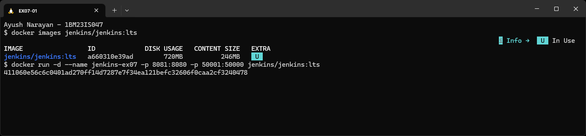

### 2. Check the container is running

`docker ps -a` lists every container with its status and port mappings.

```bash
docker ps -a --filter name=jenkins
```

```text
CONTAINER ID   IMAGE                 COMMAND                  CREATED              STATUS              PORTS                                                                                      NAMES
411060e56c6c   jenkins/jenkins:lts   "/usr/bin/tini -- /u…"   About a minute ago   Up About a minute   0.0.0.0:8081->8080/tcp, [::]:8081->8080/tcp, 0.0.0.0:50001->50000/tcp, [::]:50001->50000/tcp   jenkins-ex07
f7f39778ddf6   jenkins/jenkins:lts   "/usr/bin/tini -- /u…"   2 hours ago          Up 2 hours          0.0.0.0:8080->8080/tcp, [::]:8080->8080/tcp, 0.0.0.0:50000->50000/tcp, [::]:50000->50000/tcp   jenkins
```

Both Jenkins containers were Up. The new one maps host 8081 to Jenkins's web port 8080, and host 50001 to its agent port 50000. `tini` is a tiny init process the image uses to start Jenkins and handle signals.

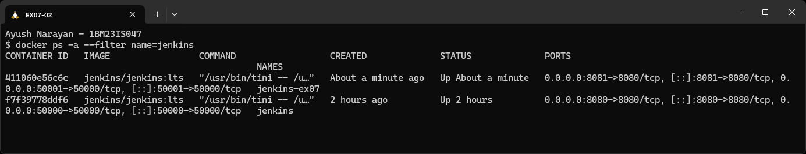

### 3. Get the initial admin password

On first start, Jenkins creates a random admin password and writes it to the log and to a file. You need it to unlock the web setup. I read it from both places, and the commands themselves mask it so it never appears on screen.

```bash
docker logs jenkins-ex07 2>&1 | sed -n '/initial setup is required/,/may also be found/p' | sed -E 's/[0-9a-f]{32}/******** password hidden ********/'
docker exec jenkins-ex07 ls -l /var/jenkins_home/secrets/
docker exec jenkins-ex07 bash -c 'whoami; cat /var/jenkins_home/secrets/initialAdminPassword' | sed -E 's/[0-9a-f]{32}/******************************** (32 hex characters, masked)/'
```

```text
[LF]> Jenkins initial setup is required. An admin user has been created and a password generated.
[LF]> Please use the following password to proceed to installation:
[LF]>
[LF]> ******** password hidden ********
[LF]>
[LF]> This may also be found at: /var/jenkins_home/secrets/initialAdminPassword
total 16
-rw-r--r-- 1 jenkins jenkins  48 Oct 18 19:08 hudson.model.User.DIRNAMES
-rw-r----- 1 jenkins jenkins  33 Oct 18 19:08 initialAdminPassword
-rw-r--r-- 1 jenkins jenkins  32 Oct 18 19:08 jenkins.model.Jenkins.crumbSalt
-rw-r--r-- 1 jenkins jenkins 256 Oct 18 19:08 master.key
jenkins
******************************** (32 hex characters, masked)
```

The password is 32 hex characters (the file is 33 bytes with the newline). Only the `jenkins` user can read the file (`-rw-r-----`), and `whoami` shows `docker exec` runs as that user. The other files in `secrets/` are Jenkins's own encryption keys. The manual opens `docker exec -it <id> bash` and runs `cat` inside. I ran the same `cat` through `bash -c`, so its output could be masked for the screenshot.

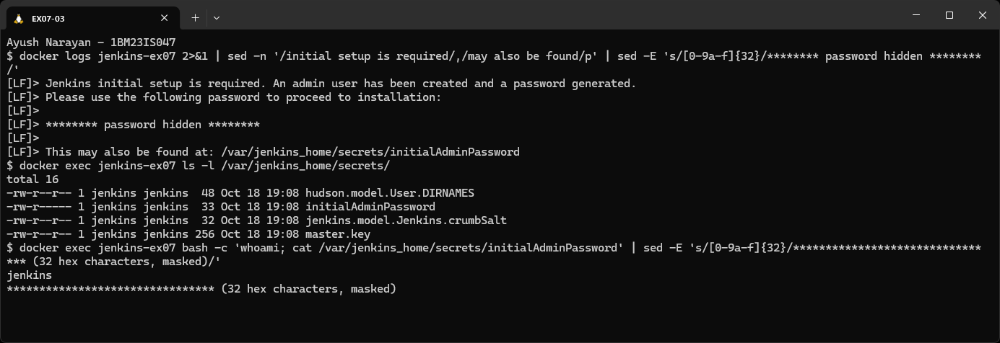

### 4. Unlock Jenkins

Opening the new Jenkins in the browser shows the Unlock page first. It is the first screen of the setup wizard.

```text
http://localhost:8081/login?from=%2F
Unlock Jenkins
To ensure Jenkins is securely set up by the administrator, a password has been written to the log ... and this file on the server:
/var/jenkins_home/secrets/initialAdminPassword
Administrator password: [ ]                                   [Continue]
```

The page names the same file as step 3. I took the screenshot before pasting the password, then pasted it and clicked **Continue**.

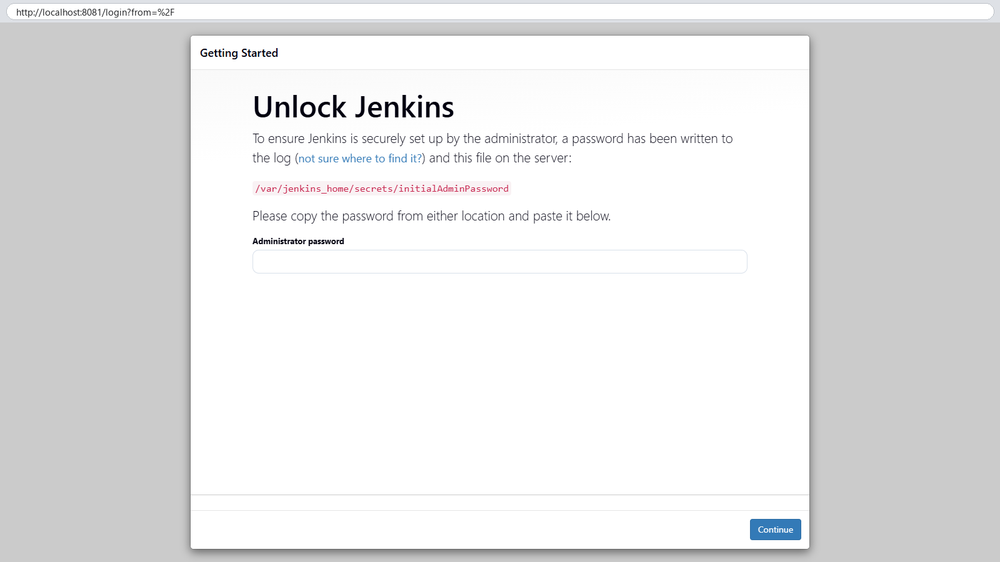

### 5. Customize Jenkins

After unlocking, Jenkins asks which plugins to install. Plugins provide most of Jenkins's features (Git, pipelines, credentials and so on).

```text
http://localhost:8081/
Customize Jenkins
[Install suggested plugins]        [Select plugins to install]
Jenkins 2.580.1
```

I chose **Install suggested plugins**, the set the Jenkins community recommends for most users.

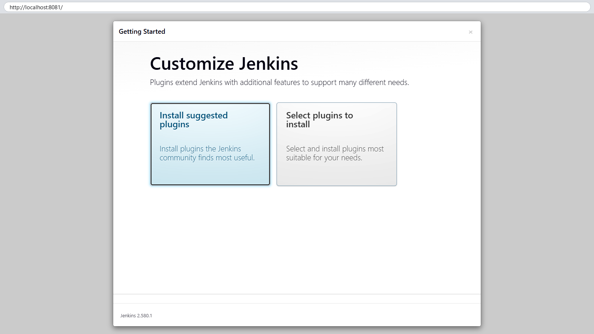

### 6. Getting Started: installing plugins

This is the manual's "getting started" screen. Each tile is a plugin, and the right-hand column lists their dependencies as they install.

```text
Getting Started   (progress bar)
✓ Folders   ✓ OWASP Markup Formatter   ✓ Build Timeout   ✓ Credentials Binding   ✓ Timestamper
  Workspace Cleanup   Ant   Gradle   Pipeline   GitHub Branch Source   Pipeline: GitHub Groovy Libraries
  Pipeline Graph View   Git   SSH Build Agents   Matrix Authorization Strategy   LDAP
  Email Extension   Mailer   Dark Theme
** commons-lang3 v3.x Jenkins API, ** Ionicons API, ... (** = required dependency)
```

The green tiles were already installed when the screenshot was taken, and the rest were still downloading. The container log shows the whole set finished:

```text
INFO  h.model.UpdateCenter$DownloadJob#run: Installation successful: dark-theme
INFO  h.m.UpdateCenter$CompleteBatchJob#run: Completed installation of 92 plugins in 2 min 50 sec
```

The 20 suggested plugins pulled in their dependencies, for 92 plugins in total, installed in under 3 minutes.

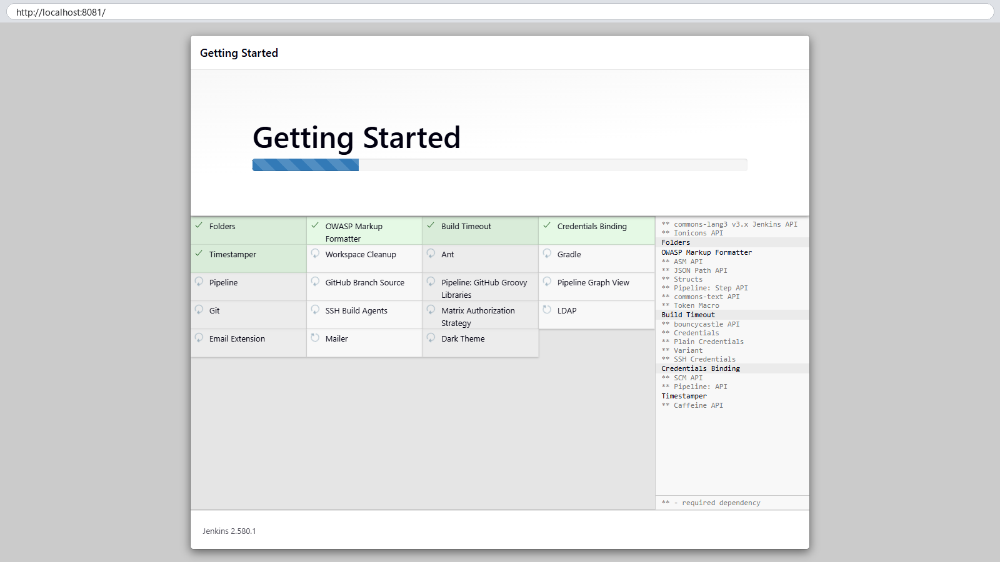

### 7. Create First Admin User

Next, the wizard offers to replace the one-time password with a real admin account.

```text
Create First Admin User
Username [ ]  Password [ ]  Confirm password [ ]  Full name [ ]  Email [ ]
Jenkins 2.580.1             Skip and continue as admin   [Save and Continue]
```

For this throwaway instance I clicked **Skip and continue as admin**, so no account was created on a container I was about to delete. On my main Jenkins (Exercise 6), I created my own admin user at this screen.

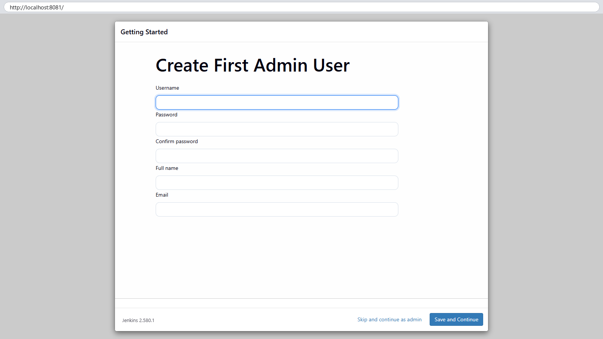

### 8. Instance Configuration

Jenkins asks for the URL people will use to reach it. It is used in links, emails and the `BUILD_URL` variable in builds.

```text
Instance Configuration
Jenkins URL: http://localhost:8081/
Not now   [Save and Finish]
```

The suggested URL matched how I opened it, so I clicked **Save and Finish**.

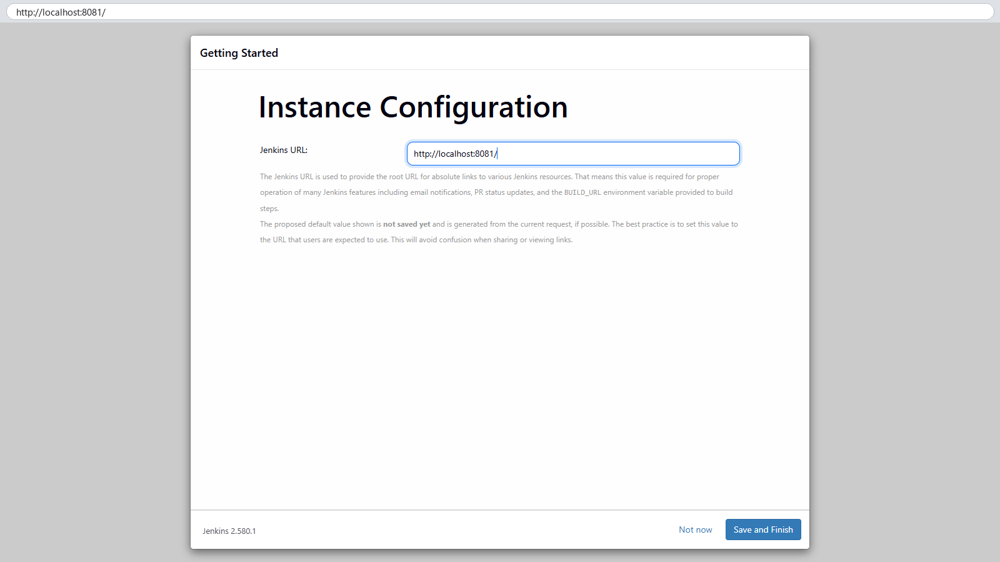

### 9. Jenkins is ready

The last wizard screen confirms setup is complete.

```text
Jenkins is ready!
You have skipped the setup of an admin user.
To log in, use the username: "admin" and the administrator password you used to access the setup wizard.
Your Jenkins setup is complete.
[Start using Jenkins]
```

Because I skipped user creation, Jenkins says the login is `admin` with the initial password. I clicked **Start using Jenkins**.

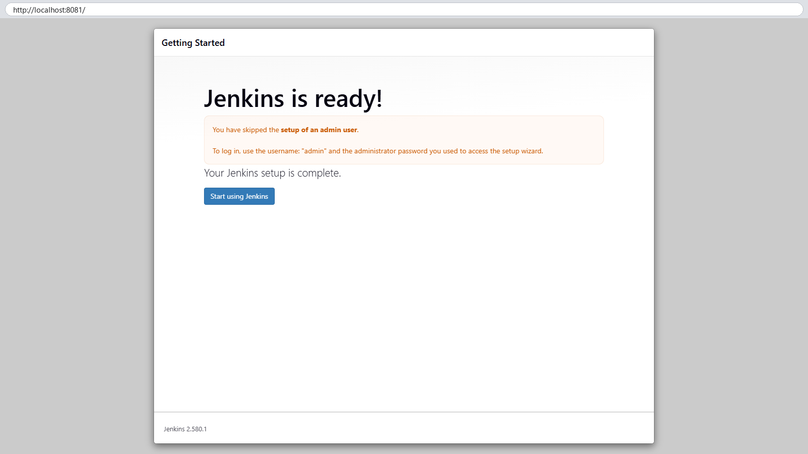

### 10. Jenkins landing page

This is the manual's final screen: the Jenkins dashboard of a brand-new install.

```text
http://localhost:8081/
Jenkins        + New Item   Build History
Welcome to Jenkins!
Start building your software project:  Create a job
Set up a distributed build:            Set up an agent | Configure a cloud | Learn more about distributed builds
Build Queue: No builds in the queue.   Build Executor Status 0/2          REST API   Jenkins 2.580.1
```

There are no jobs yet. **Build Executor Status 0/2** means the built-in node has 2 executors (build slots), and none are busy.

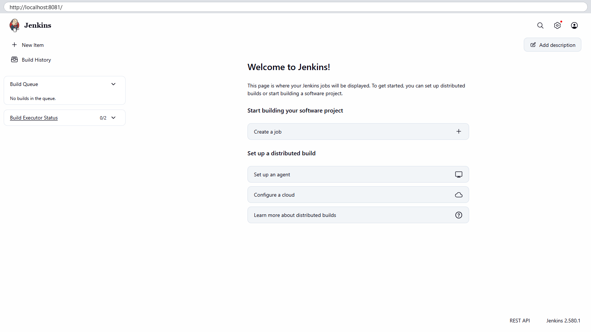

### 11. The main Jenkins after login

My main Jenkins is the one Exercises 8 and 9 will use. I logged in with my own admin user.

```text
http://localhost:8080/
All
S   W   Name                       Last Success      Last Failure   Last Duration
✓   ☀   Ex06-Delivery-Monitoring   1 hr 7 min  #1    N/A            1 min 8 sec
Build Queue: No builds in the queue.   Build Executor Status 0/2          Jenkins 2.580.1
```

It already has the `Ex06-Delivery-Monitoring` pipeline from Exercise 6. **S** is the status of the last build (green tick = success), and **W** is the "weather" health icon (sun = recent builds all passed).

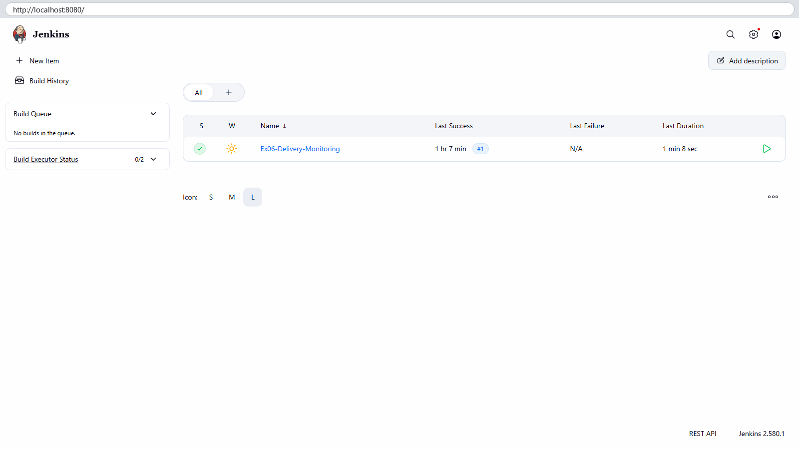

### 12. Check the Jenkins version

**Manage Jenkins → About Jenkins** shows the exact version and the libraries Jenkins is built on.

```text
http://localhost:8080/manage/about/
Jenkins   Version 2.580.1
The leading open source automation server which enables developers around the world to reliably build, test, and deploy their software.
Mavenized dependencies | Static resources | License and dependency information for plugins
```

The main Jenkins runs 2.580.1, the same LTS version as the fresh one (same image).

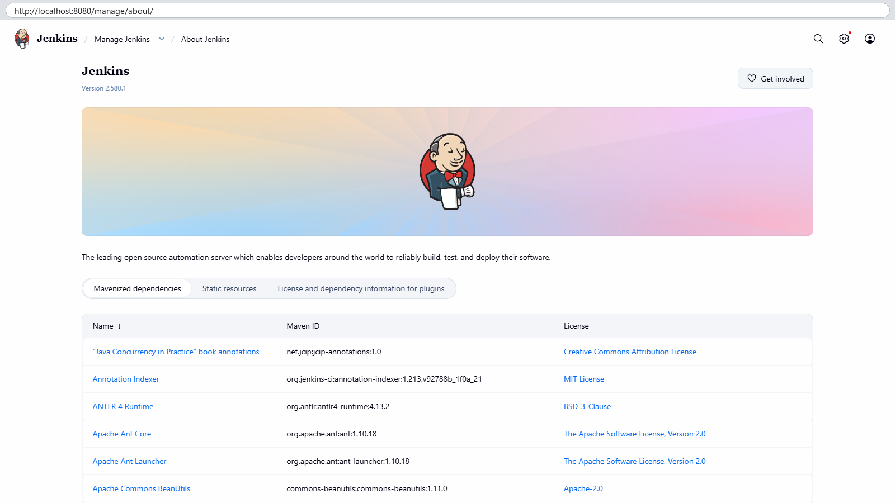

### 13. Check the Git and Pipeline plugins

Exercises 8 and 9 need Jenkins to clone from GitHub (Git plugin) and run a `Jenkinsfile` (Pipeline plugin). **Manage Jenkins → Plugins → Installed plugins** with a search filter shows them.

```text
http://localhost:8080/manage/pluginManager/installed     search: Git
Git client plugin                  6.6.1                    Utility plugin for Git support in Jenkins
Git plugin                         5.11.0                   This plugin integrates Git with Jenkins.
GitHub API Plugin                  1.330-492.v3941a_032db_2a_
GitHub Branch Source Plugin        1986.v801e40614d00
GitHub plugin                      1.47.0
Pipeline: GitHub Groovy Libraries  65.v203688e7727e
```

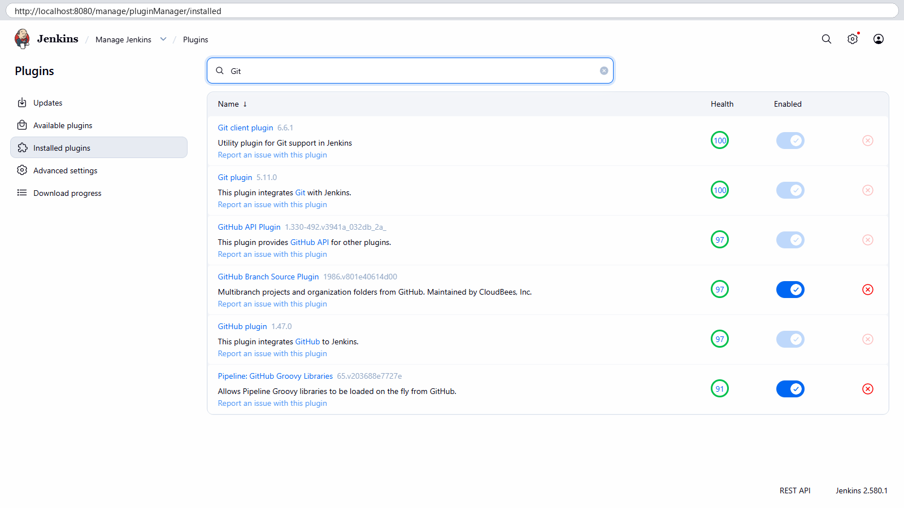

```text
http://localhost:8080/manage/pluginManager/installed     search: Pipeline
Checks API plugin                       422.vc7e8b_51488c6
Pipeline                                608.v67378e9d3db_1   A suite of plugins that lets you orchestrate automation, simple or complex.
Pipeline Graph View Plugin              1053.v9df19e6ceed2
Pipeline: API                           1413.v2ff1a_5e720fa_
Pipeline: Basic Steps                   1098.v808b_fd7f8cf4
Pipeline: Build Step                    601.v6d4c6d1a_9dc7
Pipeline: Declarative                   2.2293.v6e7193cec599
Pipeline: Declarative Extension Points API  2.2293.v6e7193cec599
```

Git plugin 5.11.0 and Pipeline 608.v67378e9d3db_1 are installed and enabled. "Pipeline" is a suite: the many `Pipeline: ...` entries (Declarative, Basic Steps and so on) are its parts. The Health number is the plugin's score from the Jenkins project. Greyed-out toggles mean another plugin depends on that one, so it can't be turned off alone.

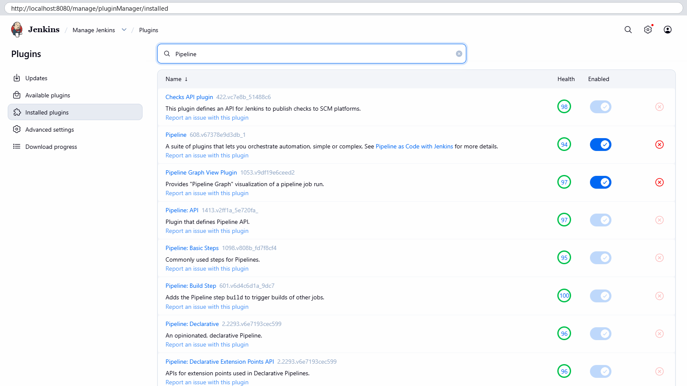

### 14. Clean up the temporary Jenkins

The fresh instance was only needed for the setup screens. The image declares `/var/jenkins_home` as a volume, so Docker had created an anonymous volume for it. `-v` removes that too.

```bash
docker inspect jenkins-ex07 --format '{{range .Mounts}}{{.Type}} volume {{.Name}} -> {{.Destination}}{{end}}'
docker rm -f -v jenkins-ex07
docker volume ls --filter name=<that volume> --format '{{.Name}}' | grep . || echo 'anonymous volume removed'
docker ps -a --filter name=jenkins --format 'table {{.Names}}\t{{.Image}}\t{{.Status}}\t{{.Ports}}'
docker volume ls --filter name=jenkins_home
```

```text
volume volume 5ccf9bcb2449db4a22ba1aeba1d67db37986982969bdfee6cfe3745f6429ad5d -> /var/jenkins_home
jenkins-ex07
anonymous volume removed
NAMES     IMAGE                 STATUS        PORTS
jenkins   jenkins/jenkins:lts   Up 2 hours    0.0.0.0:8080->8080/tcp, [::]:8080->8080/tcp, 0.0.0.0:50000->50000/tcp, [::]:50000->50000/tcp
DRIVER    VOLUME NAME
local     jenkins_home
```

The temporary container and its volume (with its plugins and password) were gone. Only the main `jenkins` container and its `jenkins_home` volume remained, kept for Exercises 8 and 9. ("volume volume" is just my format string: the mount type is `volume`, followed by my own word "volume".)

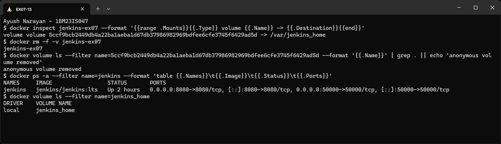

## How It Works

### Continuous Integration (CI)

CI means developers merge their changes into a shared repository often, at least daily, and every merge is checked automatically by a build and tests. Problems show up within minutes of the commit that caused them, while the change is still small and fresh in the developer's mind.

Key features:
- **Frequent integration**: small commits pushed many times a day instead of one big merge at the end.
- **Automated build**: every push is compiled or packaged without anyone running commands by hand.
- **Automated tests**: unit and integration tests run on every build, so old features don't silently break.
- **Fast feedback**: the result (pass or fail) goes straight back to the developer.

Benefits:
- **Bugs are found early**, when they're cheap to fix.
- **Teamwork is smoother**, because everyone builds on the same, always-working main branch.
- **Delivery is faster**, because building and testing no longer wait for a person.
- **Quality stays high**, because tests on every change stop regressions.

How CI works, step by step:

```text
1. Developer  : write code -> git commit -> git push           (version control, e.g. GitHub)
2. CI server  : notices the change (webhook or polling)         (Jenkins, GitLab CI, ...)
3. Build      : check out code, resolve dependencies, compile/package/build image
4. Test       : run unit / integration tests
5. Feedback   : green or red status, console log, notification -> back to the developer
```

In this lab, Exercise 6's pipeline did steps 2–4 for the monitoring stack (`Checkout SCM → Build Docker Images → Run → Verify`). Exercises 8 and 9 add the trigger and test parts.

### Common CI/CD tools (from the manual)

| Tool | What it is | Good fit when |
|---|---|---|
| Jenkins | Self-hosted, open-source automation server with a large plugin ecosystem | you want full control and run it yourself (this lab) |
| GitLab CI/CD | Built into GitLab, with pipelines in `.gitlab-ci.yml` | your code is already on GitLab |
| GitHub Actions | Workflows in YAML inside the GitHub repo, with a marketplace of actions | your code is on GitHub |
| CircleCI | Cloud CI that runs jobs in containers, with caching and parallel jobs | you use a lot of Docker and want hosted CI |
| Travis CI | Hosted CI with simple YAML config | open-source or small projects |
| Bamboo | Atlassian's CI/CD server | the team uses Jira, Bitbucket and Confluence |
| TeamCity | JetBrains' CI server with detailed build history and many runners | large enterprise builds |
| Azure Pipelines | CI/CD in Azure DevOps, YAML or classic editor | Microsoft / Azure projects, multi-platform builds |
| Spinnaker | Open-source continuous *delivery* platform (canary, blue-green deploys) | multi-cloud and Kubernetes deployments |
| Buildkite | Hosted control plane, with builds running on your own agents | code must stay on your own machines |
| Drone | Container-native CI where each step is a container | lightweight, Docker-first pipelines |

### Jenkins concepts, seen in this exercise

| Concept | Meaning | Where it showed up |
|---|---|---|
| Job / Project | a configured task Jenkins can run | `Ex06-Delivery-Monitoring` on the dashboard (step 11) |
| Build | one run of a job, numbered | build `#1`, last duration 1 min 8 sec |
| Pipeline | the job's stages written as code in a `Jenkinsfile` | Pipeline plugin suite (step 13), Ex06's stages |
| Plugins | add-ons that give Jenkins its features | 92 plugins from the suggested set (step 6) |
| Nodes / executors | machines that run builds, and their build slots | built-in node, Build Executor Status 0/2 (steps 10–11) |

### What happens on the first start of the Jenkins container

```text
docker run jenkins/jenkins:lts
   -> tini starts the Jenkins Java web app on port 8080
   -> /var/jenkins_home is empty, so Jenkins:
        creates secrets/ (master.key, initialAdminPassword ...)
        prints the initial password to the log
   -> browser: Unlock (password) -> Customize (plugins) -> Getting Started (download)
      -> Create First Admin User -> Instance Configuration (URL) -> Jenkins is ready -> dashboard
   -> all settings, jobs, plugins and users are saved in /var/jenkins_home (the volume)
```

- Everything Jenkins knows lives in `/var/jenkins_home`. That's why the main Jenkins uses a named volume (`jenkins_home`): it survives container restarts and re-creation.
- The initial password is a one-time key that proves the person running setup has access to the server (its log or file system).
- Port **8080** is the web UI and REST API. Port **50000** is where separate build agents connect to the controller (inbound TCP agents).
- Plugins are downloaded from the Jenkins update center at setup time, which is why the "Getting Started" step needs internet and takes a few minutes.

## Key Configuration

`docker run -d --name jenkins -p 8080:8080 -p 50000:50000 jenkins/jenkins:lts` (manual)
- `-d`: run in the background and return the container ID.
- `--name jenkins`: a fixed name for later `docker exec` and `docker logs` commands. My fresh instance used `jenkins-ex07`, because `jenkins` was taken.
- `-p 8080:8080`: host port to Jenkins web port. Mine used `-p 8081:8080` for the second instance.
- `-p 50000:50000`: agent port. Mine used `-p 50001:50000`.
- `jenkins/jenkins:lts`: the Long-Term Support line, which gets fewer, more tested releases than the weekly line.

Main Jenkins, extra options from Exercise 6 (in `commands.sh`)
- `-v jenkins_home:/var/jenkins_home`: a named volume, so jobs, users and plugins are kept.
- `-u root` + `-v /var/run/docker.sock:/var/run/docker.sock`: lets pipelines run `docker` commands against the host engine (needed in Ex06).

Initial admin password
- Stored at `/var/jenkins_home/secrets/initialAdminPassword` with permissions `-rw-r-----` (owner `jenkins`), and also printed once in `docker logs`.
- The manual reads it with `docker exec -it <container> bash` followed by `cat`. A one-line `docker exec <container> cat ...` gives the same result.

Setup wizard choices
- **Install suggested plugins**: the community's standard set (Git, Pipeline, Credentials Binding, GitHub Branch Source, Timestamper and others), 92 plugins with dependencies.
- **Create First Admin User**: replaces the one-time password with a named account. Skipped only on the temporary instance.
- **Jenkins URL**: `http://localhost:8081/` (temporary) or `http://localhost:8080/` (main). Jenkins uses it to build absolute links.

## Commands Used

```bash
docker images jenkins/jenkins:lts
docker run -d --name jenkins-ex07 -p 8081:8080 -p 50001:50000 jenkins/jenkins:lts
docker ps -a --filter name=jenkins
docker logs jenkins-ex07 2>&1 | sed -n '/initial setup is required/,/may also be found/p' | sed -E 's/[0-9a-f]{32}/******** password hidden ********/'
docker exec jenkins-ex07 ls -l /var/jenkins_home/secrets/
docker exec jenkins-ex07 bash -c 'whoami; cat /var/jenkins_home/secrets/initialAdminPassword' | sed -E 's/[0-9a-f]{32}/******************************** (32 hex characters, masked)/'
# browser: http://localhost:8081 -> Unlock -> Install suggested plugins -> Skip and continue as admin -> Save and Finish -> Start using Jenkins
# browser: http://localhost:8080 -> log in -> Manage Jenkins -> About Jenkins / Plugins -> Installed plugins
docker inspect jenkins-ex07 --format '{{range .Mounts}}{{.Type}} volume {{.Name}} -> {{.Destination}}{{end}}'
docker rm -f -v jenkins-ex07
docker ps -a --filter name=jenkins --format 'table {{.Names}}\t{{.Image}}\t{{.Status}}\t{{.Ports}}'
docker volume ls --filter name=jenkins_home
```

## Problems Faced

- **The manual's name and ports were already taken.** My Jenkins from Exercise 6 runs as `jenkins` on 8080 and 50000, so the manual's exact `docker run` would fail with a name conflict and "port is already allocated". I ran the fresh instance as `jenkins-ex07` on 8081 and 50001, which gave a real first-time setup without touching the main Jenkins.
- **The password was not masked on the first try.** Jenkins 2.580 starts every log line with `[LF]> `, so my first mask pattern, which only matched a line made entirely of the password, missed it in the `docker logs` output. I deleted that screenshot immediately, changed the pattern to match the 32-character password anywhere in a line, checked that no password was left in the output, and took the screenshot again.

## Result

Jenkins 2.580.1 (LTS) was installed with Docker and set up through the full first-time wizard: initial admin password, Unlock, suggested plugins (92 installed in 2 min 50 s), admin user step, Jenkins URL, "Jenkins is ready!" and the "Welcome to Jenkins!" landing page. The main Jenkins on `http://localhost:8080` runs the same version with the Git (5.11.0) and Pipeline (608.v67378e9d3db_1) plugins installed, ready for the CI jobs in Exercises 8 and 9.
