# Exercise 8 – Creating a "Hello World" Jenkins Job

> Code repository used by this job: **[marvelayush/devops-sample-code](https://github.com/marvelayush/devops-sample-code)** (public). A copy of the script is kept here as [hello-world.sh](hello-world.sh).

## Objective

Create a first Jenkins job. I wrote a small shell script, put it in a new public GitHub repository, and configured a Jenkins Freestyle project that checks the repository out and runs the script. Then I ran the job and read the result in the console output.

## Architecture

```text
 WSL Ubuntu (~/devops-sample-code)                GitHub
 hello-world.sh  --git push (gh credentials)-->  marvelayush/devops-sample-code (public, branch main)
                                                          |
                                                          | git clone / fetch (no credentials needed)
                                                          v
 Chrome --> http://localhost:8080 --> Jenkins container (jenkins/jenkins:lts 2.580.1)
                                      Freestyle job "HelloWorld"
                                      1. Source Code Management: Git, */main
                                         -> /var/jenkins_home/workspace/HelloWorld
                                      2. Build step "Execute shell": sh hello-world.sh
                                      3. Console Output: Hello, Jenkins!  Finished: SUCCESS
```

## Environment

- Windows 11 Home + WSL2 Ubuntu 24.04.2 LTS, git 2.43 in WSL, GitHub CLI (`gh`) logged in as `marvelayush`
- Jenkins 2.580.1 in Docker (`jenkins/jenkins:lts`, the main instance from Exercises 6–7), Git plugin 5.11.0
- git 2.47.3 inside the Jenkins container (used for the checkout)

## Project Structure

```text
Ex08-Jenkins-HelloWorld-Job/
├── hello-world.sh   # copy of the script that Jenkins runs (source: devops-sample-code)
├── README.md
└── screenshots/
    ├── 01-create-github-repo.png
    ├── 02-create-hello-world-script.png
    ├── 03-git-init-add-status.png
    ├── 04-git-commit-branch.png
    ├── 05-git-push.png
    ├── 06-github-repo.png
    ├── 07-github-file.png
    ├── 08-new-item-freestyle.png
    ├── 09-config-general.png
    ├── 10-config-scm.png
    ├── 11-config-build-steps.png
    ├── 12-job-page.png
    ├── 13-build-status.png
    └── 14-console-output.png

devops-sample-code/   (separate GitHub repository)
└── hello-world.sh
```

Source: [hello-world.sh](hello-world.sh) · repository [devops-sample-code](https://github.com/marvelayush/devops-sample-code)

## Steps

### Part A – Script and GitHub repository

### 1. Create the GitHub repository

Jenkins needs somewhere to fetch the code from. The manual creates a public repository named `devops-sample-code` with a fixed description. I created it from the terminal with the GitHub CLI, which does the same thing as the **+ → New repository** form.

```bash
gh repo create marvelayush/devops-sample-code --public --description "A demo repository for Jenkins scripting"
gh repo view marvelayush/devops-sample-code --json nameWithOwner,visibility,description,url --jq '.nameWithOwner+" | "+.visibility+" | "+.description+" | "+.url'
```

```text
✓ Created repository marvelayush/devops-sample-code on GitHub
  https://github.com/marvelayush/devops-sample-code
marvelayush/devops-sample-code | PUBLIC | A demo repository for Jenkins scripting | https://github.com/marvelayush/devops-sample-code
```

The repository exists, is **PUBLIC**, and has the description from the manual. Public matters, because then Jenkins can clone it without any credentials.

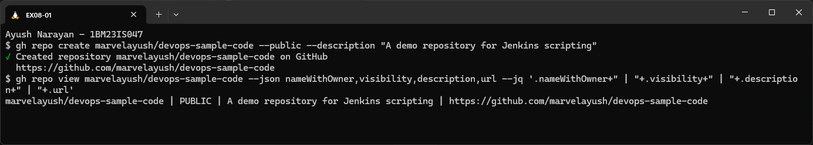

### 2. Create the script

The script is what the Jenkins job will run: a two-line Bash program.

```bash
mkdir -p ~/devops-sample-code && cd ~/devops-sample-code
pwd
touch hello-world.sh
printf '#!/bin/bash\necho "Hello, Jenkins!"\n' > hello-world.sh
cat hello-world.sh
chmod +x hello-world.sh
ls -l hello-world.sh
./hello-world.sh
```

```text
/home/ubuntu/devops-sample-code
#!/bin/bash
echo "Hello, Jenkins!"
-rwxr-xr-x 1 ubuntu ubuntu 35 Oct 18 19:46 hello-world.sh
Hello, Jenkins!
```

`touch` created the empty file, and `printf` wrote the two lines (the same as typing them in an editor, with Linux line endings). `chmod +x` added the `x` permission bits (`-rwxr-xr-x`), and running it locally printed the expected line before involving Jenkins.

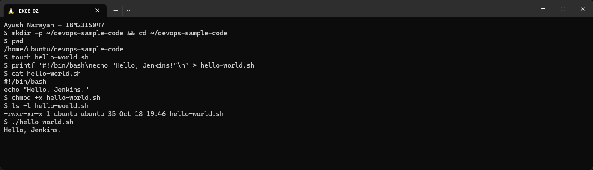

### 3. Configure git, initialise the repository and stage the file

Git records who made each commit, so the name and email must be set once. Then `git init` turns the folder into a repository and `git add` stages the script.

```bash
git config --global user.name "Ayush Narayan"
git config --global user.name
git config --global user.email > /dev/null && echo "user.email is set (hidden in this screenshot)"
git init
git add hello-world.sh
git status
```

```text
Ayush Narayan
user.email is set (hidden in this screenshot)
Initialized empty Git repository in /home/ubuntu/devops-sample-code/.git/
On branch main

No commits yet

Changes to be committed:
  (use "git rm --cached <file>..." to unstage)
        new file:   hello-world.sh
```

`git status` shows the script staged as a **new file**, ready to commit. The branch is already `main` (not `master` as in the manual), because my git has `init.defaultBranch = main` set. My email is configured but deliberately not printed.

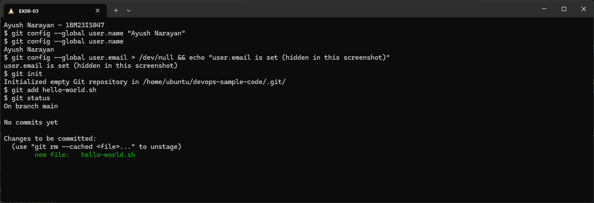

### 4. Commit and set the branch name

A commit saves the staged file in the repository's history. `git branch -M main` makes sure the branch is called `main`, which is what GitHub and the Jenkins job will use.

```bash
git commit -m "Add hello-world.sh"
git branch -M main
git branch
git log --oneline
```

```text
[main (root-commit) 26a4d52] Add hello-world.sh
 1 file changed, 2 insertions(+)
 create mode 100755 hello-world.sh
* main
26a4d52 (HEAD -> main) Add hello-world.sh
```

The first commit is `26a4d52` (root-commit). `create mode 100755` means git stored the file as executable. The manual's output shows `100644`, because its file wasn't made executable before the commit. `git branch -M main` changed nothing here, because the branch already had that name.

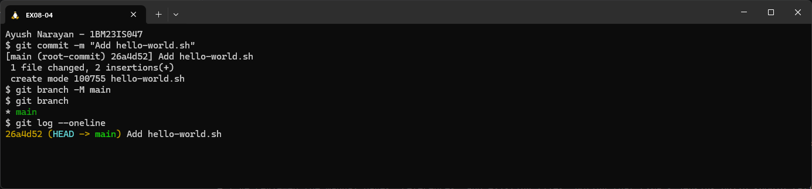

### 5. Link to GitHub and push

`git remote add` tells the local repository where GitHub's copy is, and `git push -u` uploads the commit and links the local `main` to `origin/main`.

```bash
git remote add origin https://github.com/marvelayush/devops-sample-code.git
git remote -v
git push -u origin main
```

```text
origin  https://github.com/marvelayush/devops-sample-code.git (fetch)
origin  https://github.com/marvelayush/devops-sample-code.git (push)
Enumerating objects: 3, done.
Counting objects: 100% (3/3), done.
Writing objects: 100% (3/3), 265 bytes | 265.00 KiB/s, done.
Total 3 (delta 0), reused 0 (delta 0), pack-reused 0
To https://github.com/marvelayush/devops-sample-code.git
 * [new branch]      main -> main
branch 'main' set up to track 'origin/main'.
```

3 objects were uploaded (the commit, the folder tree, and the file), and GitHub created the `main` branch. The push didn't ask for a username or token, because git uses the GitHub CLI as its credential helper (see Key Configuration).

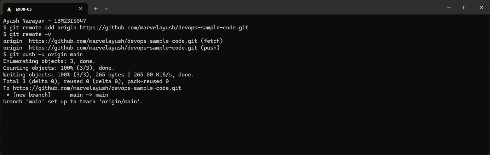

### 6. Verify the script on GitHub

The manual's last repository step is to open GitHub and find the file.

```text
https://github.com/marvelayush/devops-sample-code
devops-sample-code  Public   main · 1 Branch · 0 Tags
marvelayush  Add hello-world.sh   26a4d52 · 1 minute ago   1 Commit
hello-world.sh      Add hello-world.sh
About: A demo repository for Jenkins scripting        Languages: Shell 100%
```

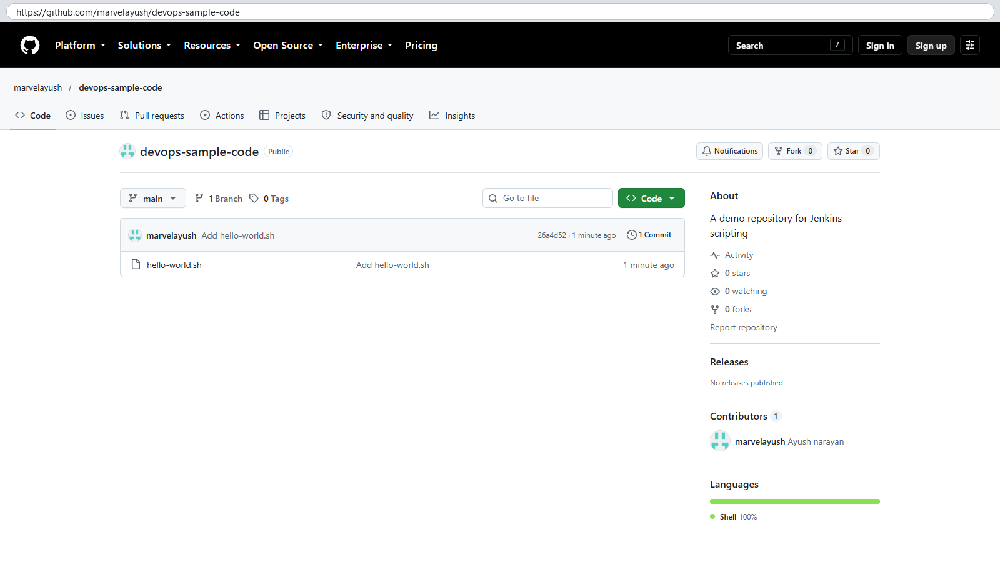

```text
https://github.com/marvelayush/devops-sample-code/blob/main/hello-world.sh
Executable File · 2 lines (2 loc) · 35 Bytes
1  #!/bin/bash
2  echo "Hello, Jenkins!"
```

The repository is public, with one commit on `main`. GitHub marks the file as an **Executable File** of 35 bytes, matching `ls -l` in step 2.

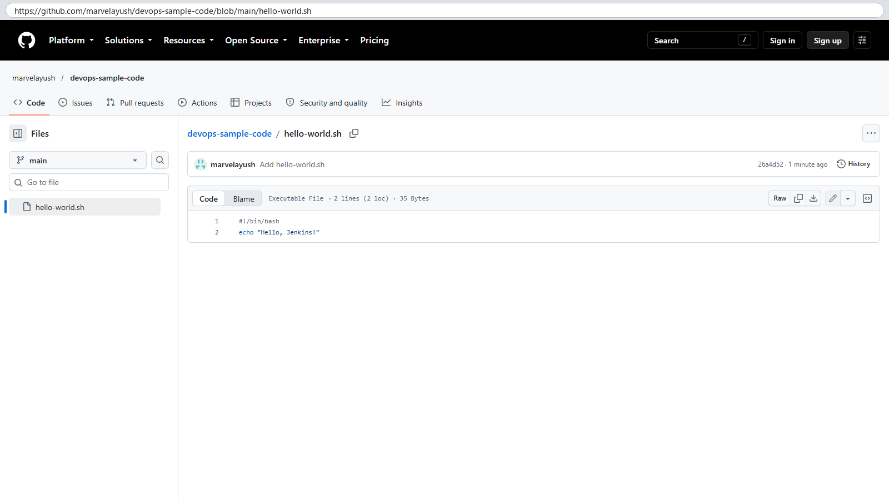

### Part B – Jenkins Freestyle job

### 7. Create a new Freestyle job

In Jenkins (`http://localhost:8080`, logged in as my admin user), **New Item** creates a job. A Freestyle project is the classic job type: one source checkout, then build steps run in order.

```text
http://localhost:8080/view/all/newJob
Enter an item name: HelloWorld
Select an item type: Freestyle project  (selected)
[OK]
```

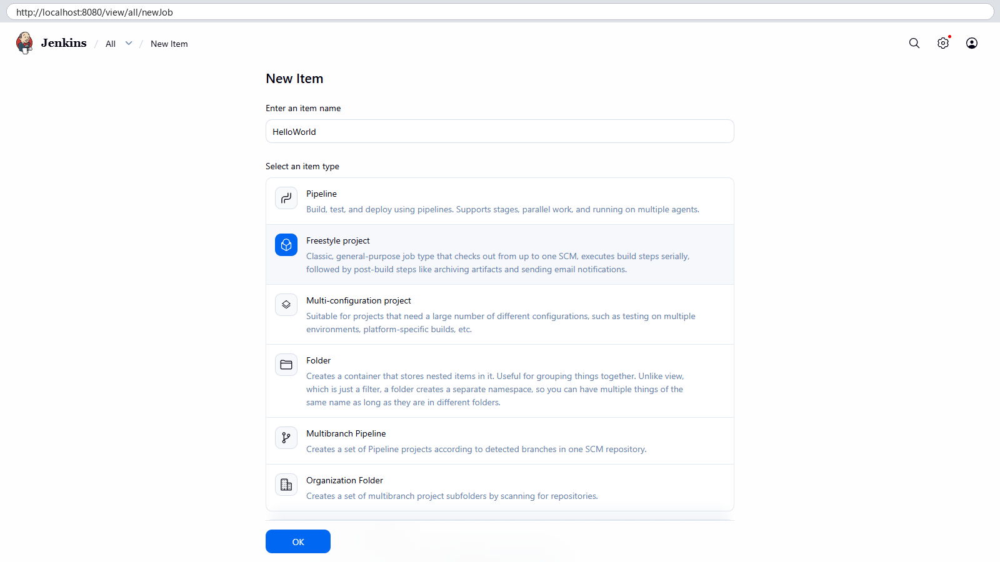

### 8. General: description

The description appears on the job page and tells others what the job does.

```text
http://localhost:8080/job/HelloWorld/configure   General
Description: Hello World! Jenkins job.
Enabled: on
```

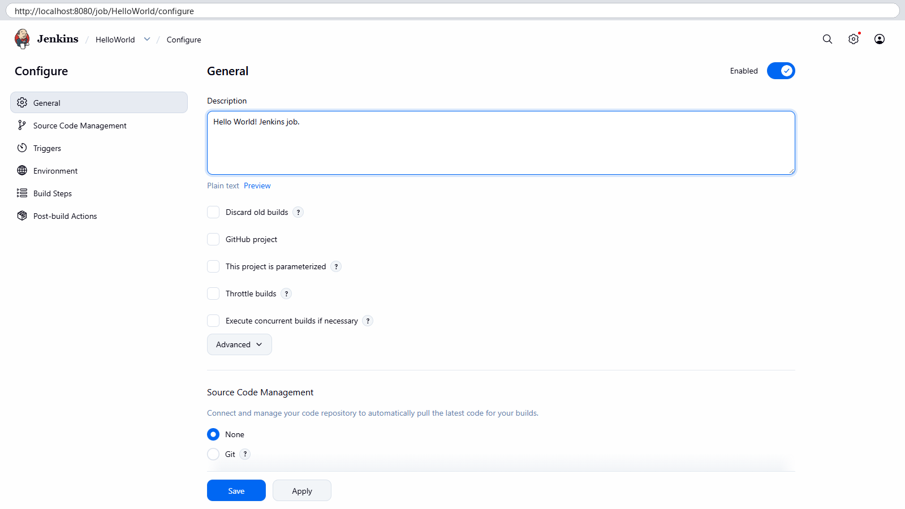

### 9. Source Code Management: Git

This tells Jenkins which repository and branch to check out before the build runs.

```text
Source Code Management: Git
Repository URL:   https://github.com/marvelayush/devops-sample-code.git
Credentials:      - none -
Branch Specifier: */main
```

No credentials are needed for a public repository. I changed the Branch Specifier from Jenkins's default `*/master` to `*/main`, because that is the only branch in the repository.

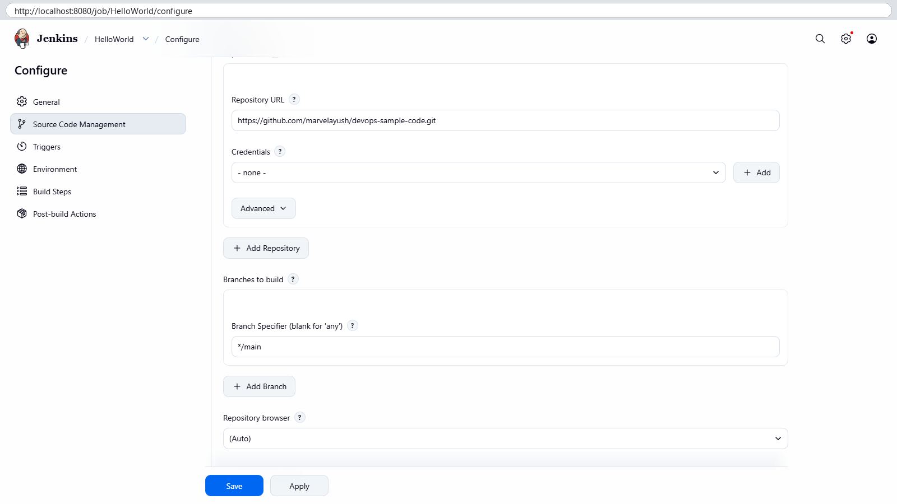

### 10. Build Steps: Execute shell

A build step is the actual work. "Execute shell" runs commands with `/bin/sh` inside the job's workspace, where the repository was checked out.

```text
Build Steps → Add build step → Execute shell
Command: sh hello-world.sh
```

Then I clicked **Save**.

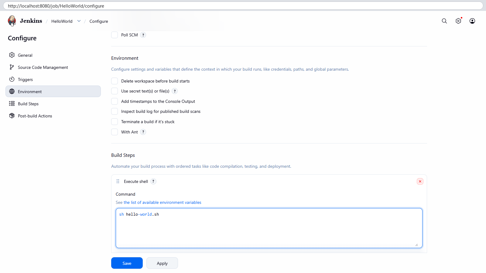

### 11. Build Now

The job page has **Build Now**, which starts a build by hand (the manual's "Build Triggers" step).

```text
http://localhost:8080/job/HelloWorld/
✓ HelloWorld
Hello World! Jenkins job.
Permalinks: Last build (#1), Last stable build (#1), Last successful build (#1), Last completed build (#1)
Builds: ✓ #1 7:48 PM
```

Build **#1** finished with a green tick, and all four permalinks point to it, because it's the only build and it passed.

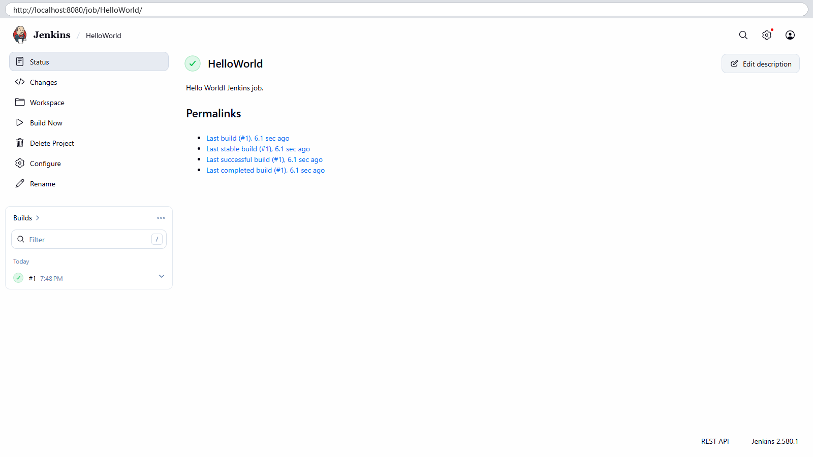

### 12. Build status

The build page records who started it, and exactly which commit was built.

```text
http://localhost:8080/job/HelloWorld/1/
✓ #1 (Oct 18, 2026, 7:48:55 PM)
Started by user ayush narayan            Took 4.2 sec
Revision:   26a4d5209525e5bf03a1a6de55895d388ba21ffc
Repository: https://github.com/marvelayush/devops-sample-code.git
  • refs/remotes/origin/main
No changes.
```

The revision is the same commit as `26a4d52` from step 4, so Jenkins built exactly what I pushed. "No changes" is normal for a first build, because there is no earlier build to compare with.

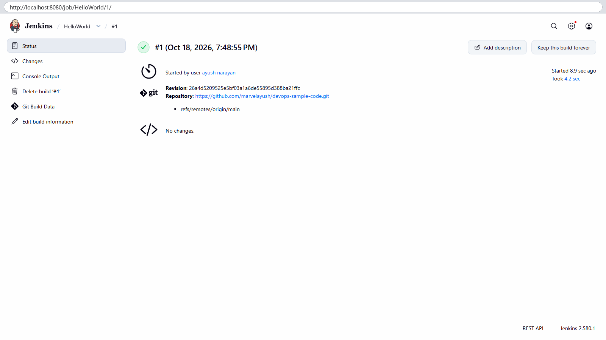

### 13. Console Output

Console Output is the full log of the build: the git checkout first, then the shell step.

```text
Started by user ayush narayan
Running as SYSTEM
Building in workspace /var/jenkins_home/workspace/HelloWorld
The recommended git tool is: NONE
No credentials specified
Cloning the remote Git repository
Cloning repository https://github.com/marvelayush/devops-sample-code.git
 > git init /var/jenkins_home/workspace/HelloWorld # timeout=10
Fetching upstream changes from https://github.com/marvelayush/devops-sample-code.git
 > git --version # timeout=10
 > git --version # 'git version 2.47.3'
 > git fetch --tags --force --progress -- https://github.com/marvelayush/devops-sample-code.git +refs/heads/*:refs/remotes/origin/* # timeout=10
 > git config remote.origin.url https://github.com/marvelayush/devops-sample-code.git # timeout=10
 > git config --add remote.origin.fetch +refs/heads/*:refs/remotes/origin/* # timeout=10
Avoid second fetch
 > git rev-parse refs/remotes/origin/main^{commit} # timeout=10
Checking out Revision 26a4d5209525e5bf03a1a6de55895d388ba21ffc (refs/remotes/origin/main)
 > git config core.sparsecheckout # timeout=10
 > git checkout -f 26a4d5209525e5bf03a1a6de55895d388ba21ffc # timeout=10
Commit message: "Add hello-world.sh"
First time build. Skipping changelog.
[HelloWorld] $ /bin/sh -xe /tmp/jenkins12198437799842445769.sh
+ sh hello-world.sh
Hello, Jenkins!
Finished: SUCCESS
```

Jenkins cloned the repository into `/var/jenkins_home/workspace/HelloWorld` and checked out `origin/main`. It then saved my build step to a temporary script and ran it with `/bin/sh -xe`: `-x` prints each command (`+ sh hello-world.sh`), and `-e` stops at the first error. The script printed **Hello, Jenkins!**, and the build ended with **Finished: SUCCESS**.

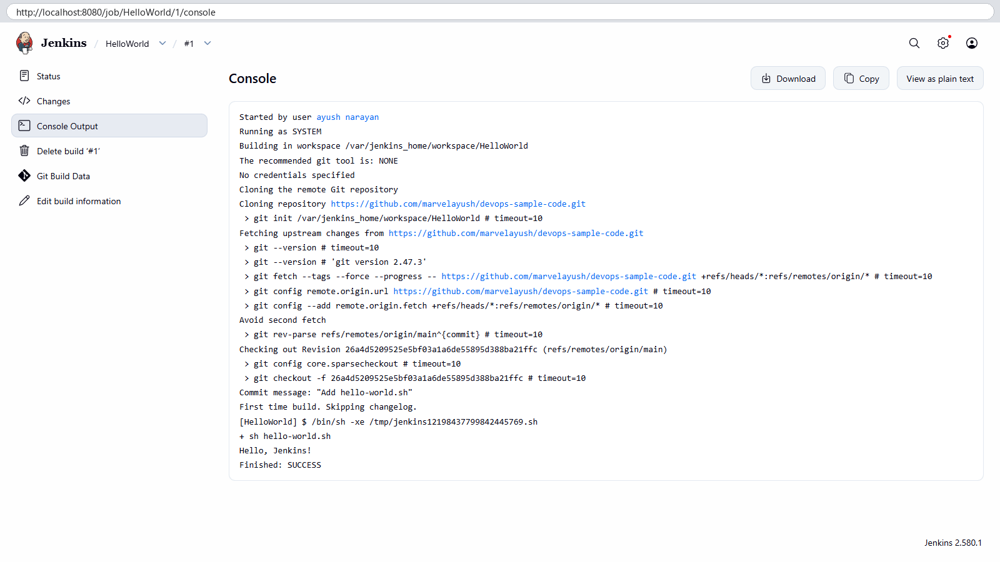

## How It Works

```text
Build Now (or a trigger)
   |
   v
Jenkins queue --> free executor on the built-in node
   |
   v
Workspace /var/jenkins_home/workspace/HelloWorld
   |
   +-- SCM step (Git plugin): git init / fetch / checkout origin/main  (revision 26a4d52)
   |
   +-- Build step "Execute shell": write command to /tmp/jenkins....sh
   |                               run: /bin/sh -xe /tmp/jenkins....sh
   |                                    -> sh hello-world.sh -> "Hello, Jenkins!"
   v
exit code 0 --> build result SUCCESS --> green tick, permalinks, console log saved under jobs/HelloWorld/builds/1
```

- A **job** is a saved recipe, and a **build** is one run of it, numbered #1, #2 and so on. Each build keeps its own log and result.
- The **workspace** is a folder per job inside `jenkins_home`, where the code is checked out and the build steps run.
- The Git plugin does the checkout and records the exact commit hash, so every build can be traced back to the code it used.
- The build result comes from the exit code of the build steps: 0 means SUCCESS, anything else means FAILURE. `-e` makes the shell stop at the first failing command.
- Because the job pulls from GitHub, anyone who pushes a change and clicks Build Now gets the new version built. That is the start of CI, and adding a trigger such as Poll SCM or a webhook makes it automatic.

## Key Configuration

hello-world.sh
- `#!/bin/bash`: the "shebang" line, which says to run the file with Bash when it's executed directly (`./hello-world.sh`).
- `echo "Hello, Jenkins!"`: the single command, whose output proves the build ran the script.
- `chmod +x`: makes the file executable (mode `100755` in git). The job runs it with `sh hello-world.sh`, which works even without the executable bit.

Git and GitHub
- `git config --global user.name / user.email`: identity written into every commit. The email is set but kept out of the screenshots.
- `git branch -M main`: rename the current branch to `main` (forced). The manual's `git init` makes `master`, and this step fixes that before pushing.
- `git remote add origin <url>` + `git push -u origin main`: `-u` sets `origin/main` as the upstream, so later `git push` / `git pull` need no arguments.

Fine-grained personal access token (manual step 1b)
- GitHub stopped accepting account passwords for git over HTTPS. A personal access token (PAT) is used as the password instead.
- A **fine-grained** PAT is limited to chosen repositories and chosen permissions. For this exercise the right scope is: **Repository access → Only select repositories → devops-sample-code**, **Repository permissions → Contents: Read and write** (Metadata: Read-only is added automatically), with a short expiry date.
- Compared with a classic token, a leaked fine-grained token can only touch that one repository's contents, and not the rest of the account.
- In my run, git used the GitHub CLI as its credential helper (`credential.https://github.com.helper = !/usr/bin/gh auth git-credential`), so no token was typed, created or shown. `gh` supplied its stored login for the push.

Jenkins Freestyle job "HelloWorld"
- **Description**: `Hello World! Jenkins job.`
- **Source Code Management → Git**: Repository URL `https://github.com/marvelayush/devops-sample-code.git`, Credentials `- none -` (public repository), Branch Specifier `*/main`. The default `*/master` would fail with "Couldn't find any revision to build", because the repository has no `master` branch. The manual leaves this out.
- **Build Steps → Execute shell**: `sh hello-world.sh`, run inside the workspace, so the relative file name works.
- No Build Triggers were set, so the build was started by hand with **Build Now**, as in the manual.

## Commands Used

```bash
gh repo create marvelayush/devops-sample-code --public --description "A demo repository for Jenkins scripting"
gh repo view marvelayush/devops-sample-code --json nameWithOwner,visibility,description,url
mkdir -p ~/devops-sample-code && cd ~/devops-sample-code
touch hello-world.sh
printf '#!/bin/bash\necho "Hello, Jenkins!"\n' > hello-world.sh
cat hello-world.sh
chmod +x hello-world.sh
ls -l hello-world.sh
./hello-world.sh
git config --global user.name "Ayush Narayan"
git config --global user.email "<my email>"
git init
git add hello-world.sh
git status
git commit -m "Add hello-world.sh"
git branch -M main
git log --oneline
git remote add origin https://github.com/marvelayush/devops-sample-code.git
git remote -v
git push -u origin main
# Jenkins: New Item -> HelloWorld -> Freestyle project -> OK
#          Description, Git URL + */main, Execute shell "sh hello-world.sh" -> Save -> Build Now -> #1 -> Console Output
```

## Result

The script `hello-world.sh` was pushed to the public repository `marvelayush/devops-sample-code`. The Jenkins Freestyle job **HelloWorld** checked out commit `26a4d52` from `main`, ran `sh hello-world.sh`, and printed `Hello, Jenkins!`. Build #1 ended with `Finished: SUCCESS` in 4.2 seconds.
