# Exercise 9 – Jenkins Multi-Stage Pipeline for a Python Application

> Code repository used by this pipeline: **[marvelayush/devops-sample-code](https://github.com/marvelayush/devops-sample-code)** (public, the same repository as Exercise 8). Copies of the files are kept in this folder.

## Objective

Create and run a Jenkins **Pipeline** with several stages (Build, Test, Deploy, Run Application, Test Application) for a small Python Flask application. The pipeline is defined as code in a `Jenkinsfile` stored in Git. Along the way, I handled the build errors the manual predicts, by installing Python tooling inside the Jenkins container.

## Use Case

The manual's scenario: I am automating CI/CD for a Python Flask app. Every run must install the dependencies (**Build**), run the unit tests (**Test**), and copy the app to a deployment directory (**Deploy**). Then it starts the app and checks it (**Run / Test Application**), so a broken change is caught before it reaches users.

## Architecture

```text
 WSL Ubuntu ~/devops-sample-code
 app.py  test_app.py  requirements.txt  Jenkinsfile  hello-world.sh(Ex08)
        |  git push
        v
 GitHub marvelayush/devops-sample-code (main)
        |  "Pipeline script from SCM": checkout + read Jenkinsfile
        v
+--------------------------- Jenkins container (2.580.1, Debian 13) ----------------------------+
|  job: Python-MultiStage-Pipeline        workspace: /var/jenkins_home/workspace/Python-...     |
|                                                                                              |
|  Checkout SCM -> Build ---------> Test -------------> Deploy --------> Run Application -----> |
|                  python3 -m venv  venv python -m      cp app.py,       nohup venv/python      |
|                  pip install -r   unittest discover   test_app.py ->   app.py & (:5000),      |
|                  requirements.txt                     python-app-deploy/  app.pid, app.log    |
|                                                                                              |
|  -> Test Application ------------------------> post { always: kill $(cat app.pid) }          |
|     test_app.py (deployed copy) + curl :5000      success / failure message                 |
|                                                                                              |
|  needs: python3, python3-venv, python3-pip (installed in Step 8 with docker exec -u root)     |
+----------------------------------------------------------------------------------------------+
```

## Environment

- Windows 11 Home + WSL2 Ubuntu 24.04.2 LTS (local tests with Python 3.12)
- Jenkins 2.580.1 in Docker (`jenkins/jenkins:lts`, Debian 13 "trixie"), with the Pipeline and Git plugins
- Inside Jenkins: Python 3.13.5, pip 25.1.1, then 26.2.1 in the venv, plus python3-venv, python3-pip and python3-flask (3.1.1) from apt
- App dependencies: Flask 3.0.3, Werkzeug 3.1.9

## Project Structure

```text
Ex09-Jenkins-MultiStage-Pipeline/        (copies of the files in devops-sample-code)
├── app.py            # Flask app: GET / -> "Hello, Jenkins Multi-Stage Pipeline!" on port 5000
├── test_app.py       # unittest: calls / with Flask's test client, checks 200 + text
├── requirements.txt  # flask==3.0.3
├── Jenkinsfile       # Build, Test, Deploy, Run Application, Test Application + post
├── .gitignore        # keeps venvs, __pycache__ and the deploy folder out of git
├── README.md
└── screenshots/      # 01 ... 19

devops-sample-code/   (GitHub, branch main)
├── .gitignore  Jenkinsfile  app.py  requirements.txt  test_app.py
└── hello-world.sh    # from Exercise 8
```

Source: [app.py](app.py) · [test_app.py](test_app.py) · [requirements.txt](requirements.txt) · [Jenkinsfile](Jenkinsfile) · [.gitignore](.gitignore) · repository [devops-sample-code](https://github.com/marvelayush/devops-sample-code)

## Steps

### 1. Create the application files

The manual's Step 2 creates three files: the app, its dependency list and its unit test. Step 5 adds the `Jenkinsfile`. I added them to the existing `devops-sample-code` clone from Exercise 8 (copied from this folder), so that one repository serves both exercises.

```bash
cd ~/devops-sample-code
cp .../Ex09-Jenkins-MultiStage-Pipeline/{app.py,requirements.txt,test_app.py,Jenkinsfile,.gitignore} .
ls -lA
cat app.py
cat requirements.txt
cat .gitignore
```

```text
total 36
drwxr-xr-x 8 ubuntu ubuntu 4096 Oct 18 19:53 .git
-rwxr-xr-x 1 ubuntu ubuntu   45 Oct 18 19:54 .gitignore
drwxr-xr-x 5 ubuntu ubuntu 4096 Oct 18 19:53 .venv
-rwxr-xr-x 1 ubuntu ubuntu 2140 Oct 18 19:54 Jenkinsfile
drwxr-xr-x 2 ubuntu ubuntu 4096 Oct 18 19:53 __pycache__
-rwxr-xr-x 1 ubuntu ubuntu  195 Oct 18 19:54 app.py
-rwxr-xr-x 1 ubuntu ubuntu   35 Oct 18 19:46 hello-world.sh
-rwxr-xr-x 1 ubuntu ubuntu   13 Oct 18 19:54 requirements.txt
-rwxr-xr-x 1 ubuntu ubuntu  409 Oct 18 19:54 test_app.py
from flask import Flask

app = Flask(__name__)


@app.route("/")
def home():
    return "Hello, Jenkins Multi-Stage Pipeline!"


if __name__ == "__main__":
    app.run(host="0.0.0.0", port=5000)
flask==3.0.3
__pycache__/
.venv/
venv/
python-app-deploy/
```

The app answers `/` with the text that the test and the pipeline check for. `.venv` and `__pycache__` came from a local test run, and the new `.gitignore` keeps them out of git.

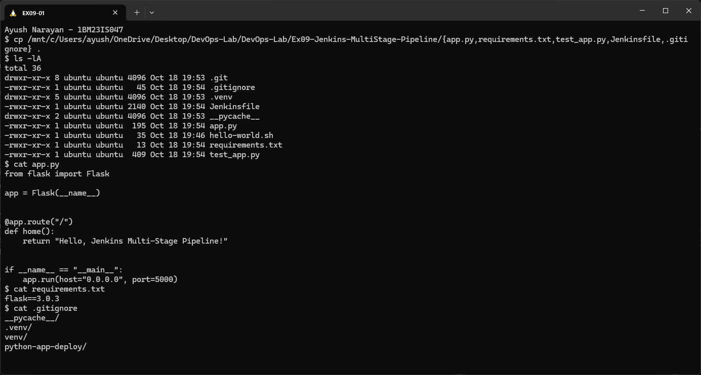

### 2. Run the tests locally first

Running the test before pushing proves the code works, so a later Jenkins failure must be an environment problem and not a code bug.

```bash
cat test_app.py
python3 -m venv .venv
.venv/bin/pip install -q -r requirements.txt && .venv/bin/pip show flask werkzeug | grep -E "^(Name|Version)"
.venv/bin/python -m unittest discover -s . -v
(.venv/bin/python app.py > /tmp/ex09-app.log 2>&1 &) ; sleep 2; curl -s http://localhost:5000/; echo
pkill -f ".venv/bin/python app.py"; echo "local app stopped"
```

```text
import unittest
from app import app


class TestApp(unittest.TestCase):
    def test_home(self):
        tester = app.test_client()
        response = tester.get("/")
        print(response.data.decode("utf-8"))
        self.assertEqual(response.status_code, 200)
        self.assertEqual(response.data.decode("utf-8"), "Hello, Jenkins Multi-Stage Pipeline!")


if __name__ == "__main__":
    unittest.main()
Name: Flask
Version: 3.0.3
Name: Werkzeug
Version: 3.1.9
test_home (test_app.TestApp.test_home) ... Hello, Jenkins Multi-Stage Pipeline!
ok

----------------------------------------------------------------------
Ran 1 test in 0.012s

OK
Hello, Jenkins Multi-Stage Pipeline!
local app stopped
```

The test checks two things: status `200` and the exact text. **Ran 1 test ... OK**. Starting the real app and calling it with `curl` returned the same text.

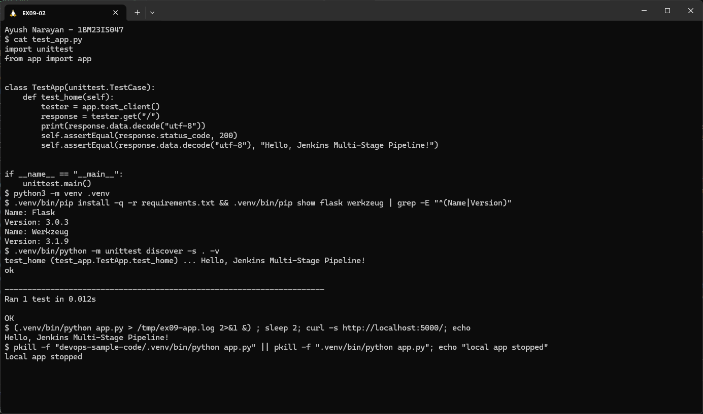

### 3. Check the manual's Flask version

The manual pins `flask==2.1.2`. Before relying on it, I tried it in a throwaway venv.

```bash
python3 -m venv /tmp/flask212 && /tmp/flask212/bin/pip install -q flask==2.1.2
/tmp/flask212/bin/pip show flask werkzeug | grep -E "^(Name|Version)"
/tmp/flask212/bin/python -c "import flask" 2>&1 | tail -1
rm -rf /tmp/flask212
```

```text
Name: Flask
Version: 2.1.2
Name: Werkzeug
Version: 3.1.9
ImportError: cannot import name 'url_quote' from 'werkzeug.urls' (/tmp/flask212/lib/python3.12/site-packages/werkzeug/urls.py). Did you mean: 'unquote'?
```

Flask 2.1.2 only requires "Werkzeug 2.0 or newer", so pip installs Werkzeug 3.1.9. That version removed `url_quote`, so `import flask` itself crashes. That's why `requirements.txt` uses `flask==3.0.3`.

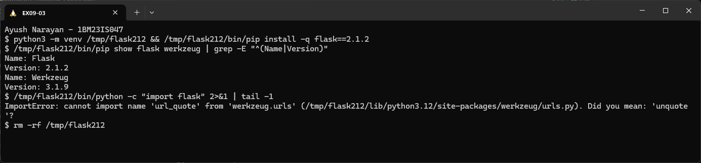

### 4. Push the application to GitHub

The manual's Step 3 pushes the code, so that Jenkins can fetch it. I committed all new files together and pushed to `main`.

```bash
git add .
git status
git commit -m "Add Python Flask app, unit test and Jenkinsfile"
git push
```

The commit as recorded, and proof that GitHub has it:

```bash
git show --stat --format="%h %an | %s" HEAD
git log --oneline
git status -sb
git ls-remote origin main
git rev-parse HEAD
```

```text
394e226 Ayush Narayan | Add Python Flask app, unit test and Jenkinsfile

 .gitignore       |  4 ++++
 Jenkinsfile      | 67 +++++++++++++++++++++++++++++++++++++++++++++++++++++++
 app.py           | 12 ++++++++++++
 requirements.txt |  1 +
 test_app.py      | 15 +++++++++++++++
 5 files changed, 99 insertions(+)
394e226 (HEAD -> main, origin/main) Add Python Flask app, unit test and Jenkinsfile
26a4d52 Add hello-world.sh
## main...origin/main
394e22637c60011de1c7adba11401fdc8bc4ba2d        refs/heads/main
394e22637c60011de1c7adba11401fdc8bc4ba2d        HEAD
```

Commit `394e226` adds the 5 files on top of Exercise 8's `26a4d52`. `## main...origin/main`, with nothing ahead or behind, and `ls-remote` giving the same hash as local `HEAD`, prove that GitHub has exactly this commit.

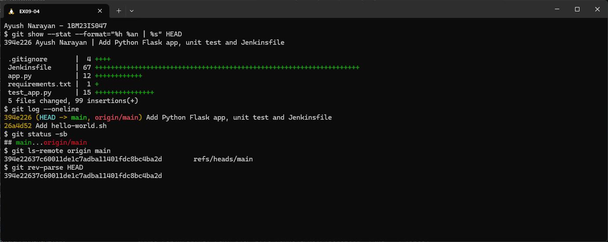

### 5. Verify the files on GitHub

```text
https://github.com/marvelayush/devops-sample-code
2 Commits   394e226 · Add Python Flask app, unit test and Jenkinsfile
.gitignore  Jenkinsfile  app.py  hello-world.sh  requirements.txt  test_app.py
Languages: Python 94.5%  Shell 5.5%
```

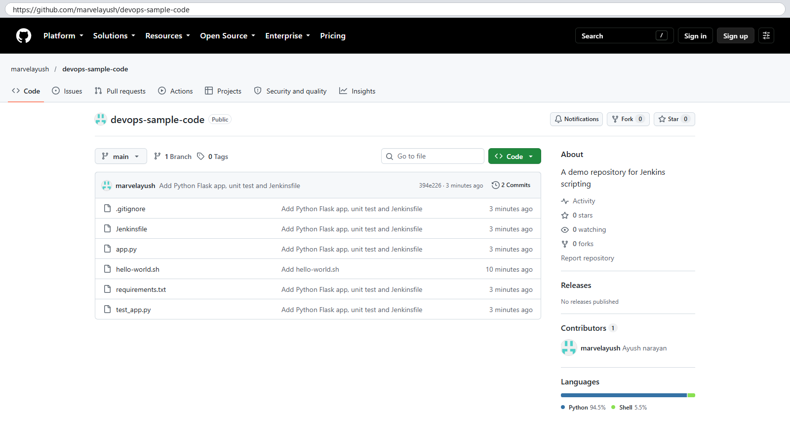

```text
https://github.com/marvelayush/devops-sample-code/blob/main/Jenkinsfile
Executable File · 67 lines (65 loc) · 2.09 KB
1 pipeline {
2     agent any
...
5         stage('Build') {
```

The repository holds the app next to the Ex08 script, and the `Jenkinsfile` is at the root, which is where the job's Script Path points.

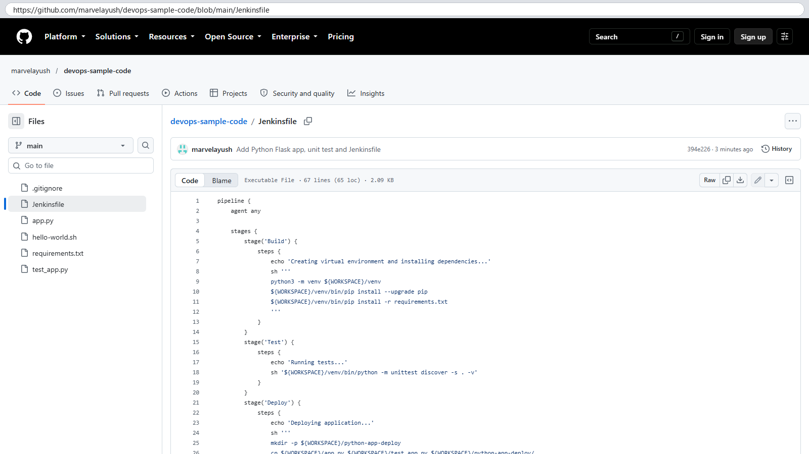

### 6. Create the Pipeline job

A **Pipeline** job runs a `Jenkinsfile`, while a Freestyle job runs build steps typed into the UI. The manual's Step 4 creates it with **New Item**.

```text
http://localhost:8080/view/all/newJob
Enter an item name: Python-MultiStage-Pipeline
Select an item type: Pipeline  (selected)  -> OK
```

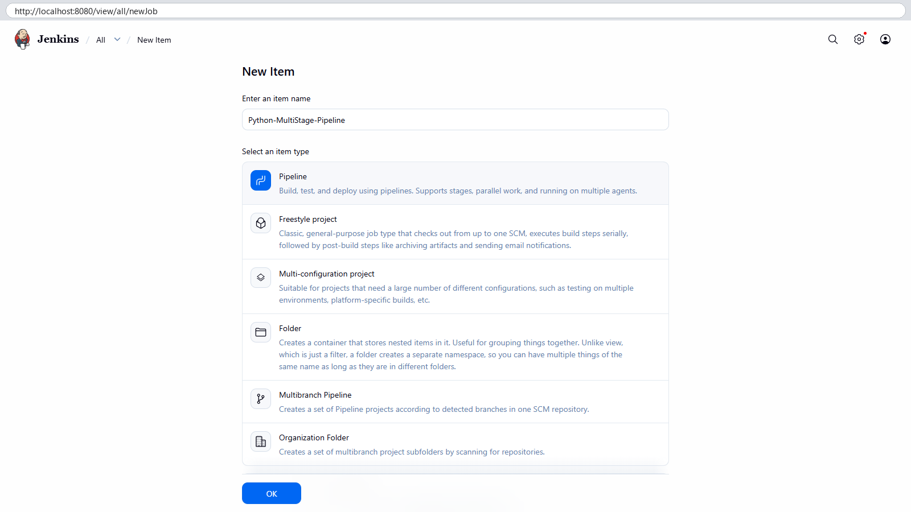

### 7. Configure Pipeline script from SCM

The manual's Step 6 makes Jenkins load the `Jenkinsfile` from Git, instead of a script pasted into the job.

```text
Pipeline → Definition: Pipeline script from SCM
SCM: Git
Repository URL:   https://github.com/marvelayush/devops-sample-code.git
Credentials:      - none -   (public repository)
Branch Specifier: */main
```

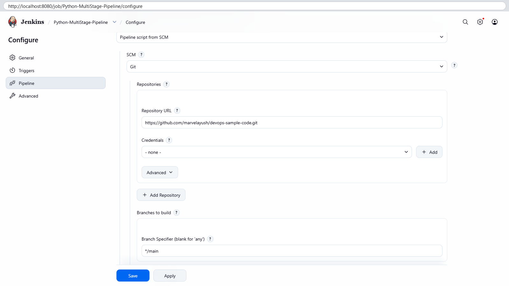

```text
Script Path: Jenkinsfile
Lightweight checkout: on
```

`*/main` replaces Jenkins's default `*/master`. Script Path is the path of the Jenkinsfile inside the repository (at the root here). Lightweight checkout lets Jenkins read just that one file first, to learn the stages.

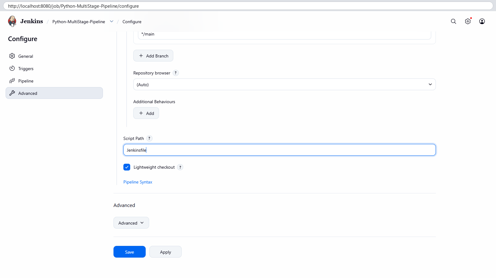

### 8. Run the pipeline (build #1 fails)

I clicked **Build Now** before preparing Jenkins, the same as the manual does. Its Step 8 warns that this first run fails because Python tooling is missing.

```text
http://localhost:8080/job/Python-MultiStage-Pipeline/1/stages/
✗ #1   Started by ayush narayan   Took 5.9 sec
✓ Checkout SCM 1s   ✗ Build 0.56s   » Test   » Deploy   » Run Application   » Test Application   ✓ Post Actions
+ python3 -m venv /var/jenkins_home/workspace/Python-MultiStage-Pipeline/venv
The virtual environment was not created successfully because ensurepip is not
available.  On Debian/Ubuntu systems, you need to install the python3-venv
package using the following command.

    apt install python3.13-venv
...
Failing command: /var/jenkins_home/workspace/Python-MultiStage-Pipeline/venv/bin/python3
script returned exit code 1
```

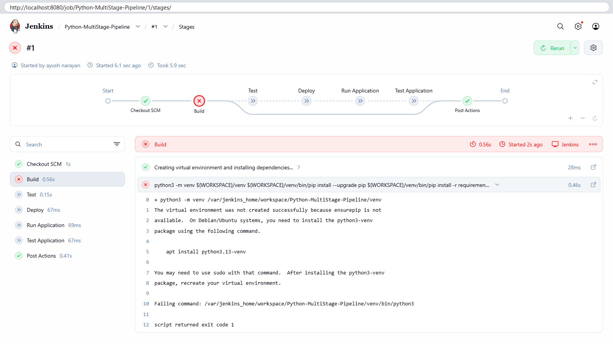

```text
Stage "Test" skipped due to earlier failure(s)
Stage "Deploy" skipped due to earlier failure(s)
Stage "Run Application" skipped due to earlier failure(s)
Stage "Test Application" skipped due to earlier failure(s)
[Pipeline] { (Declarative: Post Actions)
+ cat /var/jenkins_home/workspace/Python-MultiStage-Pipeline/python-app-deploy/app.pid
cat: .../python-app-deploy/app.pid: No such file or directory
+ kill
+ true
Pipeline failed. Check the logs for more details.
ERROR: script returned exit code 1
Finished: FAILURE
```

The checkout worked, but **Build** failed. The image has `python3` but not the `venv` module's `ensurepip`. Every later stage was **skipped**, while `post` still ran: its `kill` found no PID (`|| true` kept that harmless) and it printed the failure message. This is how a pipeline should behave: stop at the first broken stage and still report.

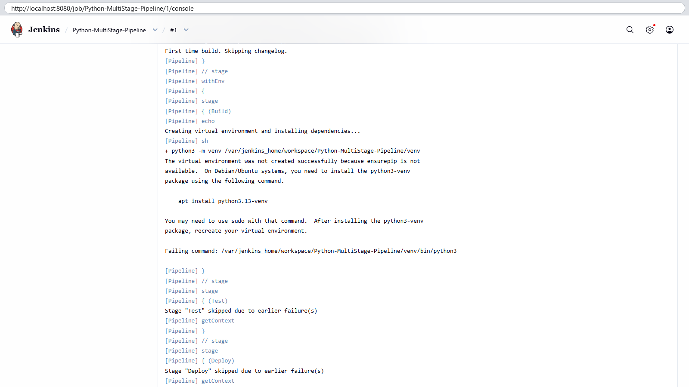

### 9. Open a root shell in the Jenkins container (manual Step 8)

The manual fixes this from inside the container as root, because installing packages needs root and Jenkins itself runs as user `jenkins`.

```bash
docker ps -a --filter name=jenkins
docker exec -u root jenkins bash -c 'whoami; hostname; grep PRETTY /etc/os-release'
```

```text
CONTAINER ID   IMAGE                 COMMAND                  CREATED       STATUS       PORTS                                                                                      NAMES
f7f39778ddf6   jenkins/jenkins:lts   "/usr/bin/tini -- /u…"   3 hours ago   Up 3 hours   0.0.0.0:8080->8080/tcp, [::]:8080->8080/tcp, 0.0.0.0:50000->50000/tcp, [::]:50000->50000/tcp   jenkins
root
f7f39778ddf6
PRETTY_NAME="Debian GNU/Linux 13 (trixie)"
```

`docker exec -u root` gave a root shell (the hostname is the container ID). The OS is **Debian 13**, which matters for the package names in the next step.

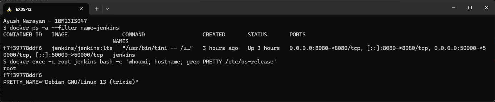

### 10. Install Python tooling in Jenkins

I ran the manual's `apt install` list as written, one package at a time, so that each real result is visible, then added the packages that actually exist on Debian 13.

```bash
docker exec -u root jenkins bash -c 'apt-get update -qq && echo apt-get update: done'
docker exec -u root -e DEBIAN_FRONTEND=noninteractive jenkins bash -c 'for p in python3 pip python3.11-venv python3-flask python3-pip python3-venv; do printf "apt install %-16s -> " $p; apt-get install -y -qq $p > /tmp/apt-$p.log 2>&1 && echo installed/ok || tail -1 /tmp/apt-$p.log; done'
docker exec jenkins bash -c 'python3 --version; pip3 --version | cut -d" " -f1-2; python3 -m venv /tmp/venv-check && echo "python3 -m venv: works"; ...'
```

```text
apt-get update: done
apt install python3          -> installed/ok
apt install pip              -> installed/ok
apt install python3.11-venv  -> E: Couldn't find any package by regex 'python3.11-venv'
apt install python3-flask    -> installed/ok
apt install python3-pip      -> installed/ok
apt install python3-venv     -> installed/ok
Python 3.13.5
pip 25.1.1
python3 -m venv: works
flask (apt) 3.1.1
```

`python3` was already there (3.13.5). apt resolved `pip` to the pip package. The manual's **`python3.11-venv` doesn't exist** on Debian 13, which has Python 3.13, so `python3-venv` (the version-neutral name) was installed instead. After this, `python3 -m venv` works.

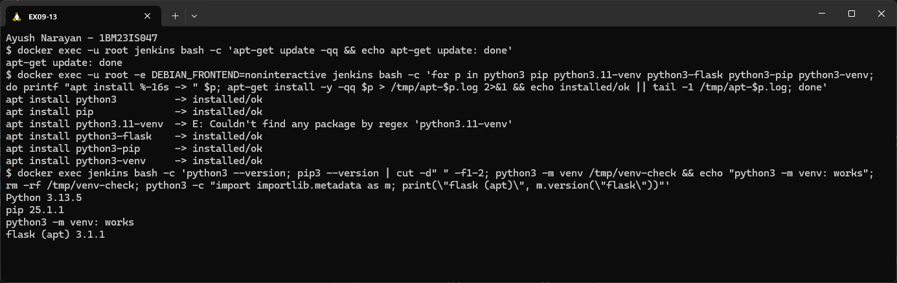

### 11. Run the tests inside the container

The manual's last Step 8 command runs the tests in the container itself, with the system Python and apt's Flask.

```bash
docker exec -w /var/jenkins_home/workspace/Python-MultiStage-Pipeline jenkins ls
docker exec -w /var/jenkins_home/workspace/Python-MultiStage-Pipeline jenkins python3 -m unittest discover -s .
```

```text
Jenkinsfile
app.py
hello-world.sh
requirements.txt
test_app.py
venv
Hello, Jenkins Multi-Stage Pipeline!
.
----------------------------------------------------------------------
Ran 1 test in 0.006s

OK
```

The workspace holds the checkout from build #1 (plus the half-made `venv`), and the test passes inside Jenkins's environment too.

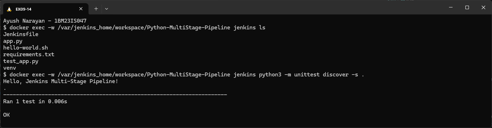

### 12. Run the pipeline again (build #2 succeeds)

With the tooling in place, the same, unchanged commit `394e226` builds cleanly.

```text
http://localhost:8080/job/Python-MultiStage-Pipeline/2/stages/
✓ #2   Started by ayush narayan   Took 16 sec
✓ Checkout SCM 0.85s → ✓ Build 7s → ✓ Test 0.6s → ✓ Deploy 0.37s → ✓ Run Application 3s → ✓ Test Application 0.6s → ✓ Post Actions 0.38s
Post Actions: kill $(cat ${WORKSPACE}/python-app-deploy/app.pid) 2>/dev/null || true
              Pipeline completed successfully!
```

All 7 stages are green: 5 from the Jenkinsfile, plus the automatic "Checkout SCM" and "Post Actions". Build took the longest (7 s), because it created the venv and downloaded Flask.

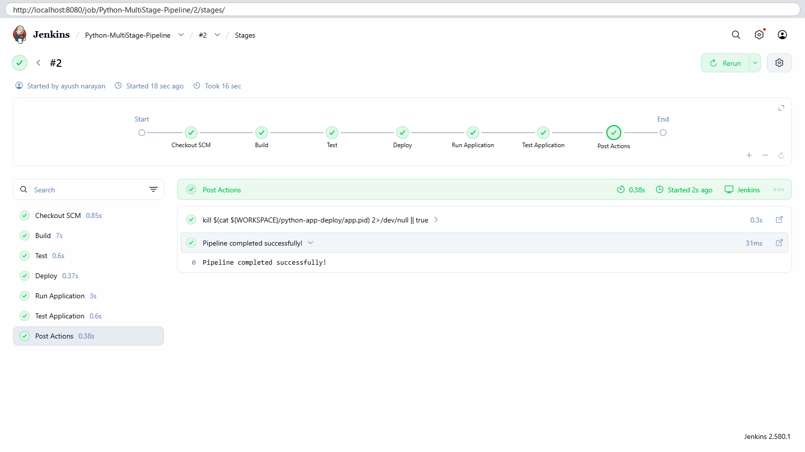

### 13. Console output: Test and Deploy

```text
[Pipeline] { (Test)
Running tests...
+ /var/jenkins_home/workspace/Python-MultiStage-Pipeline/venv/bin/python -m unittest discover -s . -v
test_home (test_app.TestApp.test_home) ... ok

----------------------------------------------------------------------
Ran 1 test in 0.019s

OK
Hello, Jenkins Multi-Stage Pipeline!
[Pipeline] { (Deploy)
Deploying application...
+ mkdir -p /var/jenkins_home/workspace/Python-MultiStage-Pipeline/python-app-deploy
+ cp /var/jenkins_home/workspace/Python-MultiStage-Pipeline/app.py /var/jenkins_home/workspace/Python-MultiStage-Pipeline/test_app.py /var/jenkins_home/workspace/Python-MultiStage-Pipeline/python-app-deploy/
+ ls -l /var/jenkins_home/workspace/Python-MultiStage-Pipeline/python-app-deploy
total 8
-rwxr-xr-x 1 root root 195 Oct 18 20:01 app.py
-rwxr-xr-x 1 root root 409 Oct 18 20:01 test_app.py
```

The Build stage (above this part of the log) installed `flask-3.0.3` and `Werkzeug-3.1.9` into the venv. **Test** then ran the unit test with the venv's Python (**Ran 1 test ... OK**), and **Deploy** copied the app and its test into `python-app-deploy`.

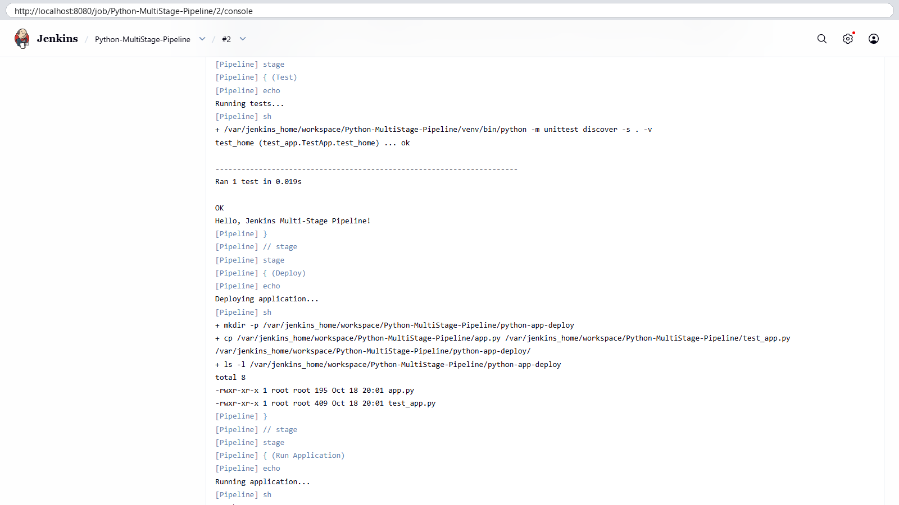

### 14. Console output: Test Application and the end

```text
+ /var/jenkins_home/workspace/Python-MultiStage-Pipeline/venv/bin/python test_app.py
.
----------------------------------------------------------------------
Ran 1 test in 0.011s

OK
Hello, Jenkins Multi-Stage Pipeline!
+ echo Live check of the running app:
Live check of the running app:
+ curl -s http://localhost:5000/
Hello, Jenkins Multi-Stage Pipeline!+ echo

[Pipeline] { (Declarative: Post Actions)
+ cat /var/jenkins_home/workspace/Python-MultiStage-Pipeline/python-app-deploy/app.pid
+ kill 4236
Pipeline completed successfully!
[Pipeline] End of Pipeline
Finished: SUCCESS
```

**Test Application** ran the deployed copy of the test, then called the app running in the background over HTTP, which answered **Hello, Jenkins Multi-Stage Pipeline!**. Post Actions then stopped the app (`kill 4236`), and the build ended with **Finished: SUCCESS**. Earlier in the log, the Run Application stage showed Flask listening on `http://172.17.0.2:5000`.

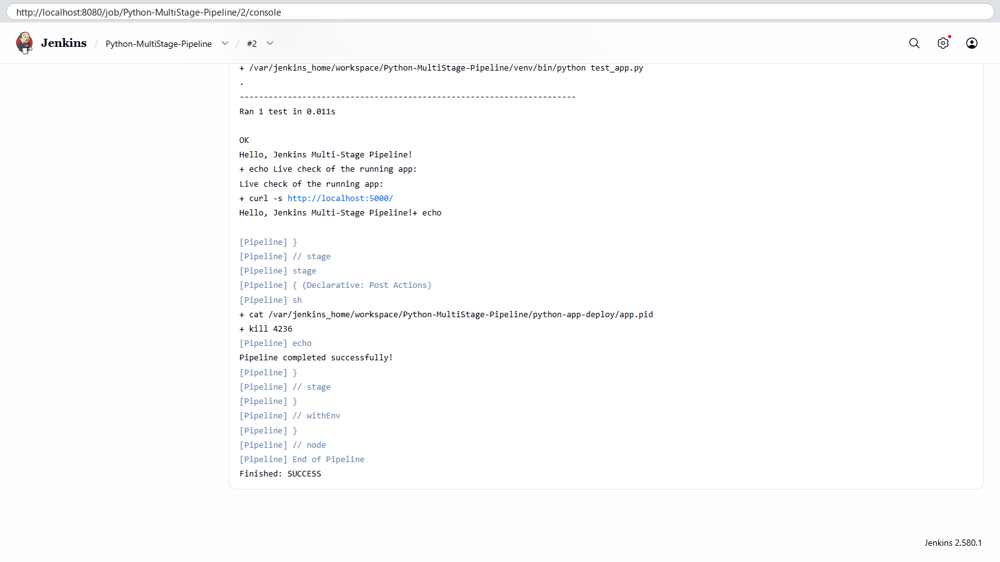

### 15. Job page with both builds

```text
http://localhost:8080/job/Python-MultiStage-Pipeline/
✓ Python-MultiStage-Pipeline
Multi-stage CI/CD pipeline (Build, Test, Deploy, Run, Test Application) for the Python Flask app.
Last build (#2) · Last stable build (#2) · Last successful build (#2) · Last failed build (#1) · Last unsuccessful build (#1) · Last completed build (#2)
Builds: ✓ #2 8:01 PM   ✗ #1 7:58 PM
```

The history keeps the failure (#1) and the fix (#2). Jenkins also tracks "last failed" and "last successful" separately.

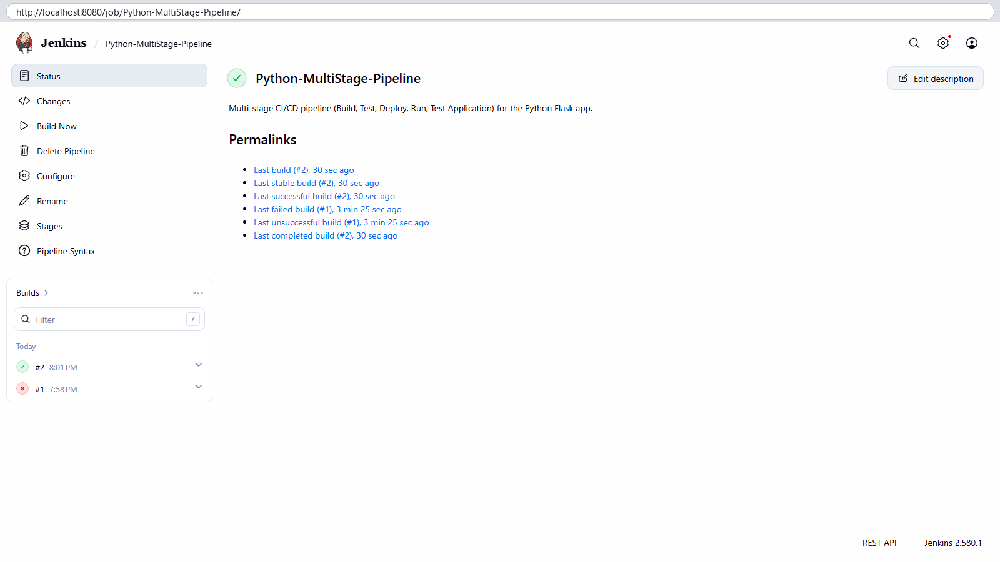

### 16. Check the deployment folder

The manual's expected outcome is a deployed copy of the app. I looked inside the Jenkins workspace after build #2.

```bash
docker exec -w /var/jenkins_home/workspace/Python-MultiStage-Pipeline/python-app-deploy jenkins ls -l
docker exec -w .../python-app-deploy jenkins cat app.pid
docker exec -w .../python-app-deploy jenkins cat app.log
docker exec -w .../python-app-deploy jenkins bash -c 'kill -0 $(cat app.pid) 2>/dev/null && echo "app still running" || echo "app process $(cat app.pid) is not running (stopped by post block)"'
docker exec jenkins curl -s -o /dev/null -w "curl http://localhost:5000/ -> exit %{exitcode}\n" http://localhost:5000/ ; true
```

```text
total 20
drwxr-xr-x 2 root root 4096 Oct 18 20:01 __pycache__
-rw-r--r-- 1 root root  379 Oct 18 20:01 app.log
-rw-r--r-- 1 root root    5 Oct 18 20:01 app.pid
-rwxr-xr-x 1 root root  195 Oct 18 20:01 app.py
-rwxr-xr-x 1 root root  409 Oct 18 20:01 test_app.py
4236
 * Serving Flask app 'app'
 * Debug mode: off
WARNING: This is a development server. Do not use it in a production deployment. Use a production WSGI server instead.
 * Running on all addresses (0.0.0.0)
 * Running on http://127.0.0.1:5000
 * Running on http://172.17.0.2:5000
Press CTRL+C to quit
127.0.0.1 - - [18/Oct/2026 20:01:24] "GET / HTTP/1.1" 200 -
app process 4236 is not running (stopped by post block)
curl http://localhost:5000/ -> exit 7
```

The deploy folder has the app, its test, the log and the PID file. The log line `"GET / HTTP/1.1" 200` is the pipeline's own `curl` from Test Application. PID 4236 no longer exists, and `curl` exit code 7 means "couldn't connect". So the `post` block cleaned up the background app, and repeated builds won't leave old servers holding port 5000.

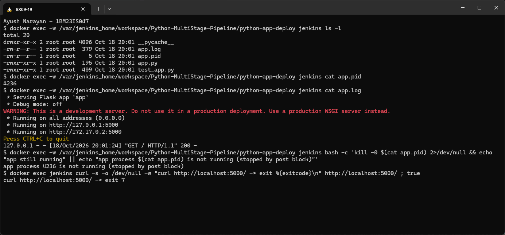

## How It Works

```text
Build Now
  -> Jenkins reads Jenkinsfile from GitHub (lightweight checkout of one file)
  -> allocates an executor + workspace on the built-in node ("agent any")
  -> Checkout SCM: full git checkout of origin/main (394e226)
  -> stages run in order; each "sh" step runs in /bin/sh -xe:
        Build             python3 -m venv venv ; venv/bin/pip install -r requirements.txt
        Test              venv/bin/python -m unittest discover -s . -v
        Deploy            cp app.py test_app.py python-app-deploy/
        Run Application   nohup venv/bin/python python-app-deploy/app.py &  -> app.pid, app.log
        Test Application  test_app.py (deployed copy) + curl http://localhost:5000/
  -> any step exits non-zero => that stage fails, later stages are SKIPPED, build = FAILURE
  -> post { always: kill app ; success: echo ... ; failure: echo ... }  runs in every case
```

- The pipeline lives in the repository as a `Jenkinsfile` ("pipeline as code"), so changes to the process are versioned and reviewed like any other code.
- A **declarative** pipeline has a fixed shape: `pipeline` → `agent` → `stages` → `stage` → `steps`, plus optional `post`. Jenkins draws each stage in the stage view.
- Stages share one workspace on disk. That's how the venv created in Build is reused in Test, and the deploy folder from Deploy is used in Run and Test Application.
- A failing stage stops the pipeline early (build #1). That's the main CI benefit: broken builds never reach Deploy.
- `post { always }` is the place for cleanup, because it runs whether the build passed or failed.

## Key Configuration

app.py
- `@app.route("/")` → `"Hello, Jenkins Multi-Stage Pipeline!"`: the one endpoint that the tests and the pipeline check.
- `app.run(host="0.0.0.0", port=5000)`: the manual uses `app.run(debug=True)`. Debug mode's reloader starts a second Python process, so killing the PID saved in `app.pid` would leave the real server running in the background. Without debug, the saved PID is the server itself. `0.0.0.0` makes it reachable on the container's network address too.

test_app.py
- `app.test_client()`: Flask's built-in fake client calls the route without starting a server, so the unit test is fast.
- Two assertions: `status_code == 200` and the exact response text. `print(...)` is why the text appears in the log.
- `if __name__ == "__main__": unittest.main()` lets the same file run directly (`python test_app.py`) in Test Application.

requirements.txt
- `flask==3.0.3` instead of the manual's `flask==2.1.2`, which no longer imports with current Werkzeug (step 3).

Jenkinsfile (differences from the manual explained)
- `agent any`: run on any available executor, here the built-in node.
- **Build**: the manual's Build stage only `echo`s "Creating virtual environment and installing dependencies..." and installs nothing. Mine really does it: `python3 -m venv ${WORKSPACE}/venv`, then `pip install --upgrade pip` and `pip install -r requirements.txt`. A venv is needed because Debian blocks `pip install` into the system Python ("externally managed", PEP 668), and it keeps the pipeline's Flask version separate from apt's Flask 3.1.1.
- **Test**: `venv/bin/python -m unittest discover -s . -v`, which finds every `test_*.py` in the workspace. `-v` lists each test by name.
- **Deploy**: as in the manual (`mkdir -p` + `cp` into `${WORKSPACE}/python-app-deploy`), plus `test_app.py` and an `ls -l` to show the result. The manual's "Expected Outcome" says `/tmp/python-app-deploy`, but its own Jenkinsfile uses the workspace, and I kept the workspace.
- **Run Application**: `nohup ... &` starts the app in the background so the pipeline can continue. `echo $! > app.pid` saves its process ID, and `sleep 3` + `cat app.log` show that it started.
- **Test Application**: runs the deployed `test_app.py` as in the manual, plus `curl -s http://localhost:5000/`. The manual's version only re-runs the unit test, which never touches the running server. The `curl` proves the deployed app really answers.
- **post**: `always { kill $(cat app.pid) 2>/dev/null || true }` stops the background app after every build. `|| true` keeps a missing PID (as in build #1) from failing the post step. `success` / `failure` print the manual's messages.

Jenkins job
- Type **Pipeline**, Definition **Pipeline script from SCM**, Git `https://github.com/marvelayush/devops-sample-code.git`, Branch `*/main`, Script Path `Jenkinsfile`, no credentials (public repository).

Jenkins container (manual Step 8)
- `docker exec -u root jenkins ...` + `apt-get install python3 pip python3-flask python3-pip python3-venv`. The manual's `python3.11-venv` doesn't exist on Debian 13. Installed packages stay inside this container (not in the `jenkins_home` volume), so they'd need reinstalling if the container were re-created from the image.

.gitignore
- `__pycache__/`, `.venv/`, `venv/`, `python-app-deploy/`: generated folders that shouldn't be committed.

## Commands Used

```bash
cd ~/devops-sample-code
cp .../Ex09-Jenkins-MultiStage-Pipeline/{app.py,requirements.txt,test_app.py,Jenkinsfile,.gitignore} .
python3 -m venv .venv
.venv/bin/pip install -q -r requirements.txt
.venv/bin/python -m unittest discover -s . -v
.venv/bin/python app.py &   ;   curl -s http://localhost:5000/
python3 -m venv /tmp/flask212 && /tmp/flask212/bin/pip install -q flask==2.1.2
/tmp/flask212/bin/python -c "import flask"
git add .
git status
git commit -m "Add Python Flask app, unit test and Jenkinsfile"
git push
git ls-remote origin main
# Jenkins: New Item -> Python-MultiStage-Pipeline -> Pipeline -> Pipeline script from SCM (Git, */main, Jenkinsfile) -> Build Now (#1 fails)
docker ps -a --filter name=jenkins
docker exec -u root jenkins bash -c 'apt-get update'
docker exec -u root jenkins bash -c 'apt-get install -y python3 pip python3.11-venv python3-flask python3-pip python3-venv'
docker exec -w /var/jenkins_home/workspace/Python-MultiStage-Pipeline jenkins python3 -m unittest discover -s .
# Jenkins: Build Now (#2 succeeds) -> Stages -> Console Output
docker exec -w /var/jenkins_home/workspace/Python-MultiStage-Pipeline/python-app-deploy jenkins ls -l
```

## Problems Faced

- **Build #1 failed in the Build stage.** `python3 -m venv` failed with `ensurepip is not available ... apt install python3.13-venv`, because the Jenkins image ships Python without the venv module. This is the error the manual's Step 8 predicts. I installed the Python packages inside the container as root, and build #2 passed with no code change.
- **`python3.11-venv` doesn't exist.** The manual's `apt install python3.11-venv` gave `E: Couldn't find any package by regex 'python3.11-venv'`, because the current Jenkins image is Debian 13 with Python 3.13. I installed `python3-venv` instead, which always matches the system Python.
- **`flask==2.1.2` can't be imported anymore.** With the Werkzeug 3.1.9 that pip picks today, `import flask` fails with `cannot import name 'url_quote' from 'werkzeug.urls'` (step 3). I pinned `flask==3.0.3`.

## Result

The Jenkins Pipeline **Python-MultiStage-Pipeline** builds the Flask app from `marvelayush/devops-sample-code` through Build, Test, Deploy, Run Application and Test Application. Build #1 failed in Build because Python's venv module was missing, as the manual predicts. After installing Python tooling in the Jenkins container (manual Step 8), build #2 passed every stage: **Ran 1 test ... OK** twice, the live app answered **Hello, Jenkins Multi-Stage Pipeline!**, the background app was stopped in `post`, and the build ended with **Finished: SUCCESS**.
