# Exercise 10 – Multi-Node Kubernetes Cluster with Multiple Applications and ReplicaSets

## Objective

Run two small services of an online store on a 3-node Minikube cluster: a **Product Catalog** with 2 replicas, and a **Shopping Cart** with 3 replicas. Pod anti-affinity forces the replicas of each app onto different nodes. I checked where the Pods landed, called both services, and then took a node out of service to see the apps stay available.

## Use Case

An online store needs product browsing and the cart to stay up. If all copies of a service ran on one machine, losing that machine would take the service down. Spreading the replicas over several nodes means one node failure removes at most one copy of each service, and customers can keep shopping.

## Architecture

```text
 WSL terminal                                   WSL terminal
 minikube service product-catalog-service       minikube service shopping-cart-service
 -> http://127.0.0.1:46087                      -> http://127.0.0.1:33609
        |                                              |
        v NodePort 32269                               v NodePort 31033
+---------------------------- Minikube profile "devops-multinode" (docker driver) ---------------------+
|                                                                                                    |
|  Service product-catalog-service (port 80)          Service shopping-cart-service (port 80)       |
|        selector app=product-catalog                       selector app=shopping-cart              |
|                                                                                                    |
|  devops-multinode (control-plane)   devops-multinode-m02            devops-multinode-m03           |
|  192.168.49.2                       192.168.49.3                    192.168.49.4                   |
|  +-----------------------+         +-----------------------+       +-----------------------+      |
|  | shopping-cart  :80    |         | product-catalog :80   |       | product-catalog :80   |      |
|  |                       |         | shopping-cart   :80   |       | shopping-cart   :80   |      |
|  +-----------------------+         +-----------------------+       +-----------------------+      |
|                                                                                                    |
|  podAntiAffinity (required, topologyKey kubernetes.io/hostname): at most 1 Pod of an app per node |
|  images product-catalog:latest + shopping-cart:latest loaded into every node (imagePullPolicy Never)|
|  addon "registry" enabled (kube-system), as in the manual                                         |
+----------------------------------------------------------------------------------------------------+
```

## Environment

- Windows 11 Home + WSL2 Ubuntu 24.04.2 LTS
- Docker Desktop (Engine 29.4.1), 16 CPUs / 8 GB for Docker
- Minikube v1.39.0, profile `devops-multinode`, 3 nodes (2 CPUs, 3072 MB each), docker driver, Docker runtime 29.7.2 inside the nodes
- Kubernetes v1.37.0, kubectl v1.34.1
- Apps: Python 3.9 (`python:3.9-slim`) + Flask (latest at build time)

## Project Structure

```text
Ex10-Multi-Node-Kubernetes/
├── product_catalog.py                # Flask app: GET /products -> list of 3 products (port 80)
├── shopping_cart.py                  # Flask app: GET /cart, POST /cart (in-memory list, port 80)
├── Dockerfile.product                # image product-catalog:latest
├── Dockerfile.shopping               # image shopping-cart:latest
├── product_catalog_deployment.yaml   # Deployment, 2 replicas, podAntiAffinity
├── shopping_cart_deployment.yaml     # Deployment, 3 replicas, podAntiAffinity (namespace fixed to default)
├── product_catalog_service.yaml      # NodePort Service :80
├── shopping_cart_service.yaml        # NodePort Service :80
├── README.md
└── screenshots/                      # 01 ... 24
```

Source: [product_catalog.py](product_catalog.py) · [shopping_cart.py](shopping_cart.py) · [Dockerfile.product](Dockerfile.product) · [Dockerfile.shopping](Dockerfile.shopping) · [product_catalog_deployment.yaml](product_catalog_deployment.yaml) · [shopping_cart_deployment.yaml](shopping_cart_deployment.yaml) · [product_catalog_service.yaml](product_catalog_service.yaml) · [shopping_cart_service.yaml](shopping_cart_service.yaml)

## Steps

### 1. Clean up the old Minikube cluster (manual Step 0)

The manual starts by removing any existing cluster, so that the new multi-node profile starts clean. I ran `minikube stop` and `minikube delete` on the old single-node `minikube` profile from Exercises 2–3, then checked what was left after the new cluster was created.

```bash
minikube stop
minikube delete
minikube profile list
docker ps -a --filter name=^minikube$ --format '{{.Names}} {{.Status}}' | grep . || echo 'old "minikube" node container: none (deleted)'
ls ~/.minikube/machines/
```

```text
| PROFILE          | DRIVER | RUNTIME | IP           | VERSION | STATUS | NODES | ACTIVE PROFILE | ACTIVE KUBECONTEXT |
| devops-multinode | docker | docker  | 192.168.49.2 | v1.37.0 | OK     | 3     |                | *                  |
old "minikube" node container: none (deleted)
devops-multinode  devops-multinode-m02  devops-multinode-m03  server-key.pem  server.pem
```

Only the new `devops-multinode` profile exists, the old `minikube` node container is gone, and the machines folder holds just the 3 new nodes.

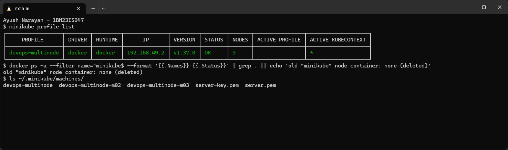

### 2. Start a 3-node cluster (manual Step 1a)

Anti-affinity can only spread Pods if there are several nodes. `--nodes 3` creates one control-plane node and two workers in a profile called `devops-multinode`.

```bash
minikube start --nodes 3 -p devops-multinode --driver=docker --container-runtime=docker
```

```text
[devops-multinode] minikube v1.39.0 on Ubuntu 24.04 (amd64)
Using the docker driver based on user configuration
Using Docker driver with root privileges
Starting "devops-multinode" primary control-plane node in "devops-multinode" cluster
Pulling base image v0.0.51 ...
Creating docker container (CPUs=2, Memory=3072MB) ...
Preparing Kubernetes v1.37.0 on Docker 29.7.2 ...
Configuring CNI (Container Networking Interface) ...
Verifying Kubernetes components...
  ▪ Using image gcr.io/k8s-minikube/storage-provisioner:v5
Enabled addons: storage-provisioner, default-storageclass

Starting "devops-multinode-m02" worker node in "devops-multinode" cluster
Creating docker container (CPUs=2, Memory=3072MB) ...
Found network options:
  ▪ NO_PROXY=192.168.49.2
Preparing Kubernetes v1.37.0 on Docker 29.7.2 ...
Verifying Kubernetes components...

Starting "devops-multinode-m03" worker node in "devops-multinode" cluster
Creating docker container (CPUs=2, Memory=3072MB) ...
Found network options:
  ▪ NO_PROXY=192.168.49.2,192.168.49.3
Preparing Kubernetes v1.37.0 on Docker 29.7.2 ...
Verifying Kubernetes components...

! /usr/local/bin/kubectl is version 1.34.1, which may have incompatibilities with Kubernetes 1.37.0.
Done! kubectl is now configured to use "devops-multinode" cluster and "default" namespace by default
```

Each node is its own Docker container with 2 CPUs and 3 GB. The workers joined the control plane at 192.168.49.2. A CNI (kindnet) was configured because Pods on different nodes need a shared network.

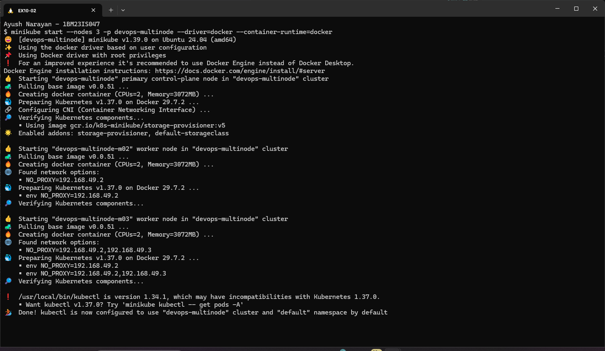

### 3. Check the nodes

```bash
kubectl config current-context
kubectl get nodes -o wide
```

```text
devops-multinode
NAME                   STATUS   ROLES           AGE     VERSION   INTERNAL-IP    EXTERNAL-IP   OS-IMAGE                         KERNEL-VERSION                     CONTAINER-RUNTIME
devops-multinode       Ready    control-plane   2m31s   v1.37.0   192.168.49.2   <none>        Debian GNU/Linux 12 (bookworm)   5.15.167.4-microsoft-standard-WSL2 docker://29.7.2
devops-multinode-m02   Ready    <none>          101s    v1.37.0   192.168.49.3   <none>        Debian GNU/Linux 12 (bookworm)   5.15.167.4-microsoft-standard-WSL2 docker://29.7.2
devops-multinode-m03   Ready    <none>          44s     v1.37.0   192.168.49.4   <none>        Debian GNU/Linux 12 (bookworm)   5.15.167.4-microsoft-standard-WSL2 docker://29.7.2
```

All 3 nodes are **Ready**, each with its own IP. They share the WSL2 kernel, because each node is a container.

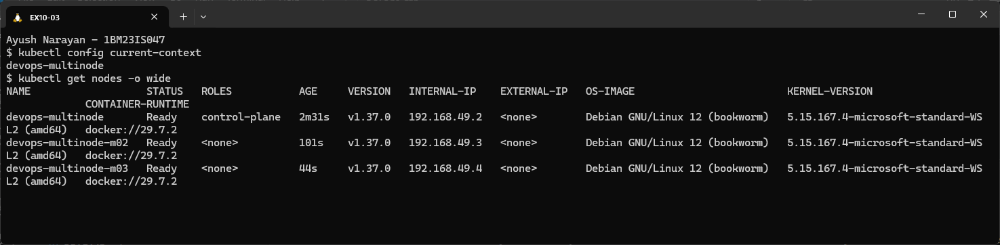

### 4. Enable the registry addon (manual Step 1b)

The manual enables Minikube's registry addon for sharing images between the nodes.

```bash
minikube -p devops-multinode addons enable registry
kubectl -n kube-system get pods -l kubernetes.io/minikube-addons=registry -o wide
```

```text
registry is an addon maintained by minikube. For any concerns contact minikube on GitHub.
  Registry addon with docker driver uses port 59071 please use that instead of default port 5000
  ▪ Using image docker.io/registry:3
  ▪ Using image registry.k8s.io/minikube/kube-registry-proxy:v0.0.11
Verifying registry addon...
The 'registry' addon is enabled
NAME                     READY   STATUS    RESTARTS   AGE   IP           NODE
registry-66d8b959dd-255rr   1/1  Running   0          13s   10.244.2.2   devops-multinode-m03
registry-proxy-5fljq     1/1     Running   0          13s   10.244.1.2   devops-multinode-m02
registry-proxy-bc2hh     1/1     Running   0          13s   10.244.0.3   devops-multinode
registry-proxy-mklw7     1/1     Running   0          13s   10.244.2.3   devops-multinode-m03
```

The addon runs one `registry` Pod, plus a `registry-proxy` on every node (a DaemonSet). On the docker driver it's reachable on port 59071 instead of 5000.

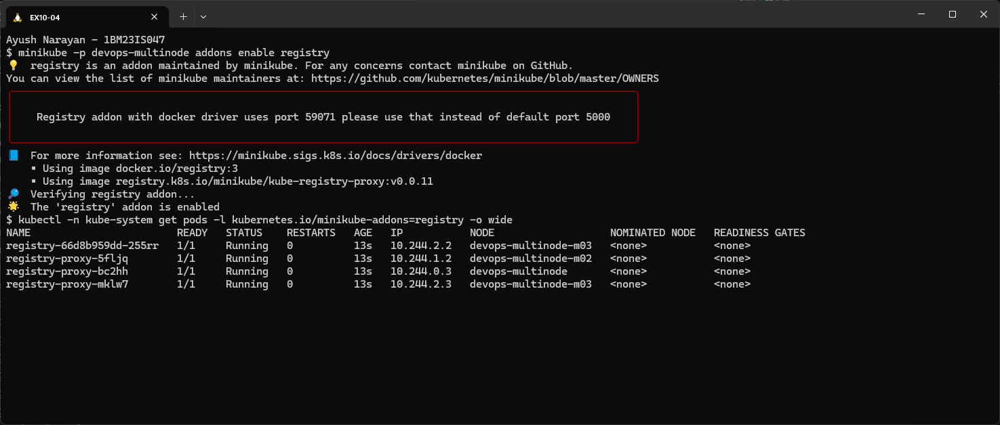

### 5. Product Catalog code (manual Steps 2 and 4)

```bash
cat product_catalog.py
cat Dockerfile.product
```

```text
from flask import Flask, jsonify

app = Flask(__name__)

products = [
    {"id": 1, "name": "Laptop", "price": 1200},
    {"id": 2, "name": "Phone", "price": 800},
    {"id": 3, "name": "Headphones", "price": 150},
]


@app.route("/products", methods=["GET"])
def get_products():
    return jsonify(products)


if __name__ == "__main__":
    app.run(host="0.0.0.0", port=80)
# Dockerfile for Product Catalog
FROM python:3.9-slim
WORKDIR /app
COPY product_catalog.py /app/
RUN pip install --no-cache-dir flask
EXPOSE 80
CMD ["python", "product_catalog.py"]
```

A read-only API with a fixed product list on port 80.

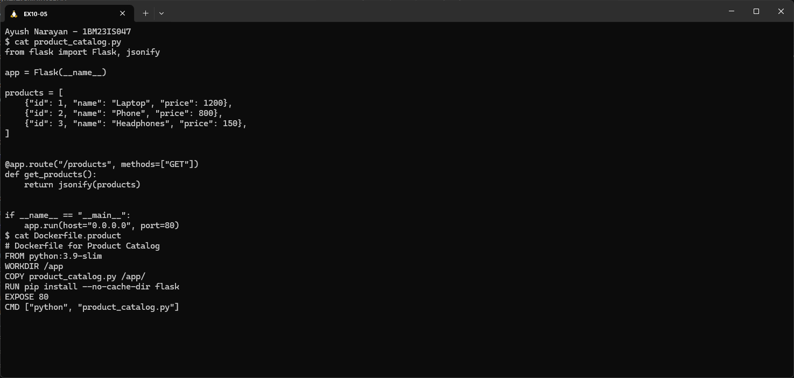

### 6. Shopping Cart code (manual Steps 3 and 4)

```bash
cat shopping_cart.py
cat Dockerfile.shopping
```

```text
from flask import Flask, jsonify, request

app = Flask(__name__)

cart = []


@app.route("/cart", methods=["GET"])
def get_cart():
    return jsonify(cart)


@app.route("/cart", methods=["POST"])
def add_to_cart():
    item = request.get_json()
    cart.append(item)
    return jsonify(cart), 201


if __name__ == "__main__":
    app.run(host="0.0.0.0", port=80)
# Dockerfile for Shopping Cart
FROM python:3.9-slim
WORKDIR /app
COPY shopping_cart.py /app/
RUN pip install --no-cache-dir flask
EXPOSE 80
CMD ["python", "shopping_cart.py"]
```

`GET /cart` returns the list, and `POST /cart` appends the JSON body and answers `201 Created`. The cart is a Python list in memory, so each Pod has its own (step 13).

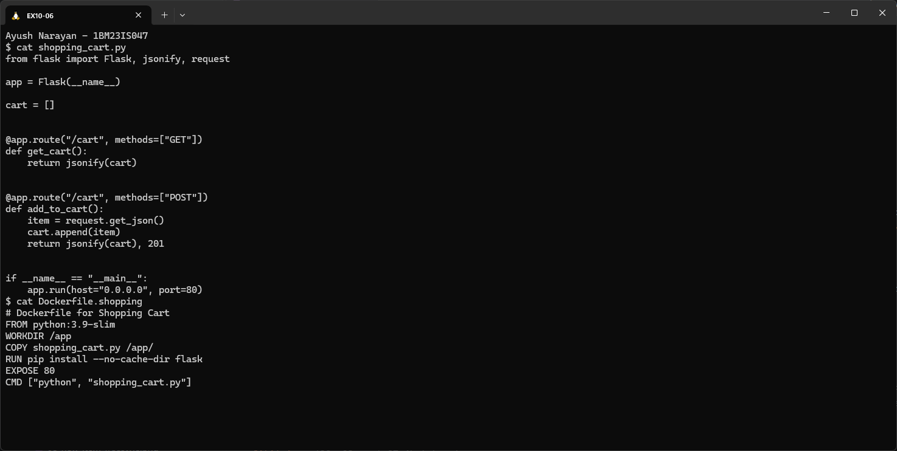

### 7. Build the Product Catalog image

```bash
docker build -t product-catalog:latest -f Dockerfile.product .
```

```text
[+] Building 10.2s (9/9) FINISHED                                     docker:default
 => [internal] load build definition from Dockerfile.product                     0.1s
 => [internal] load metadata for docker.io/library/python:3.9-slim               0.1s
 => CACHED [1/4] FROM docker.io/library/python:3.9-slim@sha256:2d97f6910b16bd338d3060f261f53f144965f755599aab1acda1e13cf1731b1b  0.1s
 => [2/4] WORKDIR /app                                                           0.1s
 => [3/4] COPY product_catalog.py /app/                                          0.1s
 => [4/4] RUN pip install --no-cache-dir flask                                   6.7s
 => exporting to image                                                           2.4s
 => => exporting config sha256:c50c50ce7195945900ddbc6cce9418302f38ace1867e9237bf066fd6bbbed938  0.0s
 => => naming to docker.io/library/product-catalog:latest                        0.0s
```

`-f` picks the Dockerfile, because there are two in the folder. The image was built on the host's Docker (Docker Desktop), not inside Minikube.

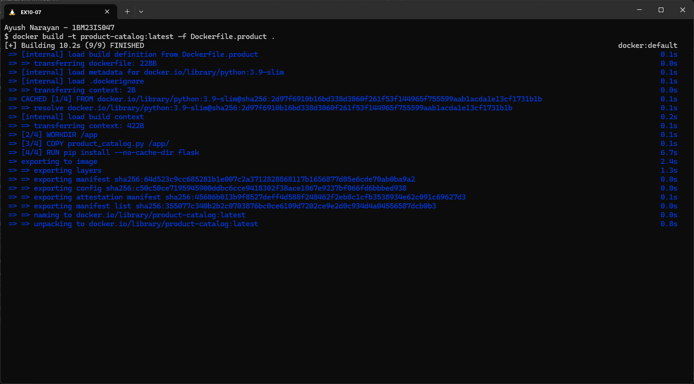

### 8. Build the Shopping Cart image

```bash
docker build -t shopping-cart:latest -f Dockerfile.shopping .
docker images --format 'table {{.Repository}}\t{{.Tag}}\t{{.ID}}\t{{.CreatedSince}}\t{{.Size}}' | grep -E 'REPOSITORY|product-catalog|shopping-cart'
```

```text
[+] Building 8.6s (9/9) FINISHED                                      docker:default
 => [1/4] FROM docker.io/library/python:3.9-slim@sha256:2d97f6910b16...           0.1s
 => CACHED [2/4] WORKDIR /app                                                    0.0s
 => [3/4] COPY shopping_cart.py /app/                                            0.1s
 => [4/4] RUN pip install --no-cache-dir flask                                   5.6s
 => => exporting config sha256:7c07b8c60dbbc9ddb0bb16bdf7c1dd0ab332fe01b5fbd08c8ecfe134a8960c77  0.0s
 => => naming to docker.io/library/shopping-cart:latest                          0.0s
REPOSITORY        TAG      IMAGE ID       CREATED          SIZE
shopping-cart     latest   9a51a95a8134   3 seconds ago    200MB
product-catalog   latest   355077c340b2   18 seconds ago   200MB
```

Both images now exist locally. Docker Desktop's image store shows the manifest-list ID (`355077c340b2`, `9a51a95a8134`), while inside the nodes the same images appear under their config IDs (`c50c50ce7195`, `7c07b8c60dbb`, step 10).

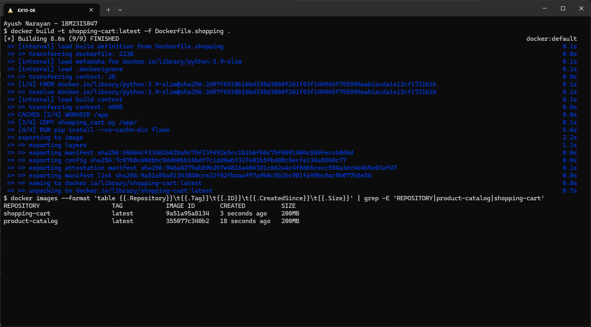

### 9. Load the images into the cluster (manual Step 5)

The nodes have their own Docker daemons, so the host's images aren't visible to them. `minikube image load` copies an image into the cluster.

```bash
minikube -p devops-multinode image load product-catalog:latest
minikube -p devops-multinode image load shopping-cart:latest
minikube -p devops-multinode image ls | grep -E 'product-catalog|shopping-cart'
```

```text
docker.io/library/shopping-cart:latest
docker.io/library/product-catalog:latest
```

Both images are listed in the cluster.

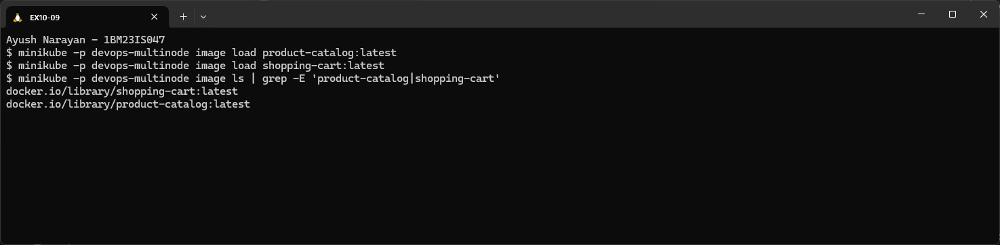

### 10. Verify the images on every node

The manual checks the images with `minikube ssh` on the primary node. Because the Deployments use `imagePullPolicy: Never`, **every** node needs its own copy, so I checked all three.

```bash
minikube -p devops-multinode ssh -- docker images | grep -E 'REPOSITORY|product-catalog|shopping-cart'
minikube -p devops-multinode ssh -n devops-multinode-m02 -- docker images | grep -E 'product-catalog|shopping-cart'
minikube -p devops-multinode ssh -n devops-multinode-m03 -- docker images | grep -E 'product-catalog|shopping-cart'
```

```text
product-catalog:latest      c50c50ce7195   133MB   0B
shopping-cart:latest        7c07b8c60dbb   133MB   0B
product-catalog:latest      c50c50ce7195   133MB   0B
shopping-cart:latest        7c07b8c60dbb   133MB   0B
product-catalog:latest      c50c50ce7195   133MB   0B
shopping-cart:latest        7c07b8c60dbb   133MB   0B
```

All 3 nodes have both images, with the same IDs as the `exporting config` lines in steps 7–8.

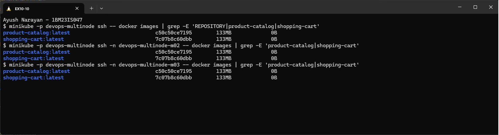

### 11. The manual's namespace bug

The manual's `shopping_cart_deployment.yaml` says `namespace: devops-exercise`, while its Service and everything else use `default`. I applied that version (made on the fly with `sed`) to see what happens.

```bash
sed 's/namespace: default/namespace: devops-exercise/' shopping_cart_deployment.yaml | grep -n namespace
sed 's/namespace: default/namespace: devops-exercise/' shopping_cart_deployment.yaml | kubectl apply -f -
kubectl get namespaces
grep -n namespace shopping_cart_deployment.yaml shopping_cart_service.yaml
```

```text
5:  namespace: devops-exercise
Error from server (NotFound): error when creating "STDIN": namespaces "devops-exercise" not found
NAME              STATUS   AGE
default           Active   6m23s
kube-node-lease   Active   6m23s
kube-public       Active   6m23s
kube-system       Active   6m23s
shopping_cart_deployment.yaml:5:  namespace: default
shopping_cart_service.yaml:5:  namespace: default
```

It fails, because the namespace was never created. Even if it existed, the Shopping Cart Pods would sit in `devops-exercise` while `shopping-cart-service` is in `default`. A Service only selects Pods in its own namespace, so it would have no endpoints and every request would fail. My file uses `namespace: default`, the same as its Service.

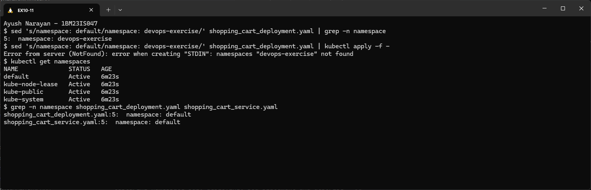

### 12. Deploy both apps and their Services (manual Steps 6 and 7)

```bash
kubectl apply -f product_catalog_deployment.yaml
kubectl apply -f shopping_cart_deployment.yaml
kubectl apply -f product_catalog_service.yaml
kubectl apply -f shopping_cart_service.yaml
kubectl rollout status deployment/product-catalog --timeout=180s && kubectl rollout status deployment/shopping-cart --timeout=180s
kubectl get deployments,services
```

```text
deployment.apps/product-catalog created
deployment.apps/shopping-cart created
service/product-catalog-service created
service/shopping-cart-service created
deployment "product-catalog" successfully rolled out
deployment "shopping-cart" successfully rolled out
NAME                              READY   UP-TO-DATE   AVAILABLE   AGE
deployment.apps/product-catalog   2/2     2            2           3s
deployment.apps/shopping-cart     3/3     3            3           3s

NAME                              TYPE        CLUSTER-IP      EXTERNAL-IP   PORT(S)        AGE
service/kubernetes                ClusterIP   10.96.0.1       <none>        443/TCP        6m30s
service/product-catalog-service   NodePort    10.100.93.127   <none>        80:32269/TCP   2s
service/shopping-cart-service     NodePort    10.97.63.180    <none>        80:31033/TCP   2s
```

Product Catalog has **2/2** replicas and Shopping Cart **3/3**. Both Services are NodePort: 32269 and 31033 are open on every node.

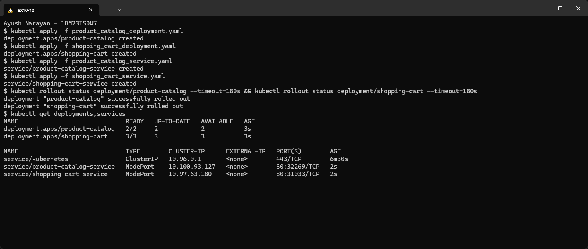

### 13. Verify the distribution across nodes (manual Step 8)

```bash
kubectl get pods -o wide
```

```text
NAME                               READY   STATUS    RESTARTS   AGE   IP           NODE                   NOMINATED NODE   READINESS GATES
product-catalog-7cb85d4f-7r295     1/1     Running   0          13s   10.244.2.4   devops-multinode-m03   <none>           <none>
product-catalog-7cb85d4f-t92lc     1/1     Running   0          13s   10.244.1.3   devops-multinode-m02   <none>           <none>
shopping-cart-6858b5f797-5w58h     1/1     Running   0          13s   10.244.1.4   devops-multinode-m02   <none>           <none>
shopping-cart-6858b5f797-8mznv     1/1     Running   0          13s   10.244.2.5   devops-multinode-m03   <none>           <none>
shopping-cart-6858b5f797-qqjgn     1/1     Running   0          13s   10.244.0.4   devops-multinode       <none>           <none>
```

The 2 Product Catalog Pods are on m02 and m03, and the 3 Shopping Cart Pods are on all three nodes. Pod IPs follow each node's own subnet (10.244.**0**.x, **1**.x, **2**.x).

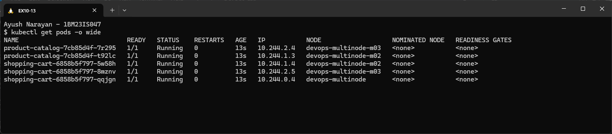

### 14. Pods grouped by node

```bash
kubectl get pods -o custom-columns=NODE:.spec.nodeName,APP:.metadata.labels.app,POD:.metadata.name,IP:.status.podIP --sort-by=.spec.nodeName
for n in devops-multinode devops-multinode-m02 devops-multinode-m03; do echo "$n -> $(kubectl get pods --field-selector spec.nodeName=$n -o jsonpath="{.items[*].metadata.labels.app}")"; done
```

```text
NODE                   APP               POD                              IP
devops-multinode       shopping-cart     shopping-cart-6858b5f797-qqjgn   10.244.0.4
devops-multinode-m02   product-catalog   product-catalog-7cb85d4f-t92lc   10.244.1.3
devops-multinode-m02   shopping-cart     shopping-cart-6858b5f797-5w58h   10.244.1.4
devops-multinode-m03   product-catalog   product-catalog-7cb85d4f-7r295   10.244.2.4
devops-multinode-m03   shopping-cart     shopping-cart-6858b5f797-8mznv   10.244.2.5
devops-multinode -> shopping-cart
devops-multinode-m02 -> product-catalog shopping-cart
devops-multinode-m03 -> product-catalog shopping-cart
```

No node has two Pods of the same app, which is exactly what the anti-affinity rule demands. Pods of *different* apps may share a node, because each rule only looks at its own app label.

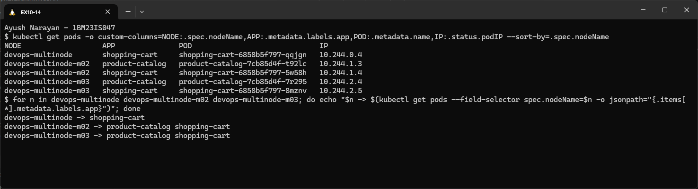

### 15. Describe the Shopping Cart Deployment

```bash
kubectl describe deployment shopping-cart | sed -n '1,13p;/Conditions:/,$p'
kubectl get deployment shopping-cart -o jsonpath='{.spec.template.spec.affinity}'; echo
```

```text
Name:                   shopping-cart
Namespace:              default
CreationTimestamp:      Sun, 18 Oct 2026 20:15:01 +0000
Selector:               app=shopping-cart
Replicas:               3 desired | 3 updated | 3 total | 3 available | 0 unavailable
StrategyType:           RollingUpdate
RollingUpdateStrategy:  25% max unavailable, 25% max surge
Conditions:
  Type           Status  Reason
  Available      True    MinimumReplicasAvailable
  Progressing    True    NewReplicaSetAvailable
NewReplicaSet:   shopping-cart-6858b5f797 (3/3 replicas created)
Events:
  Normal  ScalingReplicaSet  25s   deployment-controller  Scaled up replica set shopping-cart-6858b5f797 from 0 to 3
{"podAntiAffinity":{"requiredDuringSchedulingIgnoredDuringExecution":[{"labelSelector":{"matchLabels":{"app":"shopping-cart"}},"topologyKey":"kubernetes.io/hostname"}]}}
```

The Deployment created ReplicaSet `shopping-cart-6858b5f797` (the "ReplicaSet" of the exercise title) with 3 Pods. The JSON is the anti-affinity rule as stored in the cluster.

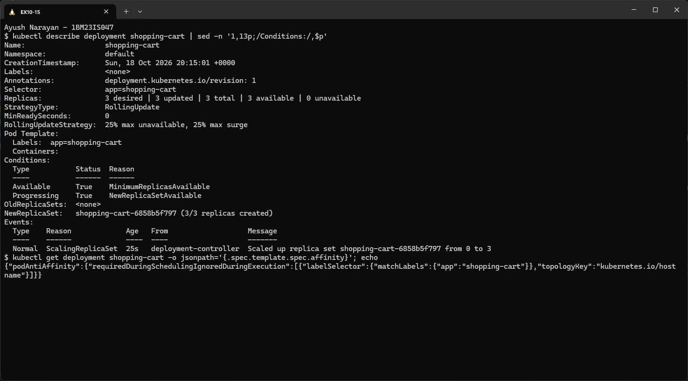

### 16. Open the Product Catalog service (manual Step 9a)

With the docker driver, node IPs (192.168.49.x) aren't reachable from WSL directly. `minikube service` opens a tunnel, and its terminal has to stay open, so I ran it in its own window.

```bash
minikube -p devops-multinode service product-catalog-service
```

```text
| NAMESPACE | NAME                    | TARGET PORT | URL                       |
| default   | product-catalog-service | 80          | http://192.168.49.2:32269 |
Starting tunnel for service product-catalog-service.
| NAMESPACE | NAME                    | TARGET PORT | URL                    |
| default   | product-catalog-service |             | http://127.0.0.1:46087 |
Opening service default/product-catalog-service in default browser...
http://127.0.0.1:46087
! Because you are using a Docker driver on linux, the terminal needs to be open to run it.
```

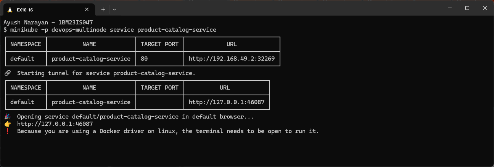

### 17. Open the Shopping Cart service (manual Step 9b)

```bash
minikube -p devops-multinode service shopping-cart-service
```

```text
| NAMESPACE | NAME                  | TARGET PORT | URL                       |
| default   | shopping-cart-service | 80          | http://192.168.49.2:31033 |
Starting tunnel for service shopping-cart-service.
| NAMESPACE | NAME                  | TARGET PORT | URL                    |
| default   | shopping-cart-service |             | http://127.0.0.1:33609 |
Opening service default/shopping-cart-service in default browser...
http://127.0.0.1:33609
! Because you are using a Docker driver on linux, the terminal needs to be open to run it.
```

Each tunnel maps a local port to the NodePort on the control-plane node. From there, kube-proxy forwards to a Pod on any node.

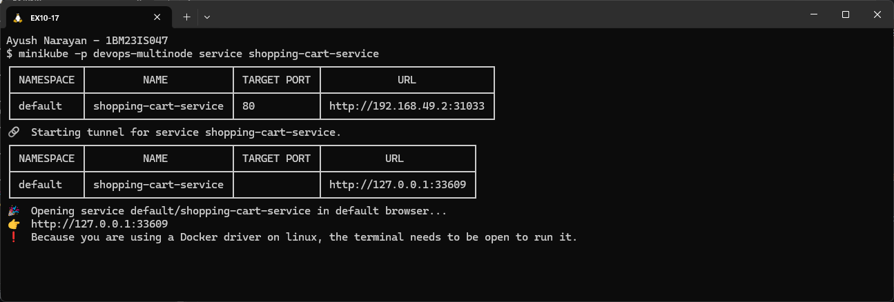

### 18. Test the APIs with curl (manual Step 10)

```bash
curl -s http://127.0.0.1:46087/products; echo
curl -s http://127.0.0.1:33609/cart; echo
curl -s -X POST http://127.0.0.1:33609/cart -H 'Content-Type: application/json' -d '{"id": 1, "name": "Laptop", "quantity": 1}'; echo
for i in 1 2 3 4 5 6; do curl -s http://127.0.0.1:33609/cart; echo; done
```

```text
[{"id":1,"name":"Laptop","price":1200},{"id":2,"name":"Phone","price":800},{"id":3,"name":"Headphones","price":150}]

[]

[{"id":1,"name":"Laptop","quantity":1}]

[]
[]
[]
[]
[]
[{"id":1,"name":"Laptop","quantity":1}]
```

The product list and the empty cart match the manual's expected output, and so does the POST response `[{"id":1,"name":"Laptop","quantity":1}]`. But when I read the cart six more times, it was empty 5 times and showed the Laptop once. Step 19 shows why.

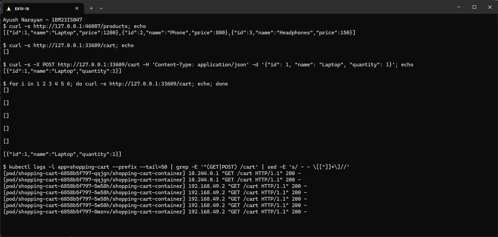

### 19. Which Pod answered each cart request

```bash
for p in $(kubectl get pods -l app=shopping-cart -o name); do echo "== $p on $(kubectl get $p -o jsonpath={.spec.nodeName})"; kubectl logs $p | grep -E "GET|POST"; done
```

```text
== pod/shopping-cart-6858b5f797-5w58h on devops-multinode-m02
192.168.49.2 - - [18/Oct/2026 20:16:55] "GET /cart HTTP/1.1" 200 -
192.168.49.2 - - [18/Oct/2026 20:16:55] "GET /cart HTTP/1.1" 200 -
192.168.49.2 - - [18/Oct/2026 20:16:55] "GET /cart HTTP/1.1" 200 -
192.168.49.2 - - [18/Oct/2026 20:16:55] "GET /cart HTTP/1.1" 200 -
== pod/shopping-cart-6858b5f797-8mznv on devops-multinode-m03
192.168.49.2 - - [18/Oct/2026 20:16:55] "POST /cart HTTP/1.1" 201 -
192.168.49.2 - - [18/Oct/2026 20:16:55] "GET /cart HTTP/1.1" 200 -
== pod/shopping-cart-6858b5f797-qqjgn on devops-multinode
10.244.0.1 - - [18/Oct/2026 20:16:55] "GET /cart HTTP/1.1" 200 -
10.244.0.1 - - [18/Oct/2026 20:16:55] "GET /cart HTTP/1.1" 200 -
```

The 8 cart requests were spread over all 3 Pods. The **POST** landed on Pod `8mznv` (on m03), so only that Pod's in-memory list has the Laptop. The single GET it served was the one that returned `[Laptop]`. The other two Pods never saw the item. This proves the load balancing works across nodes, and it also shows why real carts keep state in a shared store (Redis or a database) and not in the Pod. The source IP is the node 192.168.49.2 (the tunnel) or 10.244.0.1 (the node's bridge), because the NodePort hop rewrites the client address.

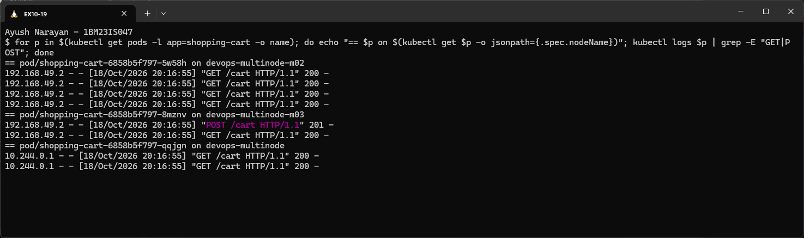

### 20. Product list in the browser

```text
http://127.0.0.1:46087/products
[{"id":1,"name":"Laptop","price":1200},{"id":2,"name":"Phone","price":800},{"id":3,"name":"Headphones","price":150}]
```

The same tunnel works from Chrome on Windows, through WSL's localhost forwarding.

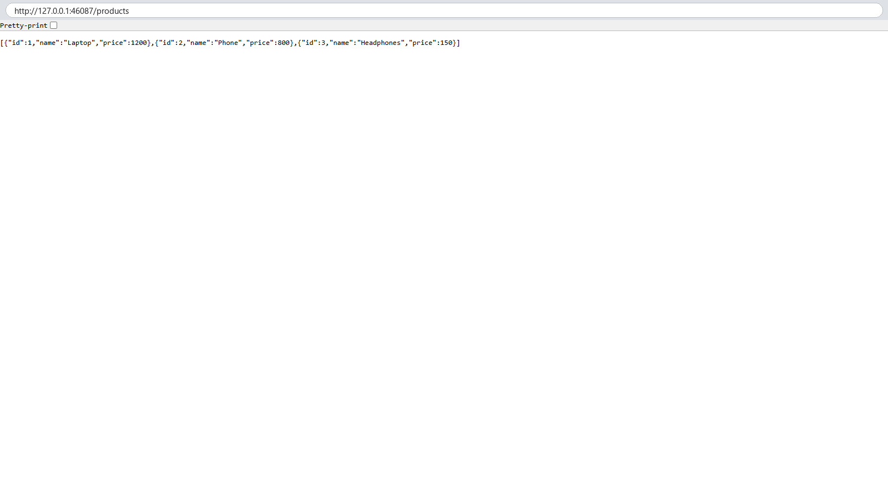

### 21. Take one node out of service (fault tolerance)

To see the redundancy, I drained `devops-multinode-m03`. That marks it unschedulable and evicts its Pods, like a planned maintenance or a failing machine.

```bash
kubectl drain devops-multinode-m03 --ignore-daemonsets --delete-emptydir-data --force
kubectl get nodes
kubectl get pods -o wide
```

```text
node/devops-multinode-m03 cordoned
Warning: ignoring DaemonSet-managed Pods: kube-system/kindnet-zzfml, kube-system/kube-proxy-9hsrb, kube-system/registry-proxy-mklw7
evicting pod kube-system/registry-66d8b959dd-255rr
evicting pod default/product-catalog-7cb85d4f-7r295
evicting pod default/shopping-cart-6858b5f797-8mznv
pod/registry-66d8b959dd-255rr evicted
pod/product-catalog-7cb85d4f-7r295 evicted
pod/shopping-cart-6858b5f797-8mznv evicted
node/devops-multinode-m03 drained
NAME                   STATUS                     ROLES           AGE    VERSION
devops-multinode       Ready                      control-plane   10m    v1.37.0
devops-multinode-m02   Ready                      <none>          10m    v1.37.0
devops-multinode-m03   Ready,SchedulingDisabled   <none>          9m6s   v1.37.0
NAME                               READY   STATUS    RESTARTS   AGE     IP           NODE                   NOMINATED NODE   READINESS GATES
product-catalog-7cb85d4f-782p7     1/1     Running   0          48s     10.244.0.5   devops-multinode       <none>           <none>
product-catalog-7cb85d4f-t92lc     1/1     Running   0          4m24s   10.244.1.3   devops-multinode-m02   <none>           <none>
shopping-cart-6858b5f797-5w58h     1/1     Running   0          4m24s   10.244.1.4   devops-multinode-m02   <none>           <none>
shopping-cart-6858b5f797-69zpf     0/1     Pending   0          48s     <none>       <none>                 <none>           <none>
shopping-cart-6858b5f797-qqjgn     1/1     Running   0          4m24s   10.244.0.4   devops-multinode       <none>           <none>
```

m03 became `SchedulingDisabled` and its 3 workload Pods were evicted. The ReplicaSets immediately made replacements:
- The new **product-catalog** Pod (`782p7`) went to the control-plane node, the only remaining node without a product-catalog Pod.
- The new **shopping-cart** Pod (`69zpf`) stayed **Pending**. Both remaining nodes already run a shopping-cart Pod, and the *required* anti-affinity rule forbids a second one.

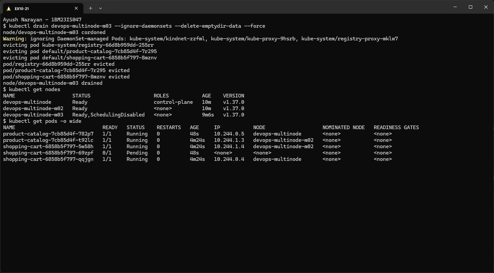

### 22. The services keep serving

```bash
for i in 1 2 3; do curl -s -o /dev/null -w 'products -> HTTP %{http_code}\n' http://127.0.0.1:46087/products; curl -s -o /dev/null -w 'cart     -> HTTP %{http_code}\n' http://127.0.0.1:33609/cart; done
kubectl get pods --field-selector=status.phase=Pending
kubectl get events --field-selector reason=FailedScheduling -o custom-columns=OBJECT:.involvedObject.name,MESSAGE:.message | tail -2
```

```text
products -> HTTP 200
cart     -> HTTP 200
products -> HTTP 200
cart     -> HTTP 200
products -> HTTP 200
cart     -> HTTP 200
NAME                             READY   STATUS    RESTARTS   AGE
shopping-cart-6858b5f797-69zpf   0/1     Pending   0          54s
OBJECT                           MESSAGE
shopping-cart-6858b5f797-69zpf   0/3 nodes are available: 1 node(s) were unschedulable, 2 node(s) didn't match pod anti-affinity rules. preemption: 0/3 nodes are available: 1 Preemption is not helpful for scheduling, 2 No preemption victims found for incoming pod.
```

With one of three nodes out, both services still answered every request (**HTTP 200**). The Product Catalog was back to 2 Pods, and the Shopping Cart ran on 2 of its 3. The scheduler's message explains the Pending Pod exactly: one node is unschedulable, and the other two fail the anti-affinity rule.

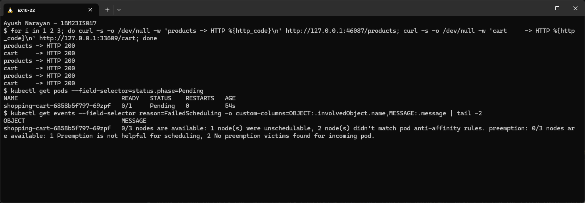

### 23. Bring the node back

```bash
kubectl uncordon devops-multinode-m03
kubectl get nodes
kubectl get pods -o wide
```

```text
node/devops-multinode-m03 uncordoned
NAME                   STATUS   ROLES           AGE     VERSION
devops-multinode       Ready    control-plane   11m     v1.37.0
devops-multinode-m02   Ready    <none>          10m     v1.37.0
devops-multinode-m03   Ready    <none>          9m38s   v1.37.0
NAME                               READY   STATUS    RESTARTS   AGE     IP           NODE                   NOMINATED NODE   READINESS GATES
product-catalog-7cb85d4f-782p7     1/1     Running   0          81s     10.244.0.5   devops-multinode       <none>           <none>
product-catalog-7cb85d4f-t92lc     1/1     Running   0          4m57s   10.244.1.3   devops-multinode-m02   <none>           <none>
shopping-cart-6858b5f797-5w58h     1/1     Running   0          4m57s   10.244.1.4   devops-multinode-m02   <none>           <none>
shopping-cart-6858b5f797-69zpf     1/1     Running   0          81s     10.244.2.6   devops-multinode-m03   <none>           <none>
shopping-cart-6858b5f797-qqjgn     1/1     Running   0          4m57s   10.244.0.4   devops-multinode       <none>           <none>
```

As soon as m03 accepted Pods again, the Pending shopping-cart Pod was scheduled there and started, so the cart is back to 3 replicas on 3 nodes. The product-catalog Pod stayed on the control-plane node, because Kubernetes doesn't move running Pods back by itself.

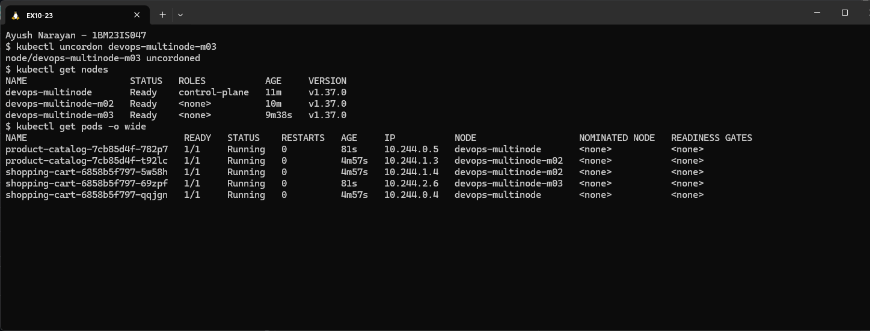

### 24. Clean up

```bash
pgrep -fa "devops-multinode service" || echo "no service tunnels running"
minikube delete -p devops-multinode
minikube profile list 2>&1 | tail -3
docker ps -a --format '{{.Names}}' | grep devops-multinode || echo 'no devops-multinode node containers left'
```

```text
no service tunnels running
Deleting "devops-multinode" in docker ...
Deleting container "devops-multinode" ...
Deleting container "devops-multinode-m02" ...
Deleting container "devops-multinode-m03" ...
Removing /home/ubuntu/.minikube/machines/devops-multinode ...
Removing /home/ubuntu/.minikube/machines/devops-multinode-m02 ...
Removing /home/ubuntu/.minikube/machines/devops-multinode-m03 ...
Removed all traces of the "devops-multinode" cluster.
    You can create one using 'minikube start'.
no devops-multinode node containers left
```

I closed both tunnels first, then deleted the whole profile, which removes all 3 node containers.

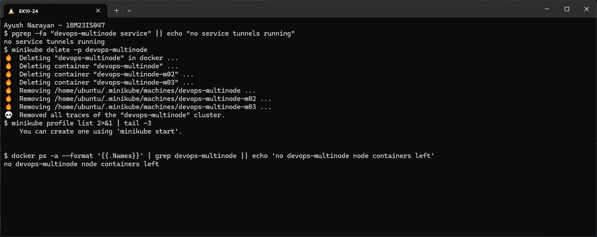

## How It Works

```text
kubectl apply -f shopping_cart_deployment.yaml   (replicas: 3, podAntiAffinity required)
   |
   v
API Server --> etcd --> Deployment controller --> ReplicaSet shopping-cart-6858b5f797 --> 3 Pod objects
   |
   v
Scheduler, for each Pod:
   filter: node schedulable?  already has a Pod with app=shopping-cart?  -> drop that node
   score:  pick the best remaining node
   -> Pod 1: devops-multinode   Pod 2: m02   Pod 3: m03     (4th Pod would be Pending)
   |
   v
Kubelet on each node --> Docker --> local image shopping-cart:latest (imagePullPolicy: Never)

request --> 127.0.0.1:33609 (minikube tunnel) --> 192.168.49.2:31033 (NodePort)
        --> kube-proxy rules --> any ready Pod with app=shopping-cart, on any node (via kindnet CNI)
```

- A **multi-node** Minikube runs each node as a Docker container, with kubelet, kube-proxy and the container runtime inside. The control plane only runs on the first node.
- **Pod anti-affinity** is a scheduling rule. `requiredDuringScheduling...` means the scheduler will rather leave a Pod Pending than break it, and `topologyKey: kubernetes.io/hostname` makes "different hostname" the meaning of "spread". `...IgnoredDuringExecution` means the rule isn't re-checked for Pods that are already running.
- The **ReplicaSet** (made by each Deployment) keeps the replica count. When m03 was drained it created replacements at once, and the scheduler decided where they could go.
- A **NodePort Service** opens the same port on every node, and kube-proxy forwards each new connection to a ready Pod anywhere in the cluster. That's why the cart requests reached Pods on all 3 nodes.
- Because each node has its own image store and the Pods use `imagePullPolicy: Never`, the images had to be loaded into every node. A missing image on one node would give `ErrImageNeverPull` there.
- High availability needs both: replicas spread over nodes (so one failure doesn't take a service down) *and* stateless Pods or shared storage (so any replica gives the same answer).

## Key Configuration

product_catalog.py / shopping_cart.py
- `@app.route("/products", methods=["GET"])` returns the fixed list with `jsonify`. `/cart` handles `GET` (read) and `POST` (append and return `201`).
- `cart = []` is module-level, in-memory state. Each Pod has its own list, and it's lost on restart (steps 18–19).
- `request.get_json()` (the manual uses `request.json`): both parse the JSON body. `get_json()` is the method form.
- `app.run(host="0.0.0.0", port=80)`: listen on all interfaces at port 80, which is what `containerPort` and the Service's `targetPort` point to.

Dockerfile.product / Dockerfile.shopping
- `FROM python:3.9-slim`, `COPY <app>.py /app/`, `RUN pip install --no-cache-dir flask`, `CMD ["python", "<app>.py"]`: as in the manual. I added `--no-cache-dir` (a smaller image) and `EXPOSE 80` (documents the port).

product_catalog_deployment.yaml / shopping_cart_deployment.yaml
- `replicas: 2` / `replicas: 3`: the manual's counts.
- `selector.matchLabels` + `template.metadata.labels` `app: ...`: tie each Deployment to its Pods, and give the anti-affinity rule and the Service something to match.
- `affinity.podAntiAffinity.requiredDuringSchedulingIgnoredDuringExecution` with `labelSelector app: <same app>` and `topologyKey: "kubernetes.io/hostname"`: no two Pods of the same app on one node.
- `image: product-catalog:latest` + `imagePullPolicy: Never`: use the image loaded into the nodes, never Docker Hub.
- `namespace: default` in both files. **Manual bug:** the manual's shopping-cart Deployment uses `namespace: devops-exercise` (never created, and different from its Service), which fails as shown in step 11.

product_catalog_service.yaml / shopping_cart_service.yaml
- `type: NodePort`, `port: 80`, `targetPort: 80`, `selector app: ...`: reachable on a node port (32269 / 31033) from outside, with Service port 80 forwarding to container port 80.

Minikube commands
- `minikube start --nodes 3 -p devops-multinode --driver=docker --container-runtime=docker`: the manual's command without `--force`, which it only adds for running as root (I run as a normal user in the `docker` group). The driver and runtime are set explicitly, as in the earlier exercises.
- `minikube -p devops-multinode addons enable registry`: enabled as the manual says. The Deployments don't pull from it, though: `image load` + `imagePullPolicy: Never` put the images straight into each node, which is the method the manual itself uses in Step 5.
- `minikube -p devops-multinode image load <image>`: copies a host image into all nodes of the profile.
- `minikube -p devops-multinode service <svc>`: needed with the docker driver on WSL, because node IPs aren't reachable directly. The tunnel only lives while its terminal is open.

## Commands Used

```bash
minikube stop
minikube delete
minikube start --nodes 3 -p devops-multinode --driver=docker --container-runtime=docker
kubectl get nodes -o wide
minikube -p devops-multinode addons enable registry
kubectl -n kube-system get pods -l kubernetes.io/minikube-addons=registry -o wide
docker build -t product-catalog:latest -f Dockerfile.product .
docker build -t shopping-cart:latest -f Dockerfile.shopping .
docker images
minikube -p devops-multinode image load product-catalog:latest
minikube -p devops-multinode image load shopping-cart:latest
minikube -p devops-multinode ssh -- docker images
minikube -p devops-multinode ssh -n devops-multinode-m02 -- docker images
minikube -p devops-multinode ssh -n devops-multinode-m03 -- docker images
sed 's/namespace: default/namespace: devops-exercise/' shopping_cart_deployment.yaml | kubectl apply -f -
kubectl apply -f product_catalog_deployment.yaml
kubectl apply -f shopping_cart_deployment.yaml
kubectl apply -f product_catalog_service.yaml
kubectl apply -f shopping_cart_service.yaml
kubectl get deployments,services
kubectl get pods -o wide
kubectl get pods -o custom-columns=NODE:.spec.nodeName,APP:.metadata.labels.app,POD:.metadata.name,IP:.status.podIP --sort-by=.spec.nodeName
kubectl describe deployment shopping-cart
minikube -p devops-multinode service product-catalog-service
minikube -p devops-multinode service shopping-cart-service
curl http://127.0.0.1:46087/products
curl http://127.0.0.1:33609/cart
curl -X POST http://127.0.0.1:33609/cart -H "Content-Type: application/json" -d '{"id": 1, "name": "Laptop", "quantity": 1}'
kubectl logs -l app=shopping-cart --prefix
kubectl drain devops-multinode-m03 --ignore-daemonsets --delete-emptydir-data --force
kubectl get events --field-selector reason=FailedScheduling
kubectl uncordon devops-multinode-m03
minikube delete -p devops-multinode
```

## Problems Faced

- **The manual's Shopping Cart namespace doesn't exist.** Applying the manual's `shopping_cart_deployment.yaml` gave `namespaces "devops-exercise" not found`. Even if created, it would separate the Pods from their Service in `default`. I set `namespace: default`, the same as the Service and the manual's other files (step 11).
- **The cart "forgets" items.** After a successful POST, 5 of 6 GETs returned `[]`. Each replica keeps its own in-memory cart, and the Service spreads requests over all 3 Pods (logs in step 19). This is how the manual's code behaves when it has more than one replica, not a cluster fault. A shared store such as Redis or a database would fix it in a real app.
- **One Pod stayed Pending during the node drain.** With m03 drained, the replacement shopping-cart Pod couldn't be placed, because the *required* anti-affinity allows only one per node and only two nodes were left. This is the rule working as designed. It cleared as soon as the node was uncordoned (steps 21–23). `preferredDuringScheduling...` would allow doubling up instead.

## Result

A 3-node Minikube cluster ran the Product Catalog (2 replicas) and Shopping Cart (3 replicas), and pod anti-affinity placed every replica of an app on a different node. Both services answered through their NodePort tunnels: `/products` returned the 3 products and `/cart` accepted a POST (`201`). Requests were load-balanced across Pods on all nodes. With one node drained, both services kept returning HTTP 200, and the cart went back to 3 replicas on 3 nodes once the node returned.
